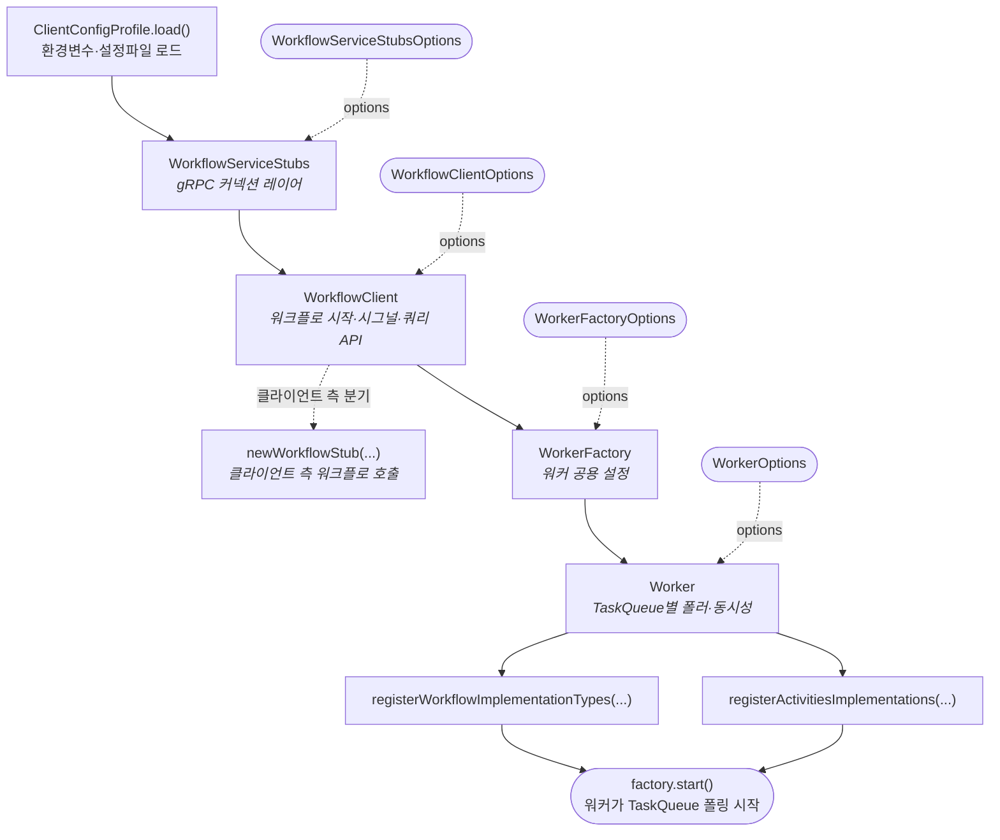

# Temporal Java SDK: Client/Worker 구성 흐름 — 색인

Temporal Java 샘플(`core/src/main/java/io/temporal/samples/hello/HelloActivity.java`)에서 반복되는 셋업 흐름과 각종 Options를 주제별로 정리했다. 아래 토픽 파일로 분리되어 있다.

---

## 전체 흐름 한눈에 보기



4개 구성요소는 **아래로 갈수록 범위가 좁아진다**: Stubs(물리 커넥션) → Client(네임스페이스/직렬화) → WorkerFactory(JVM 내 모든 워커 공통) → Worker(한 TaskQueue 단위).

---

## 토픽별 가이드

### 입문 — 처음 보는 사람 순서

| # | 파일 | 다루는 내용 |
| --- | --- | --- |
| 00 | [시작하기](temporal/00-getting-started.md) | Temporal Server 설치/실행, 전체 흐름 개요, **Spring MSA 호출과의 매핑** (WebClient/RestClient와 비교). "왜 Temporal이 pod 간 통신을 대체하는가"의 멘탈 모델부터 잡고 싶다면 여기부터. |
| 01 | [Client/Worker 셋업](temporal/01-setup.md) | `WorkflowServiceStubs` (gRPC), `WorkflowClient` (워크플로 조작 API), `WorkerFactory`, `Worker` — 4단계 셋업과 각 Options. |

### Options — 호출 당 설정

| # | 파일 | 다루는 내용 |
| --- | --- | --- |
| 02 | [WorkflowOptions](temporal/02-workflow-options.md) | 워크플로 "한 번의 실행" 정의. `WorkflowIdReusePolicy` 4가지, `SearchAttributes`, `Memo`, `StaticSummary`/`StaticDetails` 심화. |
| 03 | [Activity 옵션](temporal/03-activity.md) | `ActivityOptions`의 4가지 타임아웃, `ActivityCancellationType` 3종, `RetryOptions` 지수 백오프, 워커에 Workflow 등록할 때의 `WorkflowImplementationOptions`, Local Activity 전용 `LocalActivityOptions`. |

### 조합과 동시성

| # | 파일 | 다루는 내용 |
| --- | --- | --- |
| 04 | [Workflow 조합](temporal/04-composition.md) | `Saga.Options` 보상 트랜잭션, `ChildWorkflowOptions`(`ParentClosePolicy`·`ChildWorkflowCancellationType` 심화), Nexus 서비스 호출(`NexusServiceOptions`/`NexusOperationOptions`, 크로스 namespace RPC). |
| 05 | [동시성](temporal/05-concurrency.md) | `CancellationScope`로 async 작업 묶음 취소 — **`scope.run()`은 제어 로직이 아니라 ThreadLocal 스택에 push/pop만** (람다 실행 중 `CancellationScope.current()` 가 "나"를 반환하도록 세팅). 액티비티·타이머·자식WF가 스케줄될 때 `SyncWorkflowContext.executeActivityOnce` 등이 `CancellationScope.current().getCancellationRequest().thenApply(reason -> cancellationHandle.apply(new CanceledFailure(reason)))` 로 **자기 cleanup 람다를 그 스코프의 `cancellationPromise`에 구독**해둠. `scope.cancel()` 은 플래그 세팅 + 자식 스코프 재귀 cancel + `cancellationPromise.complete(null)` 뿐인데, 그 complete가 구독된 handlers를 전부 발화시켜 각 액티비티의 `cancellationHandle` → 상태머신에 `RequestCancelActivityTask` 커맨드 enqueue → 다음 WFT에 flush. **detached scope** 는 `setParent`에서 parent 연결을 끊어 부모 cancel 전파에서 격리됨(Saga 보상용). `Async`로 Workflow 안에서 비동기 호출, `Promise`/`CompletablePromise` 핸들링 — **`CompletablePromiseImpl` 자체는 `ArrayList<Functions.Proc> handlers` 를 가진 콜백 리스트 패턴**: `thenApply`→`handle`→private `then()` 로 수렴, `then()`은 `completed`면 즉시 실행·미완료면 리스트에 add, `complete(v)`는 `invokeHandlers()`로 for 루프 순차 동기 호출(워크플로 스레드 단일이라 synchronized 불필요·리플레이 결정적). 체인된 `thenApply(f).thenApply(g).thenApply(h)` 는 각 단계가 자기 `handlers`를 가진 새 Promise를 반환해 호출 스택 하나로 folded. `complete()`는 멱등(`if (completed) return false`) + `cancel()` 끝에서 `cancellationPromise = null` 로 치워 "한 번만 발화" 보장. `Async.function`은 **"어느 모드로 proxy를 호출하는지" 플래그 트릭** — stub(dynamic proxy)의 `InvocationHandler`가 `AsyncInternal.isAsync()` 체크로 분기해 Promise를 **ThreadLocal 사이드채널(`AtomicReference<Promise<?>>`)** 로 돌려줌(메서드 시그니처는 동기 반환 그대로이기 때문). **`Async.function`이 돌려주는 Promise는 "서버 통신 결과"가 아니라 command seq=N 과 묶인 placeholder** — WFT #1에서 호출 시 `ScheduleActivityTask(seq=N)` 커맨드 버퍼에 쌓고 unresolved Promise 반환, `.get()` 블록 시 워커가 commands flush 후 WFT 완료 → workflow 메모리에서 사라짐. Activity worker가 다른 호스트에서 실행 후 결과를 서버에 보고하면 history에 `ActivityTaskCompleted(seq=N, result=...)` 기록 + 새 WFT 스케줄. WFT #2에서 워크플로 코드 **처음부터 재실행(replay)**, `Async.function` 재호출 시 같은 seq가 history에 완료 상태면 Promise 가 즉시 resolved 로 복원 → `.get()` 반환. 즉 Promise ↔ activity 결과는 **메모리 콜백이 아니라 서버 history event 를 매개로** 연결 — 이게 **durable execution 의 본질**(워커가 중간에 죽어도 다른 워커가 replay 로 동일 상태 복원). |
| 13 | [Nexus 개요](temporal/13-nexus-overview.md) | **서비스 간 호출 프리미티브**의 전체 그림. 3단 주소 체계(Endpoint/Service/Operation), 호출 두 지점(Workflow 코드 vs Worker 등록), ChildWorkflow·일반 호출과의 결정표, 이점·핵심 옵션. 04 §13의 상세 옵션으로 들어가기 전 멘탈 모델. |
| 15 | [Saga 보상 패턴과 Nested Saga](temporal/15-nested-saga.md) | `catch` 안의 `compensate()`가 외부 cancel에 유실되는 함정(detached scope), **자식 워크플로마다 자기 Saga를 가지는 Nested Saga** 패턴(mermaid 다이어그램 + 두 가지 실패 경로 + 설계 원칙 + 체크리스트), `NestedSaga.java` 샘플 레퍼런스. |

### 메시징과 시간

| # | 파일 | 다루는 내용 |
| --- | --- | --- |
| 06 | [메시징](temporal/06-messaging.md) | **`Signal`**(비동기 입력, `@SignalMethod` 호출 메커니즘·프록시/gRPC 라우팅 포함), **`Query`**(상태 조회), **`Update`**(Signal+Query 결합, Validator, WaitPolicy). Signal/Query/Update 비교 결정 트리. **`signalWithStart`**(없으면 start+signal, 있으면 signal만 — 원자적 1회) / **`updateWithStart`**(1.26+) 패턴, **child/sibling → parent 결과 전달용 Signal 콜백** 패턴(`Workflow.newExternalWorkflowStub` + 부모의 `Workflow.await`). |
| 07 | [시간 다루기](temporal/07-time.md) | `Workflow.sleep` / `Workflow.newTimer`, Timer 서버 동작, `continue-as-new`로 히스토리 리셋하고 새 Run으로 이어가는 패턴. |

### 고급과 운영

| # | 파일 | 다루는 내용 |
| --- | --- | --- |
| 08 | [고급](temporal/08-advanced.md) | `SideEffect`/`mutableSideEffect` (비결정적 코드 결정적으로), `WorkflowLock` 뮤텍스, `Interceptor` 체인(Client/Worker/Workflow 가로채기), `DataConverter`/`PayloadConverter`/`PayloadCodec` 직렬화·암호화. |
| 09 | [운영과 테스트](temporal/09-ops-and-testing.md) | `Schedule`(Cron 상위 호환 주기 실행), `Replay`로 결정성 검증, `TestWorkflowRule`/`TestWorkflowEnvironment`/`TestWorkflowExtension` 서버 없이 테스트. |
| 10 | [버저닝](temporal/10-versioning.md) | `Workflow.getVersion` 코드 레벨 Patching, Worker Versioning(Deployment)로 서버가 관리하는 배포 버전. |

### SDK 내부와 실행 모델

| # | 파일 | 다루는 내용 |
| --- | --- | --- |
| 11 | [Worker 실행 모델과 Sticky Queue](temporal/11-worker-execution-model.md) | `Workflow.await()` vs `while` 루프, **Stub은 "리모컨"일 뿐 — 실제 workflow 메서드 바디는 Worker가 실행**, 다른 `WORKFLOW_ID`의 독립성, **pull 기반 long-poll task 분산** (Normal+Sticky 두 세트 polling), K8s에서 Pod=Worker 매핑, Sticky Queue 생명주기·fallback·설정값·관찰 지표. |
| 12 | [gRPC Retry (전송 계층 재시도)](temporal/12-grpc-retry.md) | `GrpcRetryer` facade와 Sync/Async 구현, `BackoffThrottler` 공식과 congestion 분기, `GrpcRetryerUtils` 재시도 정책 결정기, `RpcRetryOptions` 기본값, 실제 호출 지점(`GenericWorkflowClientImpl` 등), `GrpcMetricsInterceptor` 자동 계측, 서버 측 `RetryPolicy`와의 비교. **두 겹 메커니즘**(클라이언트 gRPC retry vs 서버 RetryPolicy)의 요약 포함. |
| 14 | [SDK 내부 상태머신 (`WorkflowStateMachines`)](temporal/14-state-machines.md) | WFT 수신 → History Event → Command 변환의 전체 파이프라인(mermaid), `HelloActivity` history로 보는 처리 순서, `WorkflowTaskStateMachine` / `ActivityStateMachine`(12 상태, Cancel 3경합) / `TimerStateMachine`(7 상태) 상태 전이 다이어그램, `ActivityCancellationType` 3종의 통지 시점 매핑, replay 결정론 검증 지점. 내부 3개 큐 — **`cancellableCommands`**(WFT 처리 중 누적, 아직 서버 미전송이라 취소 가능) → `prepareCommands()` → **`commands`**(전송 확정분, 순서 고정) / **`messageOutbox`**(Update 프로토콜 메시지 — Accepted/Completed) — 가 `RespondWorkflowTaskCompleted`로 함께 flush. |

### 참고

| # | 파일 | 다루는 내용 |
| --- | --- | --- |
| 99 | [체크리스트 & 샘플 레퍼런스](temporal/99-checklist.md) | 셋업 완료 전 확인할 체크리스트, 주요 샘플 파일 경로 모음. |

---

## 개념 파악 — Worker 실행 모델과 Sticky Queue

Workflow가 "어디서, 어떤 스레드에서, 어떻게 분산되어" 실행되는지의 멘탈 모델.

### 가장 자주 묻는 질문 — "workflow 메서드는 어디서 실행되나"

```java
GreetingWorkflow workflow = client.newWorkflowStub(GreetingWorkflow.class, opts);
WorkflowClient.start(workflow::getGreeting);   // 이 라인에서 메서드 바디는 실행되지 않음
```

- `workflow` 는 `GreetingWorkflowImpl` 인스턴스가 **아님** — SDK가 만든 **다이내믹 프록시**.
- `start(workflow::getGreeting)` 는 메서드 레퍼런스를 가로채서 **`StartWorkflowExecution` gRPC 요청만 서버로 전송** — 서버 TaskQueue에 workflow task 투입.
- 실제 `getGreeting(...)` **바디는 Worker 프로세스**가 `worker.registerWorkflowImplementationTypes(GreetingWorkflowImpl.class)` 로 등록해둔 클래스를 리플렉션으로 인스턴스화해서 실행.
- 샘플 레포에선 교육상 Client와 Worker가 같은 `main()`에 공존하지만, 프로덕션에선 **Starter 프로세스 ↔ Worker 프로세스** 가 분리되는 게 일반적. TaskQueue 이름만 맞으면 서버가 중개.

### Task 분산 — pull 기반 long-poll

서버는 Worker 주소를 모름. Worker가 `PollWorkflowTaskQueue` / `PollActivityTaskQueue` gRPC 를 **최대 ~60초 보류 응답**으로 걸어두고, 그동안 task가 들어오면 즉시 반환. 응답 즉시 다음 poll 발사. 그래서 pull 모델인데도 지연은 push 수준.

- **Normal + Sticky 두 세트** polling — 같은 Worker가 공유 TaskQueue와 자기 전용 sticky TaskQueue 양쪽에 각각 poller를 띄움.
- **Poller 수 ≠ 동시 실행 수** — `MaxConcurrentWorkflowTaskPollers` 는 "묻는 스레드 수", `MaxConcurrentWorkflowTaskExecutionSize` 는 "실행 slot". 전자가 적어도 후자가 크면 backpressure.
- **Sticky cache hit** 이면 full replay 생략, miss(새 worker가 받음) 면 전체 history replay 후 sticky 전환.

→ 상세: [11 Worker 실행 모델과 Sticky Queue](temporal/11-worker-execution-model.md). (§4 pull 기반 분산, **§4.5 Long-poll 메커니즘 상세** — Poller vs Executor slot, Workflow/Activity Task 왕복, backpressure, keep-alive, graceful shutdown; §6 Sticky Queue 생명주기·fallback·설정)

---

## 개념 파악 — Replay 비용과 Activity 분리 원칙

Workflow 는 매 WFT 마다 코드를 **처음부터 replay** 해서 상태를 복원한다. 그래서 workflow 메서드 안의 모든 순수 로직은 WFT 수만큼 반복 실행된다는 게 전제가 된다.

```java
@WorkflowMethod
public String run() {
    String a = activity.step1();
    String processed = heavyProcessing(a);  // ← Replay 마다 재실행됨
    String b = activity.step2(processed);
    return b;
}
```

- `activity.step1()` 결과는 history 의 `ActivityTaskCompleted` 에 저장돼 있어 replay 시 **재호출 없이 즉시 반환**된다 — Activity 코드는 다시 안 돈다.
- 그 **"사이에 낀" `heavyProcessing(a)`** 는 history 에 아무 흔적이 없으므로 WFT 가 N 번 발생하면 **N 번 재실행**된다. 10 초짜리 CPU 로직이면 매 replay 마다 10 초씩 더 든다.

### "대기" 의 의미 — workflow 는 메모리에 떠 있지 않다

`String a = activity.step1();` 에서 workflow 가 "activity 를 기다린다" 는 건 **어느 JVM 도 workflow 객체를 메모리에 붙잡고 있지 않다** 는 뜻이다. SDK 는 `ScheduleActivityTask` 커맨드를 서버로 flush 하고 **workflow 는 메모리에서 사라진다**. Activity 는 다른 JVM(또는 같은 Worker 의 Activity Executor slot) 이 Task Queue 에서 꺼내 실행. 결과가 history 에 기록되고 새 WFT 가 스케줄되면 **어느 Worker 든** 받아 workflow 코드를 처음부터 replay — `activity.step1()` 지점에 도달하면 history 에서 결과를 꺼내 즉시 반환해 다음 줄로 진행. 이 메커니즘 덕에 몇 달 걸리는 workflow 도 메모리/스레드 비용 없이 수백만 개 띄울 수 있다. (상세 메커니즘은 [11 Worker 실행 모델](temporal/11-worker-execution-model.md), [14 상태머신](temporal/14-state-machines.md), [05 Async 의 Promise ↔ history 매핑](temporal/05-concurrency.md).)

### 피하는 방법

- **Activity 로 분리** — 결과가 history 에 기록돼 replay 시 재실행 안 됨(정석). 시간이 걸리거나 side effect 있는 코드는 전부 activity.
- **Local Activity** (`Workflow.newLocalActivityStub`) — Task Queue 안 거치고 Worker 프로세스 안에서 바로 실행, 결과는 history 에 marker 로 저장 → replay 시 skip. 수 초 이내 짧고 자주 호출되는 로직용.
- `Workflow.sideEffect` / `mutableSideEffect` — UUID / 현재 시간 / 랜덤 등 단순 비결정적 값, 한 번만 실행 후 결과를 history 에 저장.

### Workflow 코드에 남겨도 되는 것 vs 빼야 하는 것

| 남겨도 OK | 빼야 함 (Activity/LocalActivity/SideEffect) |
| --- | --- |
| if/else, 루프, activity 호출 조립 (오케스트레이션) | 시간이 걸리는 모든 계산 |
| 수 ms 이내 데이터 변환 | I/O (DB, HTTP, 파일) |
| `Workflow.*` API (sleep, timer, random, currentTimeMillis) | 비결정적 값 (`new Date()`, `UUID.randomUUID()`, `Math.random()`) |
|  | 외부 상태 의존 로직 |

> 경험칙: **Workflow 메서드는 오케스트레이션 지시서, 실제 일은 activity 가 한다** — 이 원칙만 지키면 replay 오버헤드는 사실상 사라진다.

### 결정론은 Workflow 만의 요구사항 — Activity 는 오히려 비결정적이어도 된다

위 표의 "빼야 함" 열 전체는 결국 **"replay 때 무엇이 재실행되는가"** 하나로 수렴한다.

| | Workflow 코드 | Activity 코드 |
| --- | --- | --- |
| Replay 시 재실행? | **O** (매 WFT 마다 처음부터) | **X** (history 에 결과만 꺼내 씀) |
| 결정론 필요? | **필수** | **불필요** |
| 비결정 코드 둬도 됨? | 안 됨 | **됨 — 오히려 여기 둬야 함** |

- **Workflow 가 결정론적이어야 하는 이유** — Replay 는 "같은 history 를 재생하면 같은 Command 가 나와야 한다"는 전제로 동작한다. `new Date()` / `UUID.randomUUID()` / `Math.random()` 을 workflow 에서 쓰면 WFT 1 과 WFT 2 에서 다른 값이 나와 상태 머신이 깨지고 **non-deterministic error** 로 workflow 가 터진다.
- **Activity 가 결정론적일 필요 없는 이유** — Activity 결과는 **딱 한 번 실행되고 history 에 영구 기록**된다. 그 뒤로는 replay 가 몇 번 돌든 SDK 는 history 에서 값을 꺼낼 뿐 Activity 코드를 **재호출하지 않는다**. 그래서 Activity 가 `UUID.randomUUID()` 를 리턴해도 history 에 박힌 그 UUID 가 영원히 정답이 된다. ← **비결정 코드를 Activity 로 격리하는 본질적 이유**.

**Activity 재시도 시엔?** 각 시도가 다른 값을 뱉어도 OK — 실패한 시도는 `ActivityTaskFailed` 로 기록되고 **최종 성공한 시도의 결과만** `ActivityTaskCompleted(result=…)` 로 history 에 박힌다. 이후 replay 는 그 값만 반환.

> **결정론 ≠ 멱등성 (별개 문제)** — Activity 가 외부 side effect (DB 쓰기, 결제 호출 등) 를 가지면 재시도 시 **중복 실행**될 수 있으므로 **멱등성(idempotency key)** 는 Activity 작성자가 따로 책임져야 한다. Temporal 이 보장해주는 "결정론"(= workflow replay 일관성) 과는 별개 레이어.

### Workflow 코드에서 쓸 수 있는 결정론 대체 API

"간단한 비결정 값 하나" 가 필요한데 Activity 띄우긴 과한 경우를 위해 SDK 가 제공하는 **결정론적** 래퍼:

- `Workflow.currentTimeMillis()` — replay 시 저장된 값 반환
- `Workflow.randomUUID()`, `Workflow.newRandom(seed)`
- `Workflow.sideEffect(() -> ...)` / `Workflow.mutableSideEffect(...)` — 한 번만 실행, 결과를 history 에 저장

무거운 건 그냥 Activity.

→ 상세: [08 고급](temporal/08-advanced.md) (`SideEffect` / `mutableSideEffect`), [03 Activity](temporal/03-activity.md) (`LocalActivityOptions`).

---

## 자주 가는 길

- **"Temporal을 처음 본다"** → [00](temporal/00-getting-started.md) → [01](temporal/01-setup.md) → [02](temporal/02-workflow-options.md) → [03](temporal/03-activity.md)
- **"Spring MSA 쓰는데 왜 Temporal?"** → [00의 MSA 매핑 섹션](temporal/00-getting-started.md#1-a-msa-호출과의-매핑--spring-webclientrestclient와-비교)
- **"워크플로가 시작은 됐는데 폴링이 안 된다"** → [99 체크리스트](temporal/99-checklist.md)
- **"Signal이 뭔지 원리부터 알고 싶다"** → [06 메시징](temporal/06-messaging.md)의 Signal 섹션 (`@SignalMethod` 호출 메커니즘 포함)
- **"다른 서비스의 Workflow를 호출하고 싶다"** → [04 조합](temporal/04-composition.md)의 ChildWorkflow + 다른 TaskQueue, 또는 Nexus
- **"Nexus 개념 요약"** → [13 Nexus 개요](temporal/13-nexus-overview.md) (상세는 [04 조합](temporal/04-composition.md)의 §13)
- **"Activity 재시도/타임아웃 조정"** → [03 Activity 옵션](temporal/03-activity.md)
- **"gRPC 호출이 왜 자동 재시도되나 / `UNAVAILABLE` 폭주 진단 / `BackoffThrottler` 공식"** → [12 gRPC Retry](temporal/12-grpc-retry.md)
- **"클라이언트 retry 와 서버 RetryPolicy 가 어떻게 겹치나"** → [12 gRPC Retry의 §15 비교 표](temporal/12-grpc-retry.md)
- **"Workflow Stub과 Worker 차이 / Sticky Queue 원리 / K8s Pod=Worker"** → [11 Worker 실행 모델](temporal/11-worker-execution-model.md)
- **"`WorkflowClient.start(workflow::메서드)` 호출했는데 실제 메서드 바디는 어디서 실행되나"** → [11 §2 Stub은 "리모컨"](temporal/11-worker-execution-model.md) + 위 "개념 파악 — Worker 실행 모델" 섹션
- **"Worker는 서버에서 task를 어떻게 받아오나 / long-poll 기본 메커니즘 / Poller 수 vs Executor slot / backpressure / 네트워크 장비 idle timeout / shutdown과 long-poll CANCELLED"** → [11 §4.5 Long-poll 메커니즘 상세](temporal/11-worker-execution-model.md)
- **"테스트 작성"** → [09 운영과 테스트](temporal/09-ops-and-testing.md)
- **"코드 수정했는데 이미 돌고 있는 워크플로는?"** → [10 버저닝](temporal/10-versioning.md)
- **"Saga 보상이 외부 cancel에 휩쓸려 유실되는 걸 막고 싶다"** → [15 Saga 보상 패턴과 Nested Saga §1](temporal/15-nested-saga.md) (detached scope 패턴)
- **"자식 워크플로마다 자기 Saga가 필요한 경우 / 자식 성공 후 부모 단계가 실패하면 어떻게 되돌리나"** → [15 Saga 보상 패턴과 Nested Saga §2](temporal/15-nested-saga.md) + `core/src/main/java/io/temporal/samples/nestedsaga/NestedSaga.java`
- **"서버 history event 가 Command 로 변환되는 내부 과정 / replay 결정론 검증은 어디서 터지나"** → [14 SDK 내부 상태머신 (`WorkflowStateMachines`)](temporal/14-state-machines.md)
- **"`WorkflowTaskStateMachine` / `ActivityStateMachine` / `TimerStateMachine` 상태 전이 / Cancel 경합 처리"** → [14 SDK 내부 상태머신](temporal/14-state-machines.md)의 각 다이어그램
- **"Timer cancel 하면 서버 확정을 기다리나? / `Workflow.sleep` cancel 시 Promise 는 언제 깨나"** → [14 TimerStateMachine 섹션](temporal/14-state-machines.md#timerstatemachine--가장-단순한-비동기-primitive) (즉시 통지)
- **"`WorkflowClient.start` / `WorkflowClient.execute` / `stub.메서드()` 직접 호출 — 셋 다 `StartWorkflowExecution` gRPC는 같은데 뭐가 다른가"** → [02 §A.1](temporal/02-workflow-options.md) (요약: `start`=fire-and-forget `WorkflowExecution` 메타만, `execute`=`CompletableFuture<T>` 비동기 결과, 직접 호출=동기 블로킹. 내부적으로 `execute` ≈ `start` + 결과 Long-poll)
- **"`Async.function`과 `WorkflowClient.start` — 겉모양(메서드 참조 받아 비동기 시작)은 같은데 뭐가 다른가"** → [11 Stub은 "리모컨"](temporal/11-worker-execution-model.md) + [05 Async](temporal/05-concurrency.md) (요약: `Async.function`은 **워크플로 내부**에서 Command를 쌓고 `Promise<T>` 반환, `WorkflowClient.start`는 **외부 클라이언트 코드**에서 gRPC로 top-level 워크플로 시작. 전자는 Activity/ChildWorkflow/local activity stub 모두에 쓰고, 후자는 Child를 만들 수 없음)
- **"`Async.function`이 돌려준 `Promise<T>` 는 서버 통신 결과인가? 실제 activity 실행값과 어떻게 연결되나 (replay / durable execution 의 본질)"** → [05 Async](temporal/05-concurrency.md) + [11 Worker 실행 모델](temporal/11-worker-execution-model.md) (요약: Promise 는 **network callback 이 아니라 command seq=N 과 묶인 placeholder**. `Async.function` 호출 자체는 gRPC 를 쏘지 않고 커맨드 버퍼에 `ScheduleActivityTask(seq=N)` 를 쌓을 뿐이며, `Promise.anyOf(results).get()` 이 블록되면 워커는 지금까지의 커맨드를 `RespondWorkflowTaskCompleted` 로 **한 번에** 서버로 보내고 WFT #1 종료 — workflow 객체는 메모리에서 사라짐. Activity worker 가 다른 호스트에서 실행 후 결과를 서버에 보고하면 history 에 `ActivityTaskCompleted(seq=N, result=…)` 가 기록되고 새 WFT 가 스케줄됨. WFT #2 에서 워크플로 코드는 **처음부터 재실행(replay)**, `Async.function` 재호출로 재구성된 Promise 들에 대해 SDK 가 history 를 매칭 — seq=N 이 history 에 완료 상태로 있으면 Promise 는 즉시 resolved 로 복원되어 `.get()` 이 결과 반환. 결론: Promise ↔ activity 결과의 연결 매개체는 **"서버 history"** 이고, workflow 가 여러 WFT 에 걸쳐 replay 되면서 상태가 보존되는 것이 바로 Temporal 의 **durable execution** — 워커가 중간에 죽어도 다른 워커가 history 를 replay 해 동일 Promise 상태로 복원됨)
- **"workflow 메서드 안에 activity 호출 사이에 CPU 로직(가공·암호화·정렬 등)을 넣으면 replay 마다 재실행되나? / 어떻게 피하나"** → [08 고급](temporal/08-advanced.md) + [03 Activity](temporal/03-activity.md) (요약: 그렇다. workflow 는 매 WFT 마다 코드를 **처음부터 replay** 하므로 workflow 메서드 안의 모든 순수 로직은 재실행된다 — Activity 결과는 history 에 저장돼 재호출 시 즉시 반환되지만, 그 **"사이에 낀" 일반 Java 코드는 history 흔적이 없어 매 WFT 마다 다시 돈다**. 10초짜리 CPU 로직이면 매 replay 마다 10초씩 추가. 해결: ① **Activity 로 분리** — 결과가 history 에 기록돼 replay 시 재실행 안 됨(정석, 시간이 걸리거나 side effect 있는 코드 전부), ② **Local Activity** (`Workflow.newLocalActivityStub` — Task Queue 안 거치고 Worker 안에서 바로 실행, 결과는 marker 로 history 에 저장 → replay 시 skip; 수 초 이내 짧고 자주 호출되는 로직), ③ `Workflow.sideEffect`/`mutableSideEffect` (UUID / 현재 시간 / 랜덤 등 단순 비결정적 값, 한 번 실행 후 결과 저장). 원칙: **Workflow 메서드는 오케스트레이션 지시서, 실제 일은 activity 가 한다** — workflow 코드에는 빠르고 결정론적인 제어 흐름(if/else, 루프, activity 호출 조립)과 ms 단위 변환만 남긴다)
- **"`activity.step1()` 같은 **동기** 호출일 때도 workflow 가 메모리에서 사라지고 replay 로 복원되나? (JVM 이 activity 결과를 블로킹 대기하는 게 아닌가)"** → [11 Worker 실행 모델](temporal/11-worker-execution-model.md) + [14 상태머신](temporal/14-state-machines.md) (요약: 그렇다. `stub.step1()` 도 내부적으로 `Async.function` 과 같은 경로 — SDK 가 `ScheduleActivityTask` 커맨드를 버퍼에 쌓고 `RespondWorkflowTaskCompleted` 로 flush 하면 **workflow 객체는 메모리에서 사라진다**. 어느 JVM 도 workflow 를 붙잡고 있지 않음. Activity 는 다른 JVM(또는 같은 Worker 의 Activity Executor slot) 이 Task Queue 에서 꺼내 실행. 결과가 history 에 기록되고 새 WFT 가 스케줄되면 **어느 Worker 든** 받아 workflow 코드를 **처음부터 replay** — `activity.step1()` 지점에 도달하면 저장된 결과를 즉시 반환해 다음 줄로 진행. "wait" 는 Thread blocking 이 아니라 **서버 history 의 상태 전이**. Workflow/Activity 는 **다른 Worker, 다른 머신**에서 실행 가능 — Workflow Worker ↔ Activity Worker 가 TaskQueue 로만 연결된 독립 프로세스로 분리하는 게 프로덕션 패턴)
- **"Activity 도 결정론적이어야 하나? (같은 input → 같은 output 보장?) / `UUID.randomUUID()` 같은 거 Activity 안에서 써도 되나? / Activity 재시도 시 값이 달라져도 괜찮나?"** → 위 "개념 파악 — Replay 비용과 Activity 분리 원칙" §결정론 (요약: 아니다. **반대다** — 결정론은 **Workflow 만의 요구사항**. Workflow 는 replay 때 코드가 재실행되므로 `new Date()`/`UUID.randomUUID()` 를 쓰면 WFT 간 Command 가 달라져 **non-deterministic error** 로 터진다. Activity 는 결과가 **딱 한 번 실행되고 history 에 영구 기록** 되므로 replay 가 몇 번 돌든 SDK 는 history 값만 반환할 뿐 **Activity 코드를 재호출하지 않는다** — 그래서 Activity 안의 비결정 코드는 자유. 바로 이게 비결정 코드를 Activity 로 격리하는 본질적 이유. 재시도도 마찬가지 — 시도마다 다른 값이 나와도 OK, **최종 성공한 시도의 결과만** `ActivityTaskCompleted` 로 history 에 박혀 그게 영원한 정답이 된다. **단, 결정론 ≠ 멱등성** — 외부 side effect(DB 쓰기, 결제) 가 있는 Activity 는 재시도 중복 실행 대비 idempotency key 를 Activity 작성자가 따로 책임져야 한다. 이건 결정론과 별개 레이어)
- **"workflow 안에서 간단한 비결정 값 하나 (현재 시간, 랜덤, UUID) 가 필요한데 Activity 띄우긴 과하다 — 결정론적 대체 API 는?"** → [08 고급](temporal/08-advanced.md) + 위 "개념 파악 — Replay 비용" §결정론 대체 API (요약: `Workflow.currentTimeMillis()` / `Workflow.randomUUID()` / `Workflow.newRandom(seed)` 는 **결정론적** 래퍼 — replay 시 저장된 값 반환. 더 범용으로는 `Workflow.sideEffect(() -> ...)` / `Workflow.mutableSideEffect(...)` 가 임의 비결정 코드를 한 번 실행하고 결과를 history 에 저장. 복잡·무거운 비결정 로직은 그냥 Activity 로 분리)
- **"Activity 안에서 다른 워크플로를 fire-and-forget으로 띄우고 싶다 (부모-자식 관계 없이 독립 실행)"** → [04 Composition](temporal/04-composition.md) + ChildWorkflow 대안으로 `WorkflowClient` 주입 → Activity Impl 내부에서 `WorkflowClient.start(stub::method, ...)` 호출. **멱등성 필수**: 결정론적 `workflowId` + `WorkflowIdReusePolicy.ALLOW_DUPLICATE` + `WorkflowExecutionAlreadyStarted` 캐치 (Activity at-least-once 재시도 대비)
- **"child/sibling 워크플로가 끝날 때 결과를 부모에게 돌려주고 싶다 (`Workflow.await` + Signal 콜백 패턴)"** → [06 Signal](temporal/06-messaging.md) (부모가 자기 `Workflow.getInfo().getWorkflowId()`를 자식에게 넘김 → 자식이 `Workflow.newExternalWorkflowStub(ParentWorkflow.class, parentId)`로 Signal → 부모는 `Workflow.await(Duration, () -> result != null)`로 대기. **반드시 성공/실패 공통 Signal + await 타임아웃** 걸기)
- **"`signalWithStart` 유즈케이스 — 워크플로 없으면 start+signal, 있으면 signal만 (per-user 세션 집계·debounce 등)"** → [06 §signalWithStart](temporal/06-messaging.md)의 유즈케이스 (`BatchRequest`에 `workflowMethod` + `signalMethod` 두 번 add 후 `client.signalWithStart(batch)`. "조회 후 start/signal" 수동 분기는 race condition으로 금지)
- **"Signal과 Update 중 뭘 쓸지 — 결과 반환 필요한가, 검증(validator)으로 거절 가능해야 하나"** → [06 §Signal/Query/Update 결정 트리](temporal/06-messaging.md) (요약: 결과 안 봄=`Signal`, 결과 받고 싶음·검증 거절 필요=`Update`. Update는 Admitted → Accepted → Completed 3단계, `WaitForStage`로 어디까지 기다릴지 선택. 신규 설계는 결과 필요하면 Update 우선 고려)
- **"`WorkflowStateMachines` 내부의 `messageOutbox` / `commands` / `cancellableCommands` 세 큐가 각각 뭐를 담나"** → [14 state machines](temporal/14-state-machines.md) (`cancellableCommands`는 WFT 처리 중 쌓는 "아직 서버 미전송·취소 가능" 버퍼, `prepareCommands()` 호출 시 `commands`로 이동 — 서버 전송 확정분·순서 고정, `messageOutbox`는 Update 프로토콜 메시지(Accepted/Completed) 전용. WFT 종료 시 `RespondWorkflowTaskCompleted`에 commands와 messages가 분리된 필드로 함께 전송)
- **"`AsyncInternal`에서 `getAsyncInvocationResult()`가 `set` 없이 어떻게 Promise를 가져오나"** → [05 Async](temporal/05-concurrency.md) (`initAsyncInvocation`이 `ThreadLocal<AtomicReference<Promise<?>>>`에 **빈 바구니**를 올림 → `func.apply()`가 **다이내믹 프록시** stub을 호출 → `InvocationHandler`가 `isAsync()` 체크로 분기, Promise를 **사이드채널**(AtomicReference)에 담고 dummy 값 반환 → `getAsyncInvocationResult`가 바구니에서 Promise 꺼냄. 메서드 시그니처가 동기 반환이라 결과를 사이드채널로 돌려주는 트릭)
- **"`scope.cancel()` 구현이 플래그 세팅 + `cancellationPromise.complete(null)` 뿐인데 어떻게 액티비티들이 취소되나 / `scope.run()`이 뭘 제어하나"** → [05 동시성](temporal/05-concurrency.md) (요약: `scope.run()`은 ThreadLocal 스택 push/pop만 — 람다 안에서 스케줄되는 모든 비동기 작업이 `CancellationScope.current().getCancellationRequest().thenApply(...)` 로 자기 cleanup을 그 스코프의 `cancellationPromise`에 **구독**해둠. `cancel()`의 `complete(null)` 은 등록된 handlers를 전부 발화시켜 각자 `cancellationHandle(CanceledFailure)` → 상태머신에 `RequestCancelActivityTask` 커맨드 enqueue → 다음 WFT에 flush. 스코프가 액티비티 레퍼런스를 직접 들지 않는 publish/subscribe 설계라 신규 비동기 primitive 추가 시 `CancellationScopeImpl` 손대지 않아도 됨)
- **"`CompletablePromise.complete(v)` 시 체인된 `thenApply` 핸들러들이 어떻게 발화되나 / `handlers` 자료구조 / 결정적 리플레이 보장"** → [05 동시성](temporal/05-concurrency.md) (`CompletablePromiseImpl` 은 `ArrayList<Functions.Proc> handlers` 콜백 리스트. `thenApply`→`handle`→private `then()` 로 수렴, `then()`은 `completed`면 즉시 실행·미완료면 리스트에 add. `complete(v)`는 `invokeHandlers()` 로 **for 루프 동기 호출** — 비동기 큐잉 없음. 각 `thenApply`가 자기 `handlers`를 가진 새 Promise를 반환해 체인은 호출 스택 하나로 folded. 워크플로 스레드가 단일 + `DeterministicRunner`가 결정적 깨우기 → `ArrayList`에 synchronized 없어도 안전, 리플레이 때 동일 순서 보장. `complete`는 멱등이라 중복 호출 무시)
- **"`value`/`failure` 두 필드로 나눈 이유 / `thenCompose` 는 `thenApply` 와 뭐가 다른가 / `completeFrom` 이 하는 일 / 핸들러 안 걸고 실패한 Promise 예외는 어디서 로그로 뜨나"** → [05 §16 `CompletablePromiseImpl`](temporal/05-concurrency.md) (요약: ① `value`/`failure` 분리는 성공값이 `RuntimeException` 타입일 때 모호성 제거 + 제네릭 `V`/`RuntimeException` 타입 보존(캐스팅/박싱 없음). ② `thenApply(f: V→U)` 는 값 변환, `thenCompose(f: V→Promise<U>)` 는 flatMap — 함수가 또 Promise 를 돌려주는 경우. ③ `completeFrom(source)` 는 본인이 뭘 하지 않고 `source.handle(...)` 로 "완료되면 내 complete 호출해라" 람다를 등록만 함 → `source` 완료 시 `invokeHandlers()` 가 발화시켜 this 로 결과 복사 → 재귀적 자기 유사 구조. ④ `completeExceptionally` 시점에 `handlers` 가 비어있으면 `DeterministicRunnerImpl.failedPromises` Set 에 등록, 뒤늦게 `then()` 걸리면 `unregisterWithRunner()` 로 해제 → `runner.close()` 가 복사본 순회하며 `f.get()` 으로 꺼내 **WARN 로그만** 남김(워크플로 실패 아님, Node.js `unhandledRejection` 유사 포지션). 복사본 순회 이유는 `f.get()` 이 `failedPromises.remove(f)` 를 트리거해 CMEx 유발)
