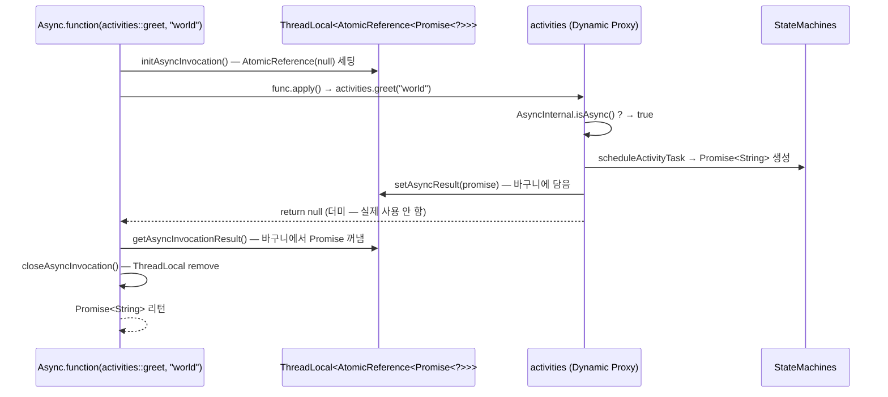

# 동시성 — CancellationScope / Async / Promise

[← 색인으로 돌아가기](../temporal-client-worker-flow.md)

---

## 14. `CancellationScope` — async 작업 묶음을 함께 취소

### 역할
Workflow 코드 안에서 **Activity / Timer / ChildWorkflow / Nexus operation을 그룹으로 묶어 한꺼번에 취소**할 수 있게 해주는 헬퍼. Options 클래스가 아니라 `io.temporal.workflow.CancellationScope`라는 런타임 객체. 지금까지 다룬 `ActivityOptions.setCancellationType` / `ChildWorkflowOptions.setCancellationType` / `NexusOperationOptions.setCancellationType`이 "취소 신호를 받으면 어떻게 반응할지"를 정했다면, Scope는 "그 신호를 **누구에게** 쏠지"를 정한다.

### 두 종류

```java
Workflow.newCancellationScope(() -> { ... })          // 일반 scope — 부모 scope 취소가 전파됨
Workflow.newDetachedCancellationScope(() -> { ... })  // detached scope — 부모 취소와 무관하게 끝까지 실행
```

워크플로 전체도 하나의 **암묵적 root scope**다. 그래서 외부에서 `WorkflowStub.cancel()`을 호출하면 내부 모든 scope가 함께 취소된다 — detached scope는 제외.

### 사용 패턴 1 — 레이싱 후 나머지 취소

`core/.../hello/HelloCancellationScope.java`, `core/.../nexuscancellation/caller/HelloCallerWorkflowImpl.java`

```java
List<Promise<String>> results = new ArrayList<>();
CancellationScope scope = Workflow.newCancellationScope(() -> {
    for (String g : greetings) {
        results.add(Async.function(activities::composeGreeting, g, name));
    }
});
scope.run();                                   // scope 안의 Async들을 동시에 시작
String winner = Promise.anyOf(results).get();  // 하나만 끝날 때까지 대기
scope.cancel();                                // 나머지 전부 취소
```

> `Async.function(...)`은 **scope 안에서 호출되어야 그 scope에 속한다.** scope 바깥에서 시작한 작업에는 `scope.cancel()`이 영향을 주지 않는다.

### 사용 패턴 2 — Timer로 Activity에 timeout 걸기

`core/.../hello/HelloCancellationScopeWithTimer.java`

```java
CancellationScope activityScope = Workflow.newCancellationScope(() -> {
    result = activities.updateInfo(input);     // 길 수 있는 Activity
});

Workflow.newTimer(Duration.ofSeconds(3))        // 3초 내 안 끝나면
    .thenApply(r -> { activityScope.cancel(); return null; });  // 취소

try { activityScope.run(); }
catch (ActivityFailure e) {
    if (e.getCause() instanceof CanceledFailure) result = "default (timeout)";
}
```
→ Activity의 `StartToCloseTimeout`을 바꾸지 않고도 "N초 넘기면 포기하고 기본값으로" 패턴을 구현. 일반 scope + Timer + `scope.cancel()` 조합.

### 사용 패턴 3 — 보상(cleanup)이 cancel에 휩쓸리지 않게

`core/.../bookingsyncsaga/TripBookingWorkflowImpl.java`, `core/.../bookingsaga/TripBookingWorkflowImpl.java`, `core/.../hello/HelloDetachedCancellationScope.java`

```java
try {
    activities.doSomething();
} catch (ActivityFailure e) {
    // ❌ saga.compensate() 그냥 호출하면, 외부에서 워크플로를 cancel한 상황에서
    //    보상 Activity도 함께 취소되어 유실됨.
    // ✅ detached scope로 감싸면 cancel 영향 없이 끝까지 실행.
    Workflow.newDetachedCancellationScope(() -> saga.compensate()).run();
    throw e;
}
```
→ **Saga 보상·DB 롤백·notification 발송처럼 "반드시 끝나야 하는 cleanup"은 detached scope가 사실상 필수.** §10의 Saga 샘플 3개 모두 이 패턴.

### 사용 패턴 4 — Signal/Update로 특정 작업만 취소

`core/.../hello/HelloUpdateAndCancellationTest.java`

```java
private CancellationScope scope;         // 필드로 노출

public String execute() {
    scope = Workflow.newCancellationScope(() -> activities.runActivity());
    scope.run();
    ...
}

@SignalMethod
public void cancelIt() { scope.cancel(); }   // signal에서 선택적 취소
```
→ 전체 워크플로를 취소하는 게 아니라 **특정 작업만** signal/update로 끊는 패턴.

### cancel이 실제로 동작하는 방식

`scope.cancel()`은 **협력적(cooperative)**이다 — 신호만 쏘고, 각 작업이 어떻게 반응할지는 **그 작업의 Options**가 결정한다.

| 작업 | 반응을 결정하는 옵션 | 특이사항 |
| --- | --- | --- |
| Activity | `ActivityOptions.setCancellationType(...)` | Activity 코드는 **heartbeat**를 호출해야 취소 알림을 받음 (`ActivityCompletionException` throw). `core/.../hello/HelloCancellationScope.java`의 Activity 코드 참고 |
| ChildWorkflow | `ChildWorkflowOptions.setCancellationType(...)` | 자식에게 cancel 요청 전파 |
| Nexus operation | `NexusOperationOptions.setCancellationType(...)` | handler에게 cancel 전파 |
| Timer (`Workflow.sleep`, `Workflow.newTimer`) | 옵션 없음 | 즉시 `CanceledFailure` throw |

### 핵심 API

| 호출 | 설명 |
| --- | --- |
| `Workflow.newCancellationScope(Runnable)` | 새 scope 생성 (부모 scope에 연결) |
| `Workflow.newDetachedCancellationScope(Runnable)` | 독립 scope 생성 (부모 cancel 영향 안 받음) |
| `scope.run()` | scope 안의 코드 실행. async 작업을 포함하면 **동기적으로 실행하되 블록하지 않음** (Promise는 백그라운드에서 진행) |
| `scope.cancel()` | scope 전체 취소. 안쪽의 모든 async 작업에 cancel 신호 전파 |
| `scope.cancel(String reason)` | 취소 사유 문자열 포함 (디버깅용) |
| `scope.isCancelRequested()` | 취소 요청 들어왔는지 확인 |
| `CancellationScope.current()` | 현재 scope 참조 (고급 패턴용) |

### 내부 메커니즘 — `cancel()` 전파는 어떻게 일어나나

`CancellationScopeImpl.cancel()` 소스를 처음 보면 "플래그 하나 세우고 Promise 하나 complete 하는데 뭘로 액티비티까지 취소가 가나?" 싶다. 핵심은 **스코프 자체는 액티비티 레퍼런스를 들고 있지 않고, 각 비동기 작업이 스케줄될 때 자기 취소 람다를 스코프의 `cancellationPromise`에 "구독"해둔다**는 점이다. publish/subscribe 패턴.

#### 1단계 — `scope.run()`은 ThreadLocal 스택 push/pop만

`io.temporal.internal.sync.CancellationScopeImpl`:

```java
private static final ThreadLocal<Deque<CancellationScopeImpl>> scopeStack =
    ThreadLocal.withInitial(ArrayDeque::new);

static CancellationScopeImpl current() {
  return scopeStack.get().peekFirst();   // "지금 유효한 스코프"
}

@Override
public void run() {
  try {
    pushCurrent(this);     // (1) 내가 top-of-stack
    runnable.run();        // (2) 사용자 람다 — 안에서 Activity/Timer가 스케줄됨
  } finally {
    popCurrent(this);      // (3) 람다 리턴 후 pop
  }
}
```

→ `run()`은 **"지금부터 람다 안에서 호출되는 모든 비동기 작업이 `CancellationScope.current()`로 **나**를 보게 하라"는 컨텍스트 세팅만 담당**. 제어 로직은 없다.

#### 2단계 — 비동기 작업이 스케줄되면서 자기 취소 람다를 구독

`io.temporal.internal.sync.SyncWorkflowContext.executeActivityOnce` (라인 297 부근):

```java
private ActivityOutput<Optional<Payloads>> executeActivityOnce(...) {
  ...
  ReplayWorkflowContext.ScheduleActivityTaskOutput activityOutput =
      replayContext.scheduleActivityTask(params, callback::invoke);

  CancellationScope.current()                            // ← 지금 run 중인 스코프
      .getCancellationRequest()                          // ← 그 스코프의 cancellationPromise
      .thenApply(reason -> {                             // ← "cancel 되면 뭐 할지" 등록
        activityOutput.getCancellationHandle()
            .apply(new CanceledFailure(reason));
        return null;
      });

  return new ActivityOutput<>(...);
}
```

같은 패턴이 **타이머·자식 워크플로·Nexus·Signal 대기** 등 모든 비동기 primitive 코드에 깔려 있다 (`SyncWorkflowContext.java` 라인 547, 749, 846, 1022, 1307).

#### 3단계 — `cancel()`은 그냥 Promise 하나 complete

```java
@Override
public void cancel() {
  cancelRequested = true;
  reason = null;
  for (CancellationScopeImpl child : children) {
    child.cancel();                        // (A) 자식 스코프 재귀 cancel
  }
  if (cancellationPromise != null) {
    cancellationPromise.complete(null);    // (B) 구독된 handlers 전부 발화
    cancellationPromise = null;            // (C) 한 번만 발화 보장
  }
}
```

- (A) **자식 스코프 전파** — `newCancellationScope` 생성 시 `setParent()`가 `parent.children.add(this)` 로 등록된다. 부모 cancel이 자식들을 재귀로 돈다. (`detached` 스코프는 `setParent`에서 `detached=true` 분기로 부모 연결을 건너뛰어 이 재귀에서 제외.)
- (B) **등록된 콜백들 전부 발화** — `CompletablePromise.complete(null)` 이 내부 `handlers` 리스트를 for 루프로 돌며 2단계에서 걸어둔 `thenApply` 람다를 전부 실행한다 → 각 액티비티의 `cancellationHandle(CanceledFailure)` 호출 → 상태머신에 `RequestCancelActivityTask` 커맨드가 쌓이고, 다음 WFT에 flush 되어 서버로 전송.
- (C) **멱등성 안전장치** — `cancellationPromise = null` 로 치워 두 번째 cancel 호출 시 재발화되지 않게.

#### 왜 이 설계여도 안전한가 — 결정론 보장 3요소

1. **워크플로 코드는 단일 스레드.** `DeterministicRunner` 가 한 번에 하나의 workflow thread만 깨우므로 `handlers.add` ↔ `invokeHandlers` 경합 없음.
2. **등록 순서가 결정적.** 액티비티들을 for 루프로 순서대로 스케줄했으면 handlers 리스트도 그 순서로 쌓이고 그 순서로 발화 → 리플레이 때 동일. (`CancellationScopeImpl.children`을 `LinkedHashSet`으로 쓰는 것도 같은 이유.)
3. **`complete`는 멱등** (`if (completed) return false`) + `cancellationPromise = null` → 한 번만 발화.

#### 이 설계의 장점 — 결합도가 "스코프 → Promise" 한 방향

`CancellationScopeImpl` 은 어떤 종류의 비동기 작업이 걸려 있는지 모른다. 신규 primitive(예: Nexus operation, Update 대기, 새 종류의 lock)를 추가할 때도 `CancellationScopeImpl`을 손댈 필요가 없다 — 그쪽 스케줄 코드에서 `CancellationScope.current().getCancellationRequest().thenApply(...)` 한 줄만 걸면 자동으로 scope cancel의 대상이 된다.

→ 상세 Promise 발화 메커니즘은 §16 `CompletablePromiseImpl` 내부 섹션 참고.

### 자주 하는 실수

1. **detached 없이 catch 블록에서 cleanup 호출** — 외부 워크플로 cancel 상황에서 cleanup Activity가 즉시 함께 취소된다. Saga 보상이 유실되는 전형적 원인. 반드시 `Workflow.newDetachedCancellationScope(() -> cleanup()).run()`.
2. **Async 호출을 scope 바깥에서 시작하고 scope.cancel 기대** — scope는 **문법적 범위(lexical scope)**가 아니라 **Async 시작 시점의 current scope**로 소속이 결정된다. scope.run() 람다 안에서 `Async.function(...)`을 호출해야 그 scope에 속한다.
3. **Activity에 heartbeat 없음** — cancel 신호가 전달되지 않아 Activity가 `StartToCloseTimeout`까지 돌아버린다. 긴 Activity는 반드시 `setHeartbeatTimeout(...)` + `context.heartbeat(...)` 호출.
4. **`WAIT_CANCELLATION_COMPLETED`로 걸어놓고 cleanup 대기 안 함** — 레이싱 패턴에서 `scope.cancel()` 호출 후 결과를 바로 반환해버리면 cleanup이 끝나기 전에 워크플로가 종료된다. `core/.../hello/HelloCancellationScope.java`처럼 `results` Promise들을 for-loop로 한 번씩 `.get()` 호출해 완료를 기다려야 함.

### 샘플 레퍼런스
- 레이싱(Activity): `core/src/main/java/io/temporal/samples/hello/HelloCancellationScope.java`
- 레이싱(Nexus operation): `core/src/main/java/io/temporal/samples/nexuscancellation/caller/HelloCallerWorkflowImpl.java`
- Timer로 Activity timeout 구현: `core/src/main/java/io/temporal/samples/hello/HelloCancellationScopeWithTimer.java`
- detached scope — 보상 보호: `core/src/main/java/io/temporal/samples/bookingsyncsaga/TripBookingWorkflowImpl.java`, `core/src/main/java/io/temporal/samples/bookingsaga/TripBookingWorkflowImpl.java`
- detached scope — cleanup Activity: `core/src/main/java/io/temporal/samples/hello/HelloDetachedCancellationScope.java`
- Signal로 scope.cancel: `core/src/test/java/io/temporal/samples/hello/HelloUpdateAndCancellationTest.java`
- Nexus handler 측 scope: `core/src/main/java/io/temporal/samples/nexuscancellation/handler/HelloHandlerWorkflowImpl.java`

---
## 15. `Async` — Workflow 안에서 비동기로 호출하기

### 역할
워크플로 코드 안에서 **Activity / ChildWorkflow / Nexus operation**을 호출할 때 기본은 **블로킹 동기 호출**(결과 반환 시까지 대기)이다. `Async`는 그 호출을 **즉시 반환하는 비동기 호출**로 바꿔 `Promise`를 돌려준다. 여러 호출을 fan-out하거나 Timer와 레이싱할 때 필수.

> ⚠️ **`CompletableFuture`나 `ExecutorService`를 쓰지 않는다** — Workflow 안에서는 `java.util.concurrent`를 직접 쓰면 결정성(determinism)이 깨진다. 비동기는 전부 `Async` + `Promise`로.

### 세 가지 메서드

| 메서드 | 반환 | 용도 |
| --- | --- | --- |
| `Async.function(func, args...)` | `Promise<R>` | **값을 반환**하는 Activity/ChildWorkflow/Nexus op 호출 (`core/.../hello/HelloChild.java`, `.../batch/slidingwindow/BatchWorkflowImpl.java`) |
| `Async.procedure(proc, args...)` | `Promise<Void>` | **void 반환** 호출 (`core/.../batch/iterator/IteratorBatchWorkflowImpl.java`, `.../batch/slidingwindow/SlidingWindowBatchWorkflowImpl.java`) |
| `Async.retry(retryOptions, expiration, func)` | `Promise<R>` | **임의의 람다를** 재시도 정책에 따라 비동기로 재실행 (일반 코드/local 함수 재시도용) |

### `AsyncInternal` — 어떻게 동기 메서드 시그니처로 Promise 를 돌려주나

`Async.function(activities::greet, "world")` 를 호출하면 `Promise<String>` 이 돌아온다. 그런데 `activities.greet(String)` 의 **원래 리턴 타입은 `String`**(동기 결과)이다. 어떻게 다른 타입이 돌아오는가? 답은 **ThreadLocal 사이드채널 + Dynamic Proxy InvocationHandler** 트릭이다.

#### 핵심 코드 지점 — `io.temporal.internal.sync.AsyncInternal`

```java
if (temporalStub) {
    initAsyncInvocation();          // ThreadLocal에 빈 "바구니"(AtomicReference) 올림
    try {
        func.apply();                // ← stub(동적 프록시) 메서드 호출
        return getAsyncInvocationResult();   // 바구니에서 Promise 꺼내 리턴
    } finally {
        closeAsyncInvocation();
    }
}
```

```java
// 바구니 자체: ThreadLocal<AtomicReference<Promise<?>>>
private static ThreadLocal<AtomicReference<Promise<?>>> asyncResult = new ThreadLocal<>();

static void initAsyncInvocation()     { asyncResult.set(new AtomicReference<>()); }
static boolean isAsync()              { return asyncResult.get() != null; }
static void setAsyncResult(Promise<?> p) { asyncResult.get().set(p); }   // ← 프록시가 호출
static <R> Promise<R> getAsyncInvocationResult() {
    return (Promise<R>) asyncResult.get().get();
}
```

**`setAsyncResult` 를 호출하는 것은 `Async.function` 자신이 아니라 프록시의 `InvocationHandler`** 다. `activities` 는 `Workflow.newActivityStub(...)` 가 만든 **JDK Dynamic Proxy** 이고, 프록시의 `invoke(...)` 가 아래처럼 동작한다(개념 코드):

```java
public Object invoke(Object proxy, Method method, Object[] args) {
    if (AsyncInternal.isAsync()) {                        // 바구니가 올라와 있는지 체크
        Promise<?> p = scheduleActivity(method, args);   // Activity Command 큐에 쌓고 Promise 생성
        AsyncInternal.setAsyncResult(p);                 // ★ 바구니에 Promise 담음
        return getDefaultValue(method.getReturnType());  // null / 0 / false 등 더미 값
    }
    return executeSync(method, args);                     // 평소: 동기 블로킹 호출
}
```

#### 단계별 흐름



#### 왜 `ThreadLocal<Promise<?>>` 가 아니라 `ThreadLocal<AtomicReference<Promise<?>>>` 인가

- `ThreadLocal<Promise<?>>` 였다면 프록시가 `asyncResult.set(promise)` 로 ThreadLocal 자체를 갈아끼워야 함. 그러면 `Async.function` 호출 측과 프록시가 **같은 바구니를 가리키는지** 보장이 애매해진다.
- `AtomicReference` 를 **"바구니"** 로 미리 올려두면 프록시가 그 안에만 쓰면 되고, `Async.function` 과 프록시가 **동일한 바구니 참조를 공유**하게 된다. 중첩/재진입 상황에서도 명확.
- `isAsync()` 판정도 **"바구니(=AtomicReference) 가 올라와 있는가"** 로 단순해진다. "바구니는 있는데 아직 안 담김"(initAsync 직후) 과 "바구니 비어있음"(outside Async) 을 명확히 구분.

#### 트릭을 쓰는 이유

메서드 시그니처는 `String greet(String)` 인데 비동기 호출에서는 `Promise<String>` 을 받아야 한다. 메서드 시그니처는 못 바꾸니:

> **"호출은 그대로 하되, 리턴값은 더미로 두고 **진짜 결과(Promise)는 사이드채널(ThreadLocal)**로 전달한다"**

는 전략. 사용자가 쓰는 API 는 `Async.function(stub::method, args)` 로 깔끔하게 유지하면서, 내부적으로는 **같은 프록시가 두 모드**(동기 블로킹 / 비동기 + 사이드채널)로 분기할 수 있다.

**똑같은 트릭이 `WorkflowClient.start` / `WorkflowClient.execute` / `signalWithStart` 등에도 쓰인다** — 모두 "메서드 참조를 받아 비동기로 처리" 형태인데, 각자 자기 진입 시점에 "지금은 start 모드다 / execute 모드다 / signalWithStart 모드다" 플래그를 세우고 프록시가 그걸 보고 분기한다.

#### 자주 하는 실수

- **`Async.function` 바깥에서 stub 메서드를 호출하면서 Promise 를 기대** — `isAsync()` 가 false 라서 그냥 동기 블로킹으로 돈다. Promise 안 돌아옴. 에러도 안 남.
- **`stub.method(args)` 리턴값을 Promise 로 캐스팅** — 더미 값(null)이라 `NullPointerException`.
- **Workflow 코드 바깥에서 `Async.function` 호출** — ThreadLocal 설정은 되지만 프록시가 Workflow 컨텍스트가 아니라 제대로 안 돈다. Workflow 코드 안에서만 사용.

---

### 사용 패턴 1 — Activity fan-out (`core/.../hello/HelloCancellationScope.java`)

```java
List<Promise<String>> results = new ArrayList<>();
for (String greeting : greetings) {
    results.add(Async.function(activities::composeGreeting, greeting, name));  // 즉시 반환
}
// 여기까지 반복문이 끝나도 아직 Activity는 전부 "시작만" 된 상태
```

### 사용 패턴 2 — ChildWorkflow 비동기 시작 (`core/.../asyncchild/ParentWorkflowImpl.java`)

```java
ChildWorkflow child = Workflow.newChildWorkflowStub(ChildWorkflow.class, opts);
Async.function(child::executeChild);                               // Promise는 버림 — 결과 대기 안 함
Promise<WorkflowExecution> started = Workflow.getWorkflowExecution(child); // 시작 확인
started.get();                                                      // 자식이 "시작됐음"만 확인
// 이 시점에서 부모가 return해도 자식은 계속 돌아감 (ParentClosePolicy.ABANDON과 함께)
```

### 사용 패턴 3 — void 호출을 Promise로 (`core/.../batch/iterator/IteratorBatchWorkflowImpl.java`)

```java
Promise<Void> result = Async.procedure(processor::processRecord, record);  // void 리턴을 Promise<Void>로
results.add(result);
// 나중에 Promise.allOf(results).get() 으로 전부 대기
```

### 사용 패턴 4 — `Async.retry`로 임의 람다 재시도

```java
Promise<Result> p = Async.retry(
    RetryOptions.newBuilder().setMaximumAttempts(5).build(),
    Optional.of(Duration.ofMinutes(10)),      // 전체 만료 시간
    () -> Async.function(activities::doStep)  // 재시도할 실제 호출
);
```
→ Activity 자체의 `RetryOptions`로 안 되는 복합 로직(여러 Activity를 묶어 재시도) 재시도에 사용.

### Scope와의 관계

`Async.function`은 **호출 시점의 current CancellationScope**에 속한다. §14의 레이싱 패턴이 이걸 활용 — scope 람다 안에서 `Async.function`을 호출해야 `scope.cancel()`로 함께 취소된다. **scope 바깥에서 시작한 Async는 그 scope에 안 속한다.**

---
## 16. `Promise` — Workflow 안의 비동기 결과 핸들

### 역할
`Async` 호출의 결과, Timer, Signal, ChildWorkflow 실행 등 **"아직 안 끝난 작업의 결과"를 나타내는 핸들**. `java.util.concurrent.CompletableFuture`의 Temporal 버전 — 다만 **워크플로 결정성이 보장되는 가상 스레드 위에서 동작**하므로 `CompletableFuture`를 Workflow 코드에 섞어 쓰면 안 된다.

### 어디서 생기나

| 소스 | 예 |
| --- | --- |
| `Async.function` / `Async.procedure` | `Promise<R> p = Async.function(activities::doIt, arg);` |
| `Workflow.newTimer(Duration)` | `Promise<Void> t = Workflow.newTimer(Duration.ofSeconds(3));` |
| `Workflow.getWorkflowExecution(childStub)` | `Promise<WorkflowExecution> e = Workflow.getWorkflowExecution(child);` |
| `Workflow.newPromise()` | 수동으로 `CompletablePromise<T>` 생성 (`core/.../bookingsyncsaga/TripBookingWorkflowImpl.java`) |

### 핵심 API

| 호출 | 설명 |
| --- | --- |
| `promise.get()` | 완료까지 **대기**하고 결과 반환. 실패면 unchecked exception throw |
| `promise.get(timeout, unit)` | 타임아웃 포함 대기 |
| `promise.isCompleted()` | 완료 여부 확인 (블록 안 함) |
| `promise.thenApply(fn)` | **완료 시 콜백** — 새 Promise 반환. 체이닝용 |
| `promise.handle(bifn)` | 완료 OR 실패 둘 다 처리하는 콜백 |
| `Promise.allOf(promises)` | 모든 Promise 완료까지 대기. `Promise<Void>` 반환, 하나라도 실패하면 그 예외 throw (`core/.../hello/HelloParallelActivity.java`, `.../batch/iterator/...`, `.../batch/slidingwindow/...`) |
| `Promise.anyOf(promises)` | **하나라도** 완료되면 그 결과 반환. 레이싱 패턴 핵심 (`core/.../hello/HelloCancellationScope.java`, `.../nexuscancellation/caller/HelloCallerWorkflowImpl.java`) |

### `CompletablePromise` — 수동으로 완료시키는 Promise

`Workflow.newPromise()`로 만든다. 외부 입력(Signal/Update)이나 다른 흐름이 결과를 밀어 넣어줘야 할 때 사용.

```java
// core/.../bookingsyncsaga/TripBookingWorkflowImpl.java
private final CompletablePromise<Booking> booking = Workflow.newPromise();

@WorkflowMethod
public void bookTrip(String name) {
    try {
        ...
        booking.complete(new Booking(...));           // Update 함수에서 기다리는 측 unblock
    } catch (ActivityFailure e) {
        booking.completeExceptionally(e);             // 실패 전파
        ...
    }
}

@UpdateMethod
public Booking waitForBooking() { return booking.get(); }   // Update가 결과를 받아 반환
```
→ "메인 흐름은 비동기로 진행하고, Signal/Update 핸들러는 그 결과를 기다리게" 하는 패턴.

### `CompletablePromiseImpl` — 내부 핸들러 콜백 리스트 메커니즘

`promise.complete(v)` 가 호출되면 체인된 `thenApply` 들이 어떻게 발화되나? 답은 **그냥 `ArrayList<Functions.Proc>` 콜백 리스트**다. §14 CancellationScope 내부 메커니즘에서 `cancellationPromise.complete(null)` 이 등록된 리스너를 터뜨리는 것도 결국 이 메커니즘.

#### 핵심 자료구조

`io.temporal.internal.sync.CompletablePromiseImpl`:

```java
class CompletablePromiseImpl<V> implements CompletablePromise<V> {
  private V value;
  private RuntimeException failure;
  private boolean completed;
  private final List<Functions.Proc> handlers = new ArrayList<>();   // ← 콜백 리스트
  ...
}
```

특별한 reactive stream 도, 디스패처도 없다. `ArrayList` 하나.

#### `thenApply` / `handle` / `exceptionally` 는 전부 private `then()` 으로 수렴

```java
@Override
public <U> Promise<U> thenApply(Functions.Func1<? super V, ? extends U> fn) {
  return handle((r, e) -> { if (e != null) throw e; return fn.apply(r); });
}

@Override
public <U> Promise<U> handle(Functions.Func2<? super V, RuntimeException, ? extends U> fn) {
  return then(result -> {
    try { U r = fn.apply(value, failure); result.complete(r); }
    catch (RuntimeException e) { result.completeExceptionally(e); }
  });
}

/** Call proc immediately if ready or register with handlers. */
private <U> Promise<U> then(Functions.Proc1<CompletablePromise<U>> proc) {
  CompletablePromise<U> resultPromise = new CompletablePromiseImpl<>();   // (A) 체인용 새 Promise
  if (completed) {
    proc.apply(resultPromise);               // (B) 이미 완료 → 즉시 실행
    unregisterWithRunner();
  } else {
    handlers.add(() -> proc.apply(resultPromise));   // (C) 미완료 → 리스트에 add
  }
  return resultPromise;                       // (D) "다음 단계" Promise 반환
}
```

- (A) **각 `thenApply` 호출마다 새 Promise 생성** → 체인마다 자기만의 `handlers` 리스트를 가짐.
- (B)(C) **완료 상태에 따라 분기** — 완료 전에 걸면 리스트에 쌓이고, 완료 후에 걸면 그 자리에서 즉시 실행. 등록 시점 걱정 없음.
- (D) 반환된 Promise 가 **체인의 다음 노드**가 된다. 사용자가 거기 또 `thenApply`를 걸면 그 Promise 의 `handlers`에 쌓인다.

#### `complete(v)` 는 for 루프로 handlers 순차 발화

```java
@Override
public boolean complete(V value) {
  if (completed) return false;      // ← 멱등 — 두 번째 complete 는 무시
  this.completed = true;
  this.value = value;
  invokeHandlers();                 // ← 발화
  return true;
}

private boolean invokeHandlers() {
  for (Functions.Proc handler : handlers) {
    handler.apply();                // ← 비동기 큐잉 없음. 그냥 동기 호출.
  }
  return !handlers.isEmpty();
}
```

**비동기 디스패치가 전혀 없다.** `complete()` 를 호출한 그 호출 스택 위에서 전부 동기적으로 끝난다.

#### 체인 발화 추적 — `A.thenApply(f).thenApply(g).thenApply(h)`

등록 결과:

```
A.handlers = [ () -> { try { B.complete(f(A.value)); } catch (e) { B.completeExceptionally(e); } } ]
B.handlers = [ () -> { ... g(B.value) 적용 후 C.complete(...) ... } ]
C.handlers = [ () -> { ... h(C.value) 적용 후 D.complete(...) ... } ]
```

`A.complete(v)` 호출 시:

```
A.invokeHandlers()
  └─ f(v) 계산 → B.complete(fv)
       └─ B.invokeHandlers()
            └─ g(fv) 계산 → C.complete(gfv)
                 └─ C.invokeHandlers()
                      └─ h(gfv) 계산 → D.complete(hgfv)
```

**체인 전체가 호출 스택 하나로 folded** 되어 동기적으로 쭉 실행된다.

#### §14 cancel 흐름을 이 메커니즘으로 재해석

`HelloCancellationScope` 에서 액티비티 5개를 scope 람다 안에 async 로 띄우면:

```
scope.cancellationPromise  (CompletablePromiseImpl<String>)
   └─ handlers: [
        () -> { activity_1.cancellationHandle.apply(CanceledFailure(null)); },
        () -> { activity_2.cancellationHandle.apply(CanceledFailure(null)); },
        () -> { activity_3.cancellationHandle.apply(CanceledFailure(null)); },
        () -> { activity_4.cancellationHandle.apply(CanceledFailure(null)); },
        () -> { activity_5.cancellationHandle.apply(CanceledFailure(null)); },
      ]
```

`scope.cancel()` → `cancellationPromise.complete(null)` → `invokeHandlers()` for 루프 → 5개 람다 전부 동기 호출 → 각자 상태머신에 `RequestCancelActivityTask` 커맨드 enqueue → WFT 종료 시 flush.

#### 결정론 보장 3요소 (재확인)

이 단순한 `ArrayList` + for 루프 설계가 안전한 이유:

1. **워크플로 코드는 단일 스레드** — `DeterministicRunner` 가 workflow thread를 하나씩만 깨움. `handlers.add` ↔ `invokeHandlers` 경합 없음. `ArrayList` 를 synchronized 없이 써도 안전.
2. **등록 순서 = 발화 순서, 둘 다 결정적** — 사용자 코드가 결정적이면 핸들러 등록 순서도 결정적이고, for 루프라 발화 순서도 결정적 → 리플레이 때 동일.
3. **`complete` 멱등** — `completeFrom` 등으로 중복 완료 시도되어도 두 번째부터는 `completed==true` 체크로 무시.

#### 자주 하는 실수 (내부 구현 관련)

- **`thenApply` 안에서 긴 작업 수행** — 핸들러는 `complete()` 호출 스택 위에서 동기 실행된다. 네트워크 호출이나 블로킹 I/O 를 넣으면 워크플로 전체가 멈춘다 (어차피 Workflow에서는 그런 코드 금지지만 의식적으로). `thenApply` 는 "다음 단계로 어떻게 변환할지" 계산용.
- **`thenApply` 안에서 또 다른 Promise 를 `.get()` 호출** — 체인 폴딩 중에 `WorkflowThread.await` 가 호출되면 교착·결정론 위반 가능. 다른 Promise 를 기다려야 하면 `thenCompose` 를 쓴다.
- **`CompletablePromise` 를 Workflow 바깥에서 complete** — Activity 코드나 외부 스레드에서 `promise.complete(...)` 호출하면 결정론 깨짐. complete 는 반드시 Workflow 스레드 (워크플로 메서드/Signal/Update 핸들러 안)에서.

### 사용 패턴 1 — fan-out & wait all

```java
List<Promise<String>> promises = new ArrayList<>();
for (var x : items) promises.add(Async.function(activities::process, x));
Promise.allOf(promises).get();                       // 전부 끝날 때까지
List<String> results = promises.stream().map(Promise::get).toList();  // get()은 이제 즉시 반환
```

### 사용 패턴 2 — 레이싱 (first-win)

```java
Promise<Result> winner = Promise.anyOf(results);
Result r = winner.get();                             // 하나 끝날 때까지
scope.cancel();                                      // 나머지 취소 (§14 참고)
```

### 사용 패턴 3 — Timer vs Activity 레이싱

```java
Promise<String> activityResult = Async.function(activities::doIt, input);
Promise<Void> timeout = Workflow.newTimer(Duration.ofSeconds(10));
Promise<Object> first = Promise.anyOf(activityResult, timeout);
first.get();
if (timeout.isCompleted()) throw new RuntimeException("timed out");
return activityResult.get();
```
→ 또는 §14 패턴2처럼 `timer.thenApply(r -> scope.cancel())` 조합도 가능.

### 사용 패턴 4 — `thenApply`로 콜백 체이닝

```java
Workflow.newTimer(Duration.ofSeconds(3))
    .thenApply(ignore -> { scope.cancel(); return null; });
// → core/.../hello/HelloCancellationScopeWithTimer.java, .../hello/HelloWorkflowTimer.java
```
Timer가 fire되면 scope를 cancel. `thenApply`는 **Workflow Task 안에서 호출되는 콜백**이므로 Workflow API를 자유롭게 사용 가능.

### 자주 하는 실수

1. **`CompletableFuture` 혼용** — Workflow 코드에서 `CompletableFuture.supplyAsync(...)`나 `ExecutorService.submit(...)` 쓰면 결정성 깨짐 + 리플레이 실패. 반드시 `Async` + `Promise`.
2. **Promise 안 받아서 결과도 못 쓰고 실패도 못 감지** — `Async.function(...)`의 반환을 버리면 그 작업의 예외를 못 잡는다. 적어도 `Promise.allOf(list).get()`으로 수집하거나 일부러 "fire-and-forget"임을 주석에 명시.
3. **`allOf`에서 일부 실패를 무시하고 싶은데 그냥 쓰기** — `allOf`는 첫 실패에서 throw. 전부 돌리고 결과를 모으려면 `HelloCancellationScope.java`처럼 for-loop로 각 Promise를 try/catch 하면서 `.get()`.
4. **`get()`을 Activity 안에서 호출** — Promise는 **Workflow 전용**. Activity 코드에서는 쓸 수 없다.
5. **`CompletablePromise`를 Workflow 바깥(Activity, 일반 스레드)에서 complete** — 이것도 결정성 깨짐. 반드시 Workflow 코드 안(또는 Signal/Update 핸들러 안)에서 complete.

### 샘플 레퍼런스
- fan-out + `allOf`: `core/src/main/java/io/temporal/samples/hello/HelloParallelActivity.java`, `core/src/main/java/io/temporal/samples/batch/iterator/IteratorBatchWorkflowImpl.java`, `core/src/main/java/io/temporal/samples/batch/slidingwindow/SlidingWindowBatchWorkflowImpl.java`
- 레이싱 + `anyOf`: `core/src/main/java/io/temporal/samples/hello/HelloCancellationScope.java`, `core/src/main/java/io/temporal/samples/nexuscancellation/caller/HelloCallerWorkflowImpl.java`
- `CompletablePromise`로 Update ↔ 메인 흐름 bridge: `core/src/main/java/io/temporal/samples/bookingsyncsaga/TripBookingWorkflowImpl.java`
- `thenApply`로 Timer 콜백: `core/src/main/java/io/temporal/samples/hello/HelloCancellationScopeWithTimer.java`, `core/src/main/java/io/temporal/samples/hello/HelloWorkflowTimer.java`
- ChildWorkflow 시작 확인(`Workflow.getWorkflowExecution`): `core/src/main/java/io/temporal/samples/asyncchild/ParentWorkflowImpl.java`, `core/src/main/java/io/temporal/samples/batch/slidingwindow/SlidingWindowBatchWorkflowImpl.java`
