# Worker 실행 모델과 Sticky Queue

[← 색인으로 돌아가기](../temporal-client-worker-flow.md)

Workflow가 "어디서, 어떤 스레드에서, 어떻게 분산되어" 실행되는지의 멘탈 모델. `core/src/main/java/io/temporal/samples/hello/HelloSignal.java` 를 레퍼런스로 짚어본다.

---

## 1. `Workflow.await()` vs `while` 루프 — 왜 `await`인가

`HelloSignal.GreetingWorkflowImpl.getGreetings()`에서:

```java
while (true) {
    Workflow.await(() -> !messageQueue.isEmpty() || exit);   // ✓
    // while (messageQueue.isEmpty() && !exit) { }           // ✗ 이렇게 하면 안 됨
    if (messageQueue.isEmpty() && exit) return receivedMessages;
    ...
}
```

**`while`로는 안 되는 이유:**
- Workflow 스레드에서 `Thread.sleep`, `Object.wait`, `CompletableFuture.get` 같은 **표준 JDK 블로킹을 쓰면 결정성이 깨짐** → replay가 재현 안 됨
- 조건만 반복 검사하는 busy-spin은 CPU만 태우고 **signal이 도착했음을 감지할 훅이 없음**

**`Workflow.await(condition)`이 하는 일:**
- Workflow 스레드를 **de-schedule** → worker는 다른 workflow task 처리 가능
- Signal / timer fire / activity 완료 등 **이벤트가 들어올 때마다 `condition` 재평가**
- `true`가 되는 순간 결정적으로 재개 → replay 시에도 동일 지점에서 통과

Workflow 코드에서 "조건이 참이 될 때까지 기다린다"는 거의 항상 `Workflow.await()` / `Workflow.sleep()`. JDK 표준 블로킹은 **쓰지 않는다**.

---

## 2. Workflow Stub은 "리모컨"일 뿐 — 스레드도, 실행도 없음

```java
GreetingWorkflow workflow1 = client.newWorkflowStub(GreetingWorkflow.class, workflowOptions);
GreetingWorkflow workflow2 = client.newWorkflowStub(GreetingWorkflow.class, workflowOptions);
```

| | Stub | Worker |
|---|---|---|
| 정체 | gRPC 호출을 감싸는 client-side **프록시** | 실제로 workflow 코드를 **실행**하는 프로세스 |
| 생성 | `client.newWorkflowStub(...)` | `WorkerFactory.newWorker(TASK_QUEUE)` |
| 스레드 | 없음 (호출 시 호출자 스레드에서 gRPC 전송) | Worker JVM 안의 workflow task executor 스레드 풀 |
| 늘리는 방법 | 메서드 호출마다 새로 만들어도 됨 | **별도 JVM 프로세스를 추가** 실행 |

**같은 `WORKFLOW_ID`로 만든 두 stub은 동일한 workflow execution의 리모컨.** `HelloSignal`에서 `workflowById`를 다시 만든 건 **"ID만 알면 signal을 보낼 수 있다"는 걸 보여주는 데모**이지, 새 workflow를 띄우는 게 아니다.

---

## 3. 다른 `WORKFLOW_ID` → 완전히 독립적인 Execution

```java
WorkflowOptions opts1 = WorkflowOptions.newBuilder().setTaskQueue(TQ).setWorkflowId("WF-1").build();
WorkflowOptions opts2 = WorkflowOptions.newBuilder().setTaskQueue(TQ).setWorkflowId("WF-2").build();
```

| 항목 | 독립 여부 |
|---|---|
| Workflow Execution (서버 instance) | ✓ 완전 별개 |
| Event History | ✓ 각자 따로 기록 |
| Workflow 상태 (`messageQueue`, `exit` 필드) | ✓ 각자 다른 `Impl` 인스턴스 |
| Signal 라우팅 | ✓ `wf1.waitForName()` → WF-1만, `wf2.waitForName()` → WF-2만 |
| Workflow 스레드 | ✓ Worker 안에서 각 execution마다 별도 workflow thread |
| 실패/재시작/타임아웃 | ✓ 서로 영향 없음 |

**공유되는 것 (물리적 리소스):**
- Worker 프로세스 / JVM / 같은 Task Queue
- Worker 스레드 풀 slot (경쟁)
- gRPC 커넥션 / `WorkflowClient`
- JVM 전역 상태 (**이래서 workflow 코드에서 `static` mutable 필드 금지**)

→ "논리적으로 완전 독립, 물리적으로 리소스 공유".

---

## 4. Worker 여러 개 — Task 분산 메커니즘

Temporal의 task 분산은 **pull 기반 (long poll)**. 서버가 push하지 않고, worker가 "일 있어?" 하고 묻는다.

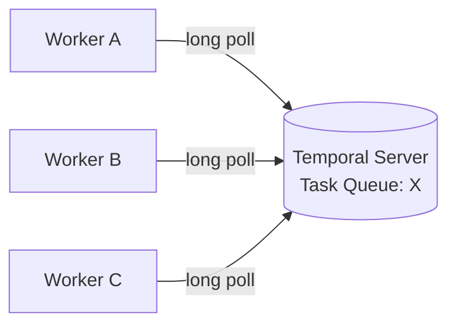

**Activity Task — 완전 분산:** 상태 없으니 매 호출마다 free worker 아무나 받음.

**Workflow Task — Sticky Execution:** 상태 유지 비용 때문에 캐시 친화적으로 라우팅 (아래 §6).

---

## 4.5. Long-poll 메커니즘 상세

§4의 "pull 기반 long poll"을 저수준에서 풀어본다. 운영 감각(장비 timeout, backpressure, graceful shutdown)과 성능 튜닝(poller 수, slot 수)의 기반이 되는 부분.

### 4.5-1. gRPC 레벨의 "long poll"

```
PollWorkflowTaskQueue   (workflow task용)
PollActivityTaskQueue   (activity task용)
```

둘 다 unary gRPC지만 **서버가 최대 ~60초까지 응답을 보류**하는 보류형 호출. 그 안에 task가 큐에 들어오면 즉시 반환, 없으면 60초 뒤 빈 응답(empty TaskToken) → worker가 즉시 재발사.

| 방식 | 평시 지연 | 평시 CPU/네트워크 | 서버가 worker 주소 알아야? |
|---|---|---|---|
| Short poll (1초마다) | ~0.5s | 낭비 많음 | 아니오 |
| Server push (SSE 등) | ms | 적음 | **필요** (NAT 뒤면 어려움) |
| **Long poll** | **ms** | 평시 거의 없음 | **아니오** ← Worker가 NAT/방화벽 뒤여도 OK |

→ K8s pod가 공인 IP를 가질 필요가 없는 이유.

### 4.5-2. Poller 스레드 풀 — "묻는 사람" 숫자

```java
WorkerOptions.newBuilder()
    .setMaxConcurrentWorkflowTaskPollers(5)   // 기본 5
    .setMaxConcurrentActivityTaskPollers(5)
```

→ **동시에 long-poll gRPC 호출을 걸고 있는 스레드 수**.

**왜 여러 개?** 하나만 띄우면 task 받아 처리하는 동안 다음 poll이 못 걸림 → 서버 큐에 task가 쌓여도 못 받음. 여러 poller면 한 쪽이 받아 넘기는 동안 다른 쪽은 계속 대기 → 지연 없이 흡수.

**너무 많으면?** 서버 쪽 커넥션/스레드 과점유. Cluster-wide로 과도하면 서버 리소스 부담.

### 4.5-3. Poller ≠ Executor slot — 가장 헷갈리는 지점

```java
.setMaxConcurrentWorkflowTaskPollers(5)         // ① 묻는 스레드 수
.setMaxConcurrentWorkflowTaskExecutionSize(200) // ② 실행 slot 수
```

| | ① Poller | ② Executor slot |
|---|---|---|
| 역할 | gRPC long-poll RPC 하나 들고 대기 | 받은 task를 workflow thread에서 실제 실행 |
| 전형값 | 5 | 200 |
| 꽉 차면 영향 | (의미 없음) | **poller가 다음 poll 안 걸음** → backpressure |

흐름:

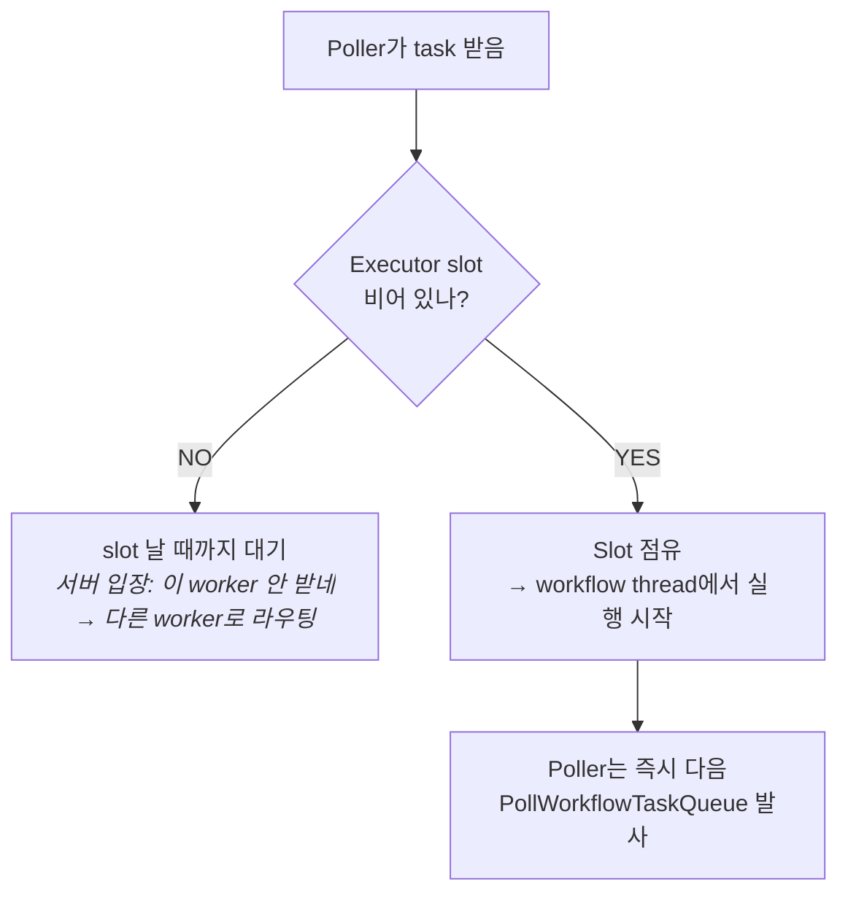

**즉 Poller 수 ≠ 동시 실행 수.** Poller는 "줄 서는 사람", Executor slot은 "실제 자리". 둘을 혼동해서 Poller만 늘려봤자 실행 처리량은 안 늘어난다 (slot이 bottleneck).

### 4.5-4. Workflow Task — 완전 왕복

Workflow task 처리는 매번 **짧게 (수십 ms) 끝난다**. "activity 결과를 기다리는 블로킹"은 workflow task 안에서 일어나지 않음 — `Workflow.await()` / `Async.function(activity::foo)` 는 모두 **"다음에 할 결정(Command)을 쌓고 반환"** 으로 변환된다.

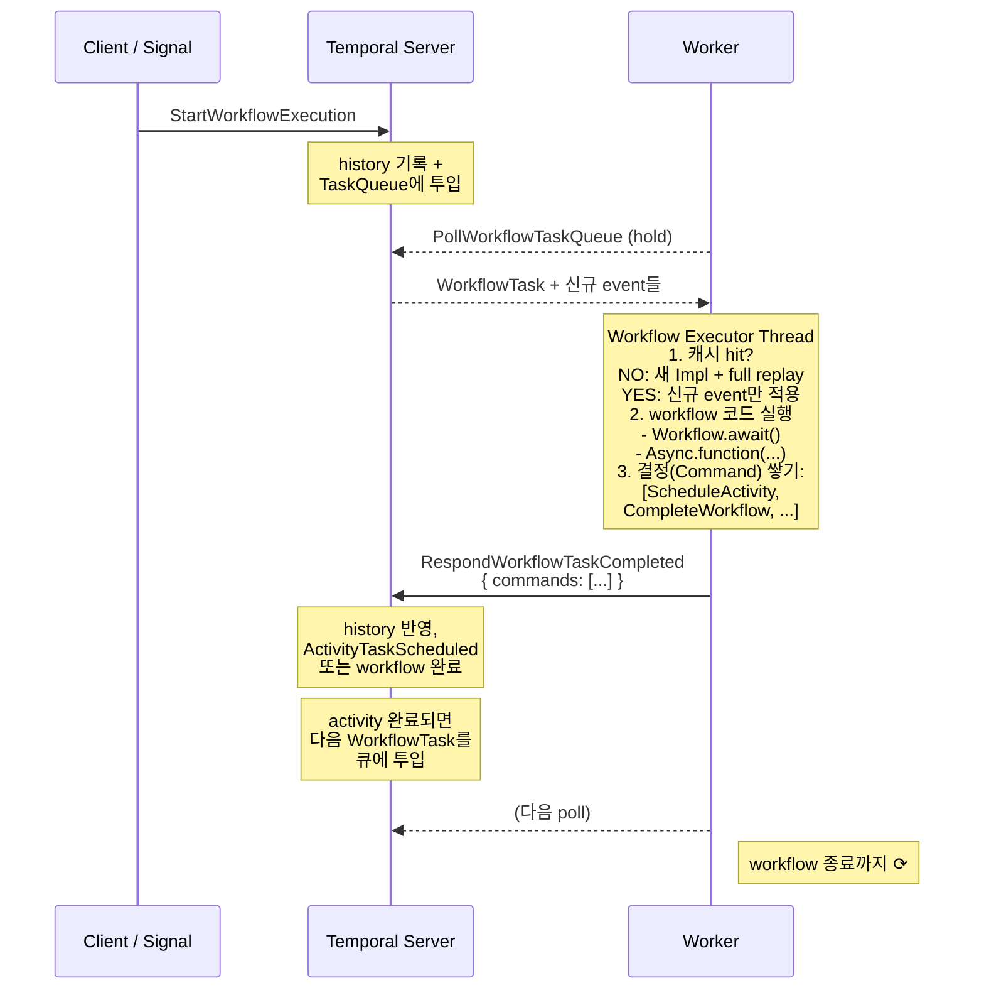

핵심: **workflow task 하나 = "서버로 보낼 결정 묶음"을 만드는 짧은 사이클.**

### 4.5-5. Activity Task — 조금 다른 흐름

Activity는 상태 없음 + 임의로 오래 걸림.

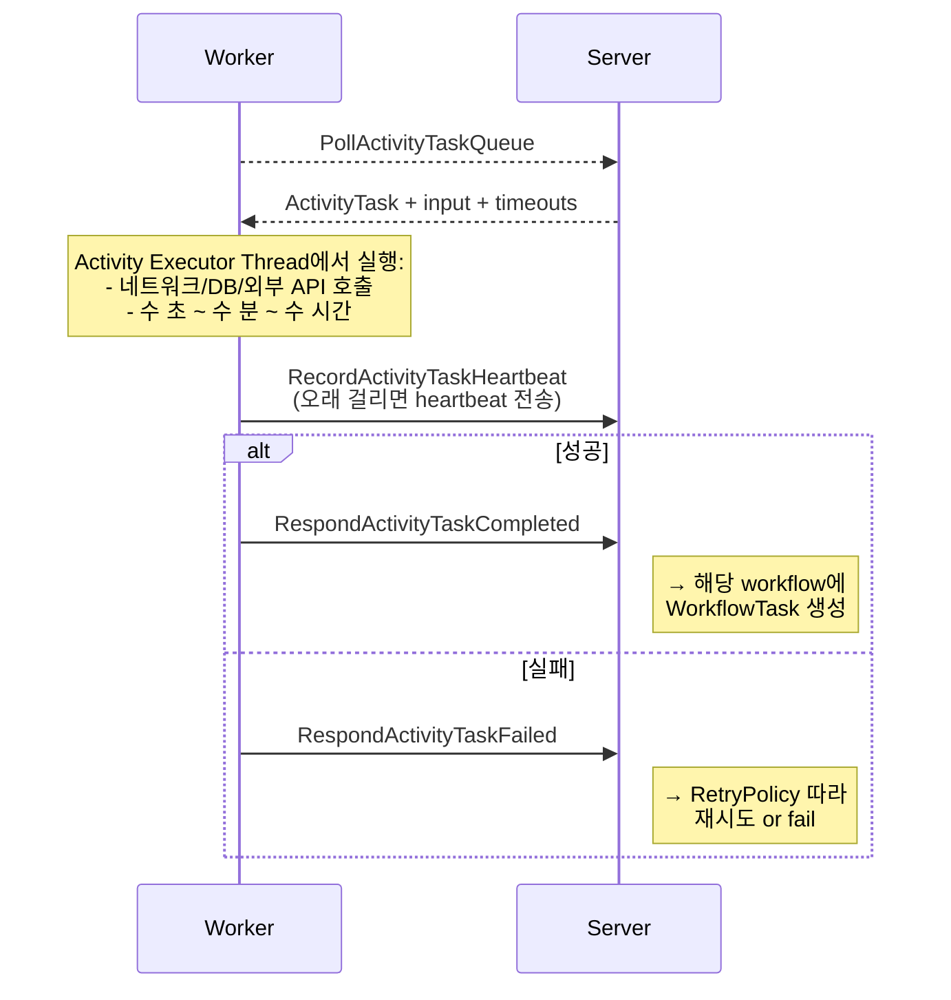

| | Workflow Task | Activity Task |
|---|---|---|
| 처리 시간 | 짧음 (수십 ms) | 길 수 있음 (수 분~시간) |
| 내용 | 결정(Command)만 | 실제 외부 I/O |
| Sticky 적용 | ✓ (상태 캐시) | ✗ (완전 분산) |
| 받는 worker | sticky 걸린 worker 우선 | 아무 free worker |

### 4.5-6. Sticky vs Normal — Poller가 두 세트

Sticky가 걸린 worker는 polling도 두 큐에 동시에 (큐 구조는 §6-1 참고).

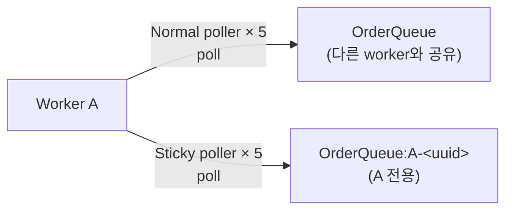

- `MaxConcurrentWorkflowTaskPollers=5` **하나로 양쪽 모두 적용** → 실제 스레드는 **10개**.
- Sticky poll이 받으면 → cache hit → full replay 생략 → 수 ms.
- Normal poll이 받으면 → cache miss → full replay → 이후 sticky 전환 (상세는 §6-2).

### 4.5-7. Backpressure — "poll을 안 거는 방식"으로 자연 발생

Executor slot이 꽉 차면 poller가 다음 poll을 걸지 않는다. 서버 입장에선 "이 worker는 지금 안 받네" → 다른 worker에게 라우팅. **명시적 "거절 응답" 같은 게 없다** — poll을 안 거는 것 자체가 신호.

관찰 지표:
- `temporal_worker_task_slots_available{worker_type="WorkflowWorker"}` — 남은 slot
- `temporal_workflow_task_schedule_to_start_latency` — poll 받기까지 걸린 시간. 커지면 polling 부족 / scale out 필요
- `temporal_sticky_cache_size` — 캐시 사용량

### 4.5-8. gRPC Keep-alive / 네트워크 중간 장비

Long poll은 **TCP 연결을 오래 열어둠**. 중간 네트워크 장비(LB, NAT, 사내 proxy)가 idle timeout으로 끊어버리면 polling이 깨짐.

| 장비 | 기본 idle timeout | 60s long-poll OK? |
|---|---|---|
| AWS NLB | 350s | ✓ |
| GCP LB | 10분 | ✓ |
| 사내 proxy | 30초로 세팅된 경우 종종 있음 | ✗ → **90s 이상으로 조정** 필요 |

SDK 쪽 기본값:
- `WorkflowServiceStubsOptions.setRpcLongPollTimeout(70s)` — 서버 60s hold보다 여유
- gRPC keep-alive ping 주기 설정 가능 — 장비 idle timer를 리셋해 조기 cutoff 방지

### 4.5-9. Graceful Shutdown과 Long-poll

§5의 shutdown hook과 연결:

```java
factory.shutdown();                             // ①
factory.awaitTermination(30, TimeUnit.SECONDS); // ②
```

**①** 호출 시:
- **진행 중인 long-poll gRPC는 즉시 CANCELLED** → 60초 hold가 자연 종료되길 기다리지 않음
- 새 poll 안 걸림
- **이미 받아서 실행 중인 workflow/activity task는 계속 진행**

**②** 대기 동안:
- 실행 중인 task 완료 대기
- Sticky queue에 쌓이는 신규 task는 받을 사람이 없어 **sticky timeout 후 서버가 자동으로 normal queue로 재발행** → 다른 pod가 받음 (§6-6 참고)

**타임아웃 4종 일관성** (K8s rolling update 시 필수):

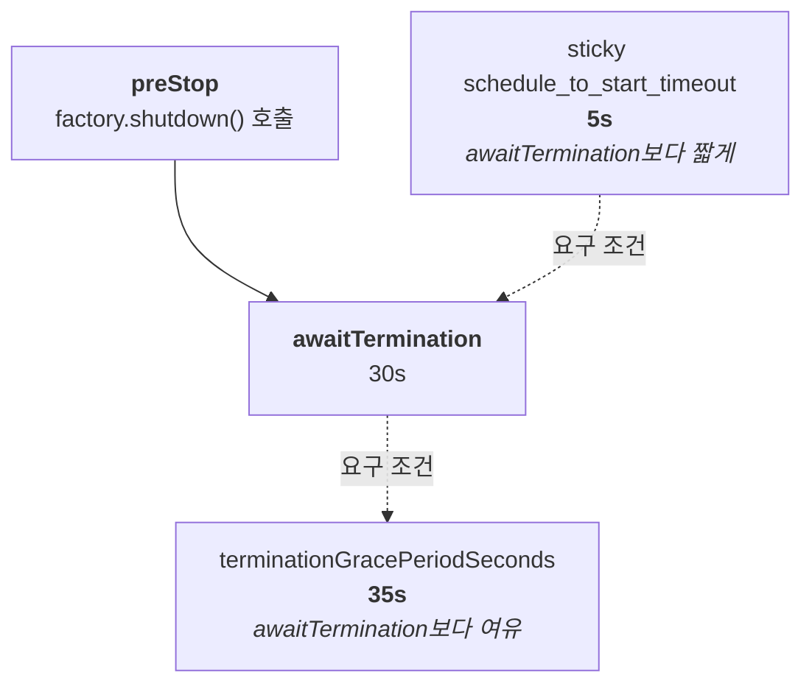

Sticky timeout이 awaitTermination보다 짧아야 "내가 아직 진행 중인 task"와 "서버가 다른 pod로 재발행하는 task"가 깨끗하게 분리된다.

---

## 5. K8s에서 Worker = Pod

**1 Pod = 1 JVM = 1 Worker 프로세스**가 전형. Pod 3개 = Worker 3개.

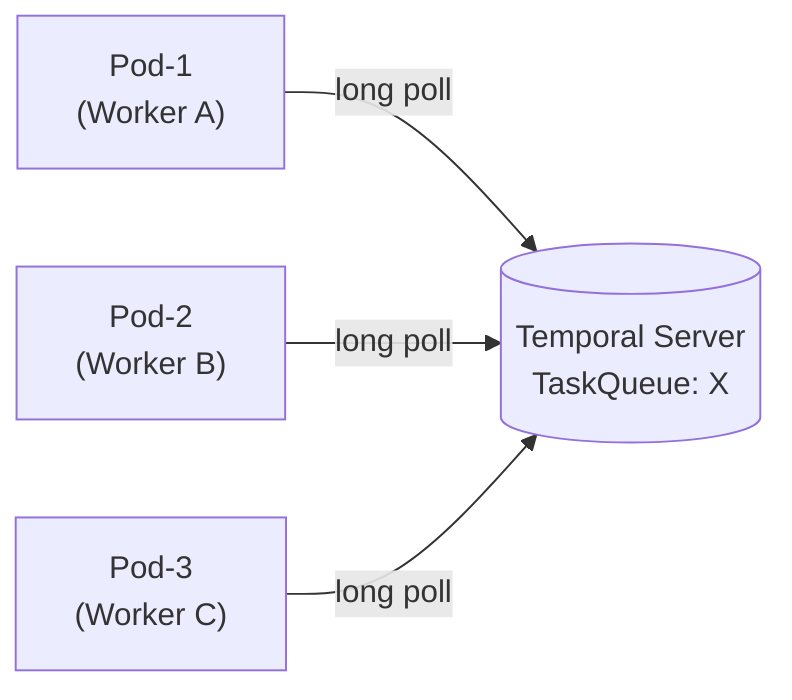

K8s에서 좋은 점:
- **Stateless scaling** — Workflow 상태는 서버 event history에 있음. Pod 죽어도 다른 pod가 replay로 이어받음 → HPA 자유롭게 적용 가능
- **Rolling update 안전** — 교체 중 pod가 들고 있던 task는 sticky timeout 후 fallback → 다른 pod가 받음 → 지연은 발생해도 손실은 없음
- **Pod는 cattle** — 죽여도, 늘려도, 교체해도 OK

Graceful shutdown 필수:
```java
Runtime.getRuntime().addShutdownHook(new Thread(() -> {
    factory.shutdown();                                   // 새 task 안 받음
    factory.awaitTermination(30, TimeUnit.SECONDS);       // 진행 중 마무리
}));
```
K8s `preStop` hook + `terminationGracePeriodSeconds` 와 맞춰야 함.

---

## 6. Sticky Queue — Replay 비용 최적화 캐시

**왜 필요한가:**
Workflow는 **event history 재생**으로 상태를 복원한다. Event 100개가 쌓인 workflow에서 매 task마다 처음부터 100개를 재생하면 비싸다. → "같은 workflow instance는 **처음 받은 worker가 메모리에 들고 있자**" = Sticky Queue.

### 6-1. 메커니즘 — 두 종류의 Queue

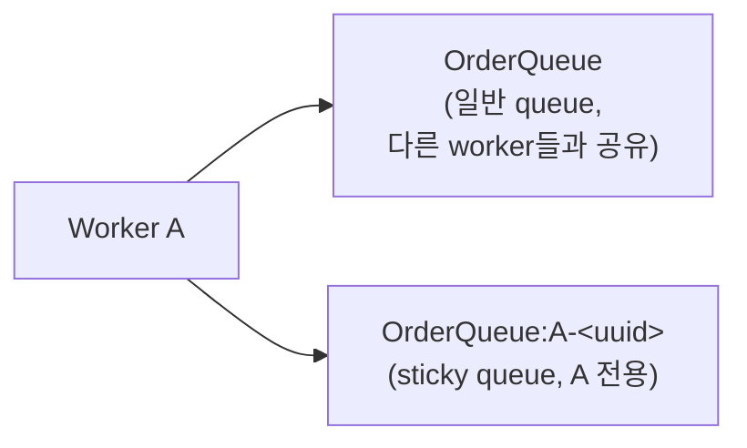

Sticky queue 이름은 worker가 생성한 unique ID. 다른 worker는 모름.

### 6-2. 생명주기

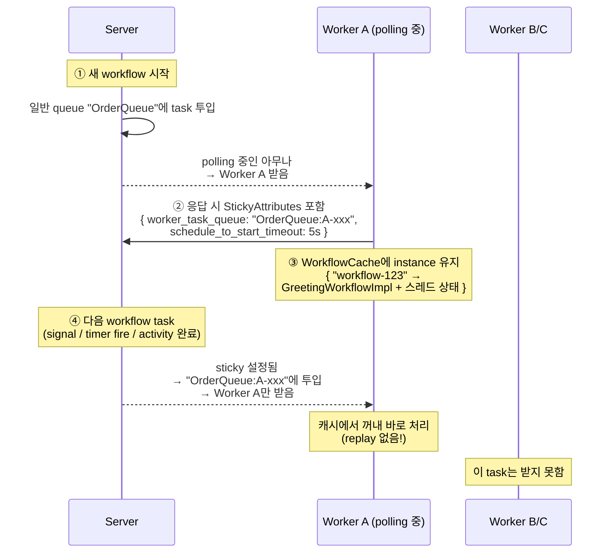

캐시 hit 시 **마지막 처리 event 이후의 신규 event만** 재생. 전체 history 재생 불필요.

### 6-3. Fallback — Sticky가 깨지는 경우

| Case | 흐름 |
|---|---|
| **Worker A가 바쁘거나 죽음** | 5초(sticky timeout) 안에 안 가져감 → 서버가 자동으로 일반 queue 재발행 → B/C 중 하나가 받음 → cache 없으니 **full replay** → 이후 sticky가 받은 worker로 전환 |
| **캐시 가득 참** | `WorkflowCacheSize` 초과 시 LRU evict → 다음 task 때 cache miss → replay |
| **코드 non-determinism 감지** | Replay 중 결정성 깨짐 → workflow task failure → 재시도 → 캐시에서 쫓겨남 |

→ Sticky가 깨져도 **정확성에는 영향 없음, 성능만 떨어짐**.

### 6-4. 설정값

```java
// WorkerFactoryOptions (JVM 당 1개)
WorkerFactoryOptions.newBuilder()
    .setWorkflowCacheSize(600)                           // sticky 캐시 크기 (worker 전체 공유)
    .setMaxWorkflowThreadCount(600)                      // workflow 실행 스레드 풀
    .setWorkflowHostLocalTaskQueueScheduleToStartTimeout(
        Duration.ofSeconds(5))                           // sticky timeout
    .build();

// WorkerOptions (Worker 당)
WorkerOptions.newBuilder()
    .setMaxConcurrentWorkflowTaskExecutionSize(200)      // 동시 workflow task slot
    .setMaxConcurrentWorkflowTaskPollers(5)              // sticky+normal 각각의 poller 수
    .build();
```

**Trade-off:**

| 설정 | 올리면 | 내리면 |
|---|---|---|
| `WorkflowCacheSize` | Cache hit률 ↑, 메모리 ↑ | 메모리 ↓, replay 빈도 ↑ |
| `StickyScheduleToStartTimeout` | Sticky 유지률 ↑, 장애 시 지연 ↑ | 빠른 fallback, cache 효용 ↓ |

### 6-5. 관찰 지표

- `workflow_task_schedule_to_start_latency` — sticky는 ms, 일반 queue는 더 김
- `sticky_cache_hit` / `sticky_cache_miss` — 캐시 효율
- `sticky_cache_total_forced_eviction` — 캐시 밀려 쫓겨난 수. 급증 시 `WorkflowCacheSize` 키우거나 worker scale out 필요

### 6-6. K8s Rolling Update와의 상호작용

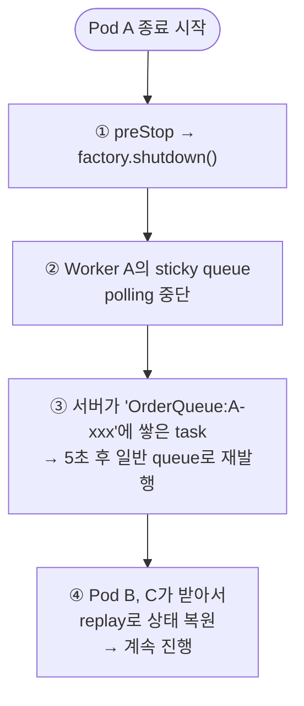

Sticky timeout이 **너무 길면 rolling update 지연 ↑**, **너무 짧으면 평시 cache miss ↑**.

---

## 7. 그림 요약

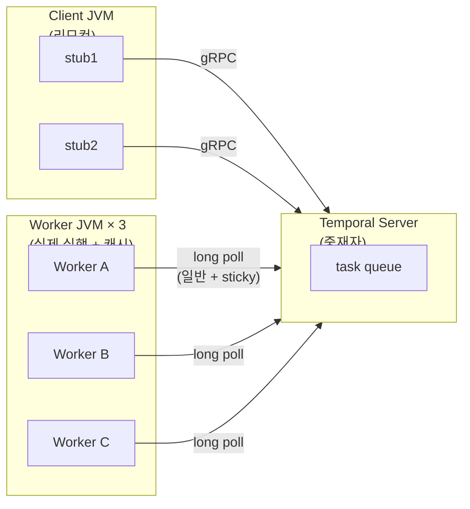

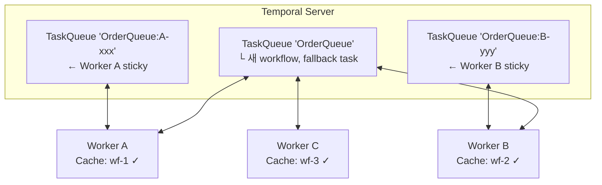

---

## 요약

- **Stub = 리모컨**, 스레드 없음. 같은 WORKFLOW_ID → 서버에 **단 하나의** execution
- **다른 WORKFLOW_ID → 독립 execution**, 상태/history/signal 모두 분리. 리소스(worker, 스레드, 커넥션)만 공유
- **Worker 분산**: pull 기반 long poll. Activity는 완전 분산, Workflow는 sticky
- **Sticky Queue** = worker별 private task queue + in-memory cache. Replay 비용 제거
- **K8s**: Pod ≈ Worker. HPA/Rolling update 안전. Graceful shutdown 필수
- Sticky가 깨져도 정확성은 유지됨 (성능만 저하)

---

## 관련 토픽

- [01 Client/Worker 셋업](01-setup.md) — `WorkerFactoryOptions` / `WorkerOptions` 상세
- [12 gRPC Retry](12-grpc-retry.md) — 전송 계층 재시도 (상호 보완 관계)
- [06 메시징](06-messaging.md) — Signal/Query/Update 메커니즘
