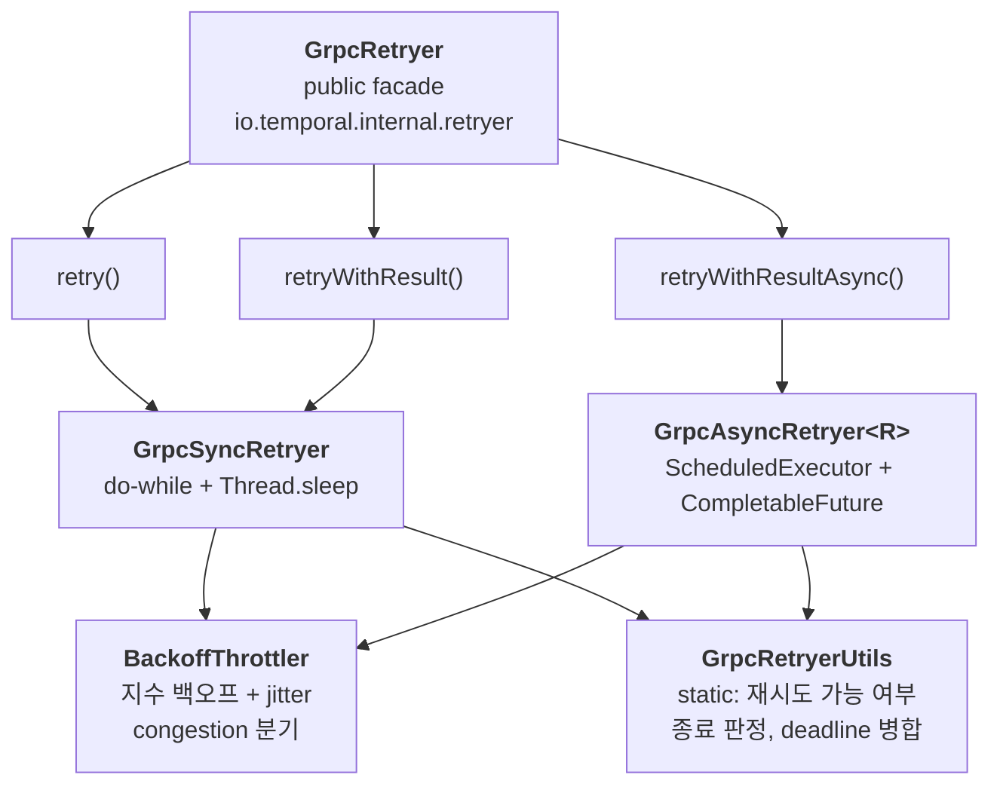
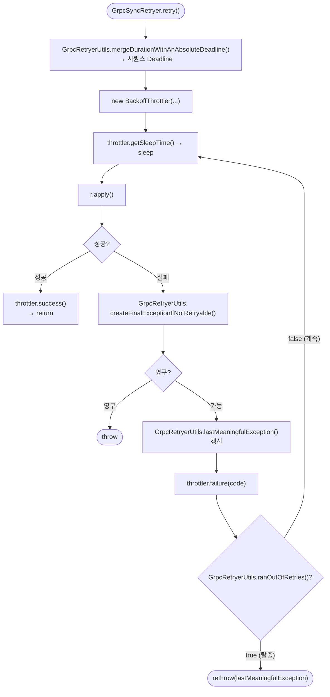
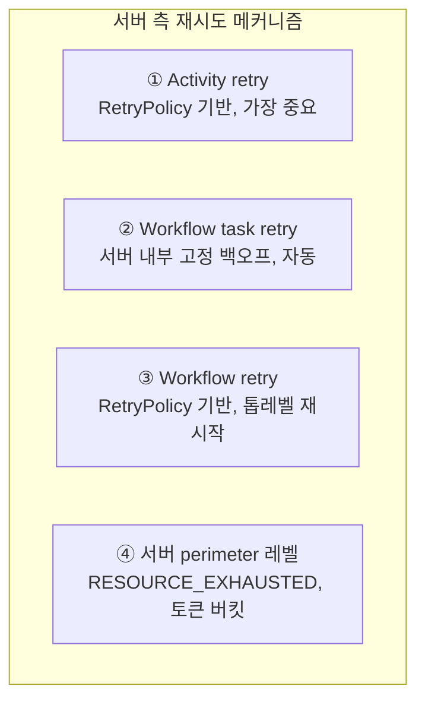
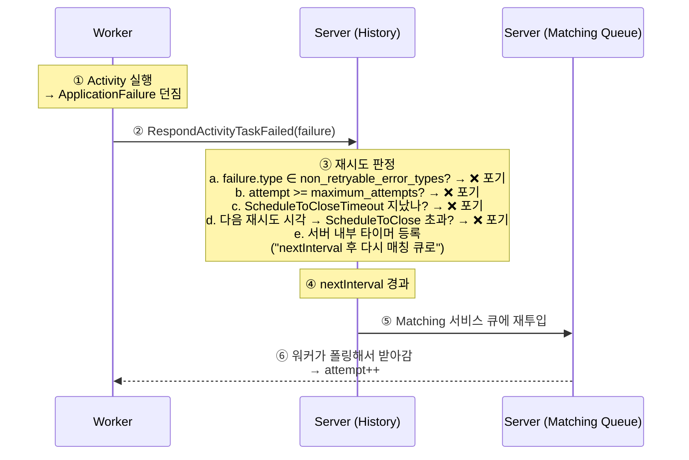

# gRPC Retry — 전송 계층 재시도

[← 색인으로 돌아가기](../temporal-client-worker-flow.md)

Temporal의 "retry"는 **두 겹의 완전히 다른 메커니즘**이다:

1. **클라이언트 gRPC 재시도** (`GrpcRetryer`) — 네트워크/서버 혼잡 흡수. 짧고 메모리에 상주, 프로세스 종료 시 유실.
2. **서버 측 RetryPolicy** — Activity/Workflow 실패를 지속성 있게 재실행. 길고 영속, 워커 재시작에도 생존.

Activity의 `RetryOptions`([03 Activity 옵션](03-activity.md))가 (2) 서버 측 재시도의 사용자 노출 API라면, 이 문서는 (1) **transport 수준의 자동 재시도**가 어떻게 동작하는지 다룬다. SDK 사용자는 거의 신경 쓸 일이 없지만, 운영 중 `temporal_request_failure` 가 튀거나 호출이 지연될 때 진단에 필요하다.

---

## 1. 핵심 클래스 구성



**분리 원칙 (policy / mechanism / coordination):**

- `BackoffThrottler` = **메커니즘**(얼마나 쉴지)
- `GrpcRetryerUtils` = **정책**(계속할지, 어떤 예외로 끝낼지)
- `GrpcSyncRetryer` / `GrpcAsyncRetryer` = **조정자**

두 보조 클래스는 서로를 **직접 참조하지 않음** — Sync/Async가 공유하는 공통 결정 로직이라 자연스럽게 일관성 보장. 공유하는 유일한 정보는 "실패한 gRPC `Status.Code`" 하나뿐.

---

## 2. GrpcRetryer — 공개 진입점 (facade)

```java
public final class GrpcRetryer {
  private final Supplier<GetSystemInfoResponse.Capabilities> serverCapabilities;

  public interface RetryableProc<E extends Throwable> { void apply() throws E; }
  public interface RetryableFunc<R, E extends Throwable> { R apply() throws E; }

  public GrpcRetryer(Supplier<Capabilities> serverCapabilities) { ... }

  public <T extends Throwable> void retry(RetryableProc<T> r, GrpcRetryerOptions options) throws T {
    retryWithResult(() -> { r.apply(); return null; }, options);
  }

  public <R, T extends Throwable> R retryWithResult(RetryableFunc<R, T> r, GrpcRetryerOptions options) throws T {
    return new GrpcSyncRetryer().retry(r, options, serverCapabilities.get());
  }

  public <R> CompletableFuture<R> retryWithResultAsync(
      ScheduledExecutorService asyncThrottlerExecutor,
      Supplier<CompletableFuture<R>> function,
      GrpcRetryerOptions options) {
    return new GrpcAsyncRetryer<>(asyncThrottlerExecutor, function, options, serverCapabilities.get()).retry();
  }

  public static class GrpcRetryerOptions {
    public void validate() {
      options.validate(false);
      Preconditions.checkState(
          options.getMaximumInterval() != null
              || options.getMaximumAttempts() > 0
              || deadline != null,
          "configuration of the retries has to be finite");
    }
  }
}
```

**역할:**
- **파사드** — Sync/Async 두 구현을 뒤에 숨기고 세 가지 API 제공
- **capability 보관** — `Supplier<Capabilities>`로 받음. 매 호출 시 `.get()`을 돌려서 최신값 (서버 재접속 후 바뀌어도 반영)
- **lambda-friendly** — `RetryableProc`/`RetryableFunc`는 `<E extends Throwable>`로 선언 → 체크 예외도 던질 수 있는 람다 허용
- **상태 미보유** — 매 호출마다 `new GrpcSyncRetryer()` / `new GrpcAsyncRetryer<>()` 로 1회성 인스턴스. `GrpcRetryer` 자체는 재사용 가능 (thread-safe)

**세 API 선택 규칙:**

| 메서드 | 반환 | 쓰임새 |
|---|---|---|
| `retry(RetryableProc, opts)` | `void` | 응답 안 쓰는 fire-and-forget RPC (cancel, terminate) |
| `retryWithResult(RetryableFunc, opts)` | `R` | 응답이 필요한 일반 동기 RPC |
| `retryWithResultAsync(executor, Supplier<CF>, opts)` | `CompletableFuture<R>` | long poll / async 체인 — 호출 스레드를 블록하지 않음 |

`retry()`는 사실 `retryWithResult()`를 `return null`로 감싸는 shim.

**`GrpcRetryerOptions.validate()`** — "max interval / max attempts / deadline" OR 조건으로 하나라도 있어야 통과. 무한 재시도 설정 실수를 생성 시점에 차단.

---

## 3. GrpcSyncRetryer — 동기 do-while 루프

```java
public <R, T extends Throwable> R retry(
    RetryableFunc<R, T> r, GrpcRetryerOptions options, Capabilities serverCapabilities) throws T {
  options.validate();
  RpcRetryOptions rpcOptions = options.getOptions();
  Deadline retriesExpirationDeadline =
      GrpcRetryerUtils.mergeDurationWithAnAbsoluteDeadline(rpcOptions.getExpiration(), options.getDeadline());
  BackoffThrottler throttler = new BackoffThrottler(
      rpcOptions.getInitialInterval(),
      rpcOptions.getCongestionInitialInterval(),
      rpcOptions.getMaximumInterval(),
      rpcOptions.getBackoffCoefficient(),
      rpcOptions.getMaximumJitterCoefficient());

  int attempt = 0;
  StatusRuntimeException lastMeaningfulException = null;
  do {
    attempt++;
    try {
      long throttleMs = throttler.getSleepTime();
      if (throttleMs > 0) Thread.sleep(throttleMs);
      R result = r.apply();
      throttler.success();
      return result;
    } catch (InterruptedException e) {
      Thread.currentThread().interrupt();
      throw new CancellationException();
    } catch (StatusRuntimeException e) {
      RuntimeException finalException =
          GrpcRetryerUtils.createFinalExceptionIfNotRetryable(e, rpcOptions, serverCapabilities);
      if (finalException != null) throw finalException;
      lastMeaningfulException = GrpcRetryerUtils.lastMeaningfulException(e, lastMeaningfulException);
      throttler.failure(e.getStatus().getCode());
    }
  } while (!GrpcRetryerUtils.ranOutOfRetries(
      rpcOptions, attempt, retriesExpirationDeadline, Context.current().getDeadline()));

  rethrow(lastMeaningfulException);
  throw new IllegalStateException("unreachable");
}
```

**단계별 흐름:**

1. **초기화** — `expiration + deadline` 병합, `BackoffThrottler` 생성
2. **sleep (백오프)** — 첫 시도(attempt=1)에서는 0ms, 이후만 지수 백오프 대기
3. **성공 경로** — `throttler.success()` (상태 리셋) → 즉시 반환
4. **`InterruptedException`** — 쓰레드 interrupt 재설정 + `CancellationException`으로 변환 (재시도 안 함)
5. **`StatusRuntimeException`** — `GrpcRetryerUtils.createFinalExceptionIfNotRetryable()`로 재시도 가능/영구 판정
   - 영구 → throw
   - 가능 → `lastMeaningfulException` 갱신, `throttler.failure(code)` 호출
6. **종료 조건** — `ranOutOfRetries()`가 세 가지 중 하나라도 참이면 탈출
7. **최종 throw** — "가장 의미 있는" 예외를 `rethrow()`로 던짐 (제네릭 소거 트릭)

**설계 포인트:** `StatusRuntimeException` 이외 예외는 catch하지 않고 그대로 전파. **gRPC 전용 retryer**이기 때문.

---

## 4. GrpcAsyncRetryer — 비동기 콜백 체인

```java
class GrpcAsyncRetryer<R> {
  private final ScheduledExecutorService executor;
  private final BackoffThrottler throttler;
  private final Deadline retriesExpirationDeadline;
  private StatusRuntimeException lastMeaningfulException = null;

  public CompletableFuture<R> retry() {
    CompletableFuture<R> resultCF = new CompletableFuture<>();
    retry(resultCF);
    return resultCF;
  }

  private void retry(CompletableFuture<R> resultCF) {
    CompletableFuture<Void> throttleFuture = new CompletableFuture<>();
    executor.schedule(
        Context.current().wrap(() -> throttleFuture.complete(null)),
        throttler.getSleepTime(),
        TimeUnit.MILLISECONDS);

    throttleFuture.thenAccept((ignore) -> {
      try {
        CompletableFuture<R> result = function.get();
        result.whenComplete((r, e) -> {
          if (e == null) { throttler.success(); resultCF.complete(r); }
          else {
            throttler.failure(code(e));
            failOrRetry(e, resultCF);
          }
        });
      } catch (Throwable e) {
        throttler.failure(code(e));
        failOrRetry(e, resultCF);
      }
    });
  }

  private void failOrRetry(Throwable currentException, CompletableFuture<R> resultCF) {
    currentException = unwrapCompletionException(currentException);
    if (!(currentException instanceof StatusRuntimeException)) {
      resultCF.completeExceptionally(currentException);
      return;
    }
    StatusRuntimeException sre = (StatusRuntimeException) currentException;
    RuntimeException finalException = GrpcRetryerUtils.createFinalExceptionIfNotRetryable(sre, ...);
    if (finalException != null) { resultCF.completeExceptionally(finalException); return; }
    this.lastMeaningfulException = GrpcRetryerUtils.lastMeaningfulException(sre, lastMeaningfulException);
    if (GrpcRetryerUtils.ranOutOfRetries(..., throttler.getAttemptCount(), ...)) {
      resultCF.completeExceptionally(lastMeaningfulException);
    } else {
      retry(resultCF);  // trampoline — 재귀 아님
    }
  }

  private static Throwable unwrapCompletionException(Throwable e) {
    return e instanceof CompletionException ? e.getCause() : e;
  }
}
```

**Sync와의 결정적 차이:**

1. **`Thread.sleep` → `executor.schedule(...)`** — 백오프 중 스레드를 묶지 않음
2. **`Context.current().wrap(...)`** — gRPC Context(deadline, cancellation signal)를 비동기 스레드 경계 넘어 전파. Sync는 같은 스레드라 자동
3. **`unwrapCompletionException`** — `CompletableFuture` 체인에서 예외가 `CompletionException`으로 자동 포장되는 함정 해결
4. **재귀가 아닌 trampoline** — `retry()`가 자기 자신 호출하지만 사이에 스케줄러를 거치면서 **스택이 unwind**됨. 수백 회 재시도해도 StackOverflow 없음
5. **예외 폭이 더 넓음** — Sync는 `catch(StatusRuntimeException)`만, Async는 임의 `Throwable` 수용 → `code` 추출 시 `UNKNOWN` fallback

**숨은 함정:** `executor.schedule(...)`이 반환한 `ScheduledFuture`를 `ignored`로 버림. 바깥에서 `resultCF.cancel(true)` 호출해도 **이미 스케줄된 백오프 타이머는 발화**함.

---

## 5. Sync vs Async 비교

| 측면 | GrpcSyncRetryer | GrpcAsyncRetryer |
|---|---|---|
| 수명 | 메서드 1회 호출 | 인스턴스 1회 재시도 세션 |
| 상태 위치 | 지역 변수 | 필드 |
| attempt 카운터 | 지역 `int attempt` | `throttler.getAttemptCount()` |
| 흐름 제어 | `do-while` | 콜백 체인 + 재귀 호출 |
| 백오프 대기 | `Thread.sleep(ms)` | `executor.schedule(ms)` |
| 스레드 | 호출자 스레드 블록킹 | ScheduledExecutor + 콜백 |
| gRPC Context 전파 | 자동 (같은 스레드) | `Context.current().wrap()` |
| `CompletionException` | 해당 없음 | unwrap 필요 |
| 반환 | `R` (또는 throw `T`) | `CompletableFuture<R>` |

---

## 6. BackoffThrottler — 백오프 공식과 상태

```java
public final class BackoffThrottler {  // @NotThreadSafe
  private int failureCount = 0;
  private Status.Code lastFailureCode = Code.OK;

  public long getSleepTime() {
    if (failureCount == 0) return 0;
    Duration initial = (lastFailureCode == Code.RESOURCE_EXHAUSTED)
        ? congestionInitialSleep : regularInitialSleep;
    double jitter = Math.random() * maxJitterCoefficient * 2 - maxJitterCoefficient;
    double sleepMillis = Math.pow(backoffCoefficient, failureCount - 1) * initial.toMillis() * (1 + jitter);
    return maxSleep != null ? Math.min((long) sleepMillis, maxSleep.toMillis()) : (long) sleepMillis;
  }

  public void success() { failureCount = 0; lastFailureCode = Code.OK; }
  public void failure(Status.Code code) { failureCount++; lastFailureCode = code; }
}
```

**공식:**
```
sleep = min( backoffCoefficient^(failureCount-1) × initial × (1 + jitter),  maxSleep )
```

- **첫 호출** (`failureCount == 0`) → **0 반환**. Retryer의 `do-while` 첫 attempt를 즉시 실행 가능하게 함
- **지수 성장** — 실패 1회 후 `initial × (1+jitter)`, 2회 후 `×backoff`, ...
- **Jitter** — `Math.random() ∈ [0,1)` → `jitter ∈ [-maxJitter, +maxJitter)`. 평균값 유지, 분산만 추가 (thundering herd 방지)
- **상한** — `maxSleep` 설정 시 clamp
- **상태 리셋 vs 증가** — `success()`로 완전 리셋, `failure(code)`로 카운터++ 및 code 저장

**Congestion 분기 (의도된 특성):**
> attempt X can possibly get a shorter throttle than attempt X-1, if a non-congestion failure occurs after a congestion failure.

즉 "서버 과부하 → 일반 오류" 전환 시 다음 sleep이 오히려 **짧아질 수 있음**. Congestion 신호가 사라지면 공격적 백오프 유지 불필요.

**숫자 궤적 (일반 서비스 기본값):**

| 실패횟수 | 지수부 | 기대 sleep (jitter 전) |
|---|---|---|
| 1 | 1.7⁰ = 1.00 | 100ms |
| 2 | 1.7¹ = 1.70 | 170ms |
| 3 | 1.7² = 2.89 | 289ms |
| 4 | 1.7³ = 4.91 | 491ms |
| 5 | 1.7⁴ = 8.35 | 835ms |
| 6 | 1.7⁵ = 14.20 | 1420ms |
| 7 | 1.7⁶ = 24.14 | 2414ms |
| 8 | 1.7⁷ = 41.03 | 4103ms |
| 9+ | | 5000ms (상한 clamp) |

---

## 7. GrpcRetryerUtils — 재시도 정책 결정기

static 유틸리티 4개. 상태 없음.

### 7-1. `createFinalExceptionIfNotRetryable(e, options, serverCapabilities)`

반환값 규약:
- `null` → 재시도 가능, 루프 계속
- 뭔가 리턴 → 이걸 throw, 끝

판정 테이블:

| Status.Code | 처리 |
|---|---|
| `CANCELLED` | `CancellationException`으로 변환 후 throw |
| `INVALID_ARGUMENT`, `NOT_FOUND`, `ALREADY_EXISTS`, `FAILED_PRECONDITION`, `PERMISSION_DENIED`, `UNAUTHENTICATED`, `UNIMPLEMENTED` | 영구 오류 → throw |
| `INTERNAL` | 서버가 `internalErrorDifferentiation=true`면 throw, 아니면 재시도 (구버전 서버 호환) |
| `DEADLINE_EXCEEDED` | **재시도** (attempt 단위 데드라인으로 해석) |
| `RESOURCE_EXHAUSTED` | 메시지 크기 초과(`GrpcMessageTooLargeException`)면 throw, 아니면 congestion backoff로 재시도 |
| default | `RpcRetryOptions.doNotRetry` 리스트 매칭 시 throw. `(code, 선택적 detail class)` 쌍으로 세밀 지정 가능 |

**디자인 결정 두 가지:**
- gRPC 세계 관례와 다름 — go-grpc-middleware는 `DEADLINE_EXCEEDED` 재시도 안 하지만 Temporal은 "한 번의 호출이 느렸을 뿐"로 간주
- `CANCELLED` → `CancellationException` 변환 — 사용자가 Java 표준으로 catch 가능

### 7-2. `lastMeaningfulException(current, previous)`

```java
if (previousException != null
    && currentException.getStatus().getCode() == DEADLINE_EXCEEDED
    && previousException.getStatus().getCode() != DEADLINE_EXCEEDED) {
  return previousException;
}
return currentException;
```

재시도가 길어지면 결국 `DEADLINE_EXCEEDED`로 끝나는 경우가 많은데, 디버깅 입장에선 **"왜 재시도 지경까지 갔는지"**가 더 중요. 그래서 "DEADLINE 이 아닌 **의미 있는** 마지막 예외"를 보존.

### 7-3. `ranOutOfRetries(options, attempt, retriesExpirationDeadline, grpcContextDeadline)`

세 OR 조건:
- `maxAttempts > 0 && attempt >= maxAttempts` — 횟수 소진
- `retriesExpirationDeadline.isExpired()` — 전체 시퀀스 데드라인 만료
- `grpcContextDeadline.isExpired()` — gRPC Context 데드라인 만료 (상위 호출자가 심어둔 것)

세 번째가 특히 중요 — 상위 코드의 `Context.withDeadline(...)`을 자동 상속.

### 7-4. `mergeDurationWithAnAbsoluteDeadline(duration, deadline)`

```java
Deadline durationDeadline = null;
if (duration != null) {
  long ms = duration.toMillis();
  durationDeadline = (ms > 0) ? Deadline.after(ms, MILLISECONDS)
                               : Deadline.after(duration.toNanos(), NANOSECONDS);
}
return (deadline != null && durationDeadline != null)
    ? deadline.minimum(durationDeadline)
    : (deadline != null ? deadline : durationDeadline);
```

- **ms vs ns 분기** — Duration이 1ms 미만이면 `toMillis()`가 0으로 떨어져 즉시 만료 → ns 로 재계산
- **`deadline.minimum(...)`** — 둘 중 더 빨리 만료되는 쪽. 가장 엄격한 데드라인 승리

---

## 8. 호출 관계 (요약 시퀀스)



---

## 9. RpcRetryOptions — 기본값과 검증

두 세트의 디폴트가 선언돼 있음:

### 9-1. `DefaultStubServiceOperationRpcRetryOptions` — 일반 서비스 호출

| 상수 | 값 | 의미 |
|---|---|---|
| `INITIAL_INTERVAL` | `Duration.ofMillis(100)` | 첫 재시도 대기 시작점 |
| `CONGESTION_INITIAL_INTERVAL` | `Duration.ofMillis(1000)` | `RESOURCE_EXHAUSTED` 때 시작점 (일반의 10배) |
| `EXPIRATION_INTERVAL` | `Duration.ofMinutes(1)` | 전체 시퀀스 60초 안에 끝내라 |
| `BACKOFF` | `1.7` | 지수부 |
| `MAXIMUM_INTERVAL_MULTIPLIER` | `50` | `maxInterval` 미지정 시 initial × 50 (= 5초) |
| `MAXIMUM_JITTER_COEFFICIENT` | `0.2` | ±20% 흔들림 |

### 9-2. `DefaultStubLongPollRpcRetryOptions` — Long poll 전용

```java
public static final Duration INITIAL_INTERVAL = Duration.ofMillis(200);
public static final Duration CONGESTION_INITIAL_INTERVAL = Duration.ofMillis(1000);
public static final Duration MAXIMUM_INTERVAL = Duration.ofSeconds(10);
public static final double BACKOFF = 2.0;
public static final double MAXIMUM_JITTER_COEFFICIENT = 0.2;

// partial build because expiration is not set,
// long polls work with absolute deadlines instead
public static final RpcRetryOptions INSTANCE = getBuilder().build();
static { INSTANCE.validate(false); }  // ← finite 검증 완화
```

**세 가지 핵심 차이:**
1. **`expiration` 없음** — 종료는 호출측 absolute `Deadline`이 담당. `validate(false)`로 유한성 검증 완화
2. **`BACKOFF = 2.0`** — 일반 호출(1.7)보다 공격적. Long poll은 서버가 바로 응답 못 주는 게 정상이라 더 성큼성큼
3. **`MAXIMUM_INTERVAL = 10초`** — 일반(5초)의 2배

**비교:**

| 설정 | 일반 서비스 | Long poll |
|---|---|---|
| INITIAL | 100ms | 200ms |
| CONGESTION_INIT | 1000ms | 1000ms |
| BACKOFF | **1.7** | **2.0** |
| MAX_INTERVAL | initial × 50 (=5s) | 10s |
| EXPIRATION | 1분 | **없음** |
| JITTER | ±20% | ±20% |

**`backoff = 1.7`인 이유:** 2.0이면 10회 안에 상한 도달. 1.7로 완만하게 늘려서 1분 안에 더 많은 attempt 가능.

### 9-3. `validateBuildWithDefaults()` — Builder → 안전한 값 채움

```java
public RpcRetryOptions validateBuildWithDefaults() {
  if (backoffCoefficient < 1) backoffCoefficient = BACKOFF;
  if (initialInterval == null) initialInterval = INITIAL_INTERVAL;
  if (congestionInitialInterval == null) congestionInitialInterval = CONGESTION_INITIAL_INTERVAL;
  if (expiration == null) expiration = EXPIRATION_INTERVAL;
  if (maximumInterval == null && maximumAttempts == 0) {
    maximumInterval = initialInterval.multipliedBy(MAXIMUM_INTERVAL_MULTIPLIER);
  }
  if (maximumJitterCoefficient < 0) maximumJitterCoefficient = MAXIMUM_JITTER_COEFFICIENT;
  result.validate();  // 유한성 재확인
  return result;
}
```

- `backoffCoefficient < 1` — 미설정(0) 또는 잘못 설정(음수)을 똑같이 fallback
- `maximumInterval` lazy 계산 — `initial × 50`은 `maxAttempts == 0`일 때만 적용 (횟수 제한 있으면 상한 없이도 안전)

### 9-4. `validate(boolean hasToBeFinite)` — 두 모드 검증

- `true` (일반) — `expiration` 또는 `maxAttempts` 중 하나는 **반드시** 있어야 함
- `false` (long poll) — 유한성 검증 완화. 호출측 absolute `Deadline`이 종료 보장

---

## 10. 영구 오류 (재시도 안 함)

§7-1 `createFinalExceptionIfNotRetryable()` 테이블 참조. 사용자가 바꿀 수 있는 건 default 그룹의 `doNotRetry` 리스트뿐. 내장 영구 오류 목록은 교체 불가.

---

## 11. 세 종류의 Deadline (중복이 아닌 역할 분리)

| 레벨 | 출처 | 체크 위치 |
|---|---|---|
| **전체 시퀀스** (상대 duration + 절대 deadline 병합) | `RpcRetryOptions.expiration` + `GrpcRetryerOptions.deadline` | `GrpcRetryerUtils.ranOutOfRetries` |
| **gRPC Context** | 상위 코드의 `Context.withDeadline(...)` | `GrpcRetryerUtils.ranOutOfRetries` |
| **단일 attempt** | gRPC call 자체의 deadline | 서버가 `DEADLINE_EXCEEDED`로 응답 → 재시도 결정 |

---

## 12. 실제 호출 지점

진입점은 공개돼 있지만 실제 호출 지점은 세 군데로 수렴:

### 12-1. `GenericWorkflowClientImpl` (`temporal-sdk`)

거의 모든 Workflow/Activity RPC. 생성자에서 1회 생성, ~50개 메서드가 공유.

```java
public GenericWorkflowClientImpl(WorkflowServiceStubs service, Scope metricsScope) {
  this.service = service;
  this.metricsScope = metricsScope;
  RpcRetryOptions rpcRetryOptions = RpcRetryOptions.newBuilder()
      .buildWithDefaultsFrom(service.getOptions().getRpcRetryOptions());
  this.grpcRetryer = new GrpcRetryer(service.getServerCapabilities());
  this.grpcRetryerOptions = new GrpcRetryer.GrpcRetryerOptions(rpcRetryOptions, null);
}
```

**호출 패턴 5가지:**

```java
// 1) 일반 응답 — 공유 옵션
return grpcRetryer.retryWithResult(
    () -> service.blockingStub().withOption(METRICS_TAGS_CALL_OPTIONS_KEY, scope)
            .startWorkflowExecution(request),
    grpcRetryerOptions);

// 2) void (명령형) — 공유 옵션
grpcRetryer.retry(
    () -> service.blockingStub().withOption(METRICS_TAGS_CALL_OPTIONS_KEY, metricsScope)
            .requestCancelWorkflowExecution(request),
    grpcRetryerOptions);

// 3) Sync long poll — 매번 새 deadline으로 옵션 생성
return grpcRetryer.retryWithResult(
    () -> service.blockingStub()
            .withOption(HISTORY_LONG_POLL_CALL_OPTIONS_KEY, true)
            .withDeadline(deadline)
            .getWorkflowExecutionHistory(request),
    new GrpcRetryer.GrpcRetryerOptions(DefaultStubLongPollRpcRetryOptions.INSTANCE, deadline));

// 4) Async long poll — ScheduledExecutor 주입
return grpcRetryer.retryWithResultAsync(
    asyncThrottlerExecutor,
    () -> toCompletableFuture(
        service.futureStub()
            .withOption(HISTORY_LONG_POLL_CALL_OPTIONS_KEY, true)
            .withDeadline(deadline)
            .getWorkflowExecutionHistory(request)),
    new GrpcRetryer.GrpcRetryerOptions(DefaultStubLongPollRpcRetryOptions.INSTANCE, deadline));
```

**세 축으로 요약:**
1. **응답 사용 여부** → `retryWithResult` vs `retry`
2. **동기/비동기** → `blockingStub` + `retry*` vs `futureStub` + `retryWithResultAsync`
3. **종료 기준** → 공유 옵션(`expiration=1분`) vs 매번 새 옵션(`deadline` 전달)

### 12-2. `ChannelManager.connect()`

헬스체크 1회성, `new GrpcRetryer(...)` 매번 생성:

```java
GrpcRetryerOptions grpcRetryerOptions = new GrpcRetryerOptions(
    RpcRetryOptions.newBuilder().setExpiration(timeout).validateBuildWithDefaults(), null);
new GrpcRetryer(getServerCapabilities())
    .retryWithResult(() -> this.healthCheck(healthCheckServiceName, null), grpcRetryerOptions);
```

### 12-3. `SystemInfoInterceptor.getServerCapabilitiesWithRetryOrThrow()`

capability 조회 (bootstrap). supplier로 `Capabilities::getDefaultInstance`를 넘김 — "capability를 조회하는 호출" 자체가 capability가 필요하므로 닭-달걀 회피:

```java
capabilities = new GrpcRetryer(Capabilities::getDefaultInstance)
    .retryWithResult(() -> getServerCapabilitiesOrThrow(channel, computedDeadline), grpcRetryerOptions);
```

---

## 13. Metrics — `GrpcMetricsInterceptor`

**결론:** `GrpcRetryer` / Sync / Async retryer 코드에는 **metrics 호출이 한 줄도 없음.** 대신 매 attempt가 gRPC 레이어의 `GrpcMetricsInterceptor`를 통과하면서 자동 계측됨. retry는 "같은 RPC를 N번 호출"하는 것뿐이므로, retry가 1번 돌 때마다 interceptor가 1건의 완결된 측정을 기록.

```java
// 매 attempt 마다 interceptCall → MetricsClientCall 생성
MetricsClientCall(...) {
  longPoll = LongPollUtil.isLongPoll(method, callOptions);
  if (longPoll) {
    metricsScope.counter(TEMPORAL_LONG_REQUEST).inc(1);
    sw = metricsScope.timer(TEMPORAL_LONG_REQUEST_LATENCY).start();
  } else {
    metricsScope.counter(TEMPORAL_REQUEST).inc(1);
    sw = metricsScope.timer(TEMPORAL_REQUEST_LATENCY).start();
  }
}

// 응답 종료 시
onClose(Status status, ...) {
  sw.stop();
  if (!status.isOk()) {
    Scope scope = metricsScope.tagged(STATUS_CODE_TAGS.get(status.getCode()));
    scope.counter(longPoll ? TEMPORAL_LONG_REQUEST_FAILURE : TEMPORAL_REQUEST_FAILURE).inc(1);
  }
}
```

**발행되는 지표 6종:**

- `temporal_request` / `temporal_long_request` — attempt 1건당 +1 (생성자에서)
- `temporal_request_failure` / `temporal_long_request_failure` — 실패 attempt에만 `{status_code=...}` 태그로 +1 (`onClose`에서)
- `temporal_request_latency` / `temporal_long_request_latency` — attempt 하나의 start ~ onClose 구간

**Tag:**
- `operation` — RPC 메서드 이름 (ex: `StartWorkflowExecution`)
- `status_code` — gRPC 상태 코드 (실패 시만)
- `namespace`, `task_queue`, `workflow_type` 등 — 호출측이 scope에 주입

**중요한 특성:**

- **"재시도 횟수" 자체는 별도 지표가 없음.** `request - failure = 성공`으로 유추. `temporal_request_failure{status_code=~"UNAVAILABLE|RESOURCE_EXHAUSTED"}` 급등이 재시도 폭풍 신호
- **백오프 sleep 시간은 timer 밖**이라 측정 안 됨. "retry 포함 체감 시간"은 metric으로 안 나옴
- **Long poll 지표가 별도** — polling 지연이 일반 RPC 지연으로 보이는 걸 방지
- Scope는 `METRICS_TAGS_CALL_OPTIONS_KEY` **CallOption 경로**로 흐름 (gRPC Context가 아님). 람다 캡처 → `withOption` → interceptor로 자연스럽게 모든 attempt가 같은 태그 공유
- **try/finally** — 사용자 interceptor가 터져도 metrics는 always-record

**Interceptor 입장에서는 "같은 호출의 재시도"와 "서로 다른 호출"을 구별하지 않음** — 둘 다 똑같이 1건의 ClientCall로 보임. 이 **의도된 무지(deliberate ignorance)**가 retry와 metrics가 결합 없이 공존하는 이유.

---

## 14. 서버 측 재시도 — RetryPolicy

지금까지는 **전송 계층(gRPC)**. 서버 측에는 전혀 다른 메커니즘이 존재:



### 14-1. Activity Retry — 가장 큰 그림

```proto
message RetryPolicy {
  Duration initial_interval             = 1;
  double   backoff_coefficient          = 2;
  Duration maximum_interval             = 3;
  int32    maximum_attempts             = 4;
  repeated string non_retryable_error_types = 5;
}
```

**서버 디폴트 (사용자 미설정 시):**
- initial_interval: 1초
- backoff_coefficient: 2.0
- maximum_interval: 100초 (initial × 100)
- maximum_attempts: 0 (무제한)
- non_retryable_error_types: []

→ "실패하면 1초 뒤 재시도, 2배씩 늘려서 최대 100초 간격, 영원히". 종료 보장은 **`ScheduleToCloseTimeout`**이 담당.

**서버 측 흐름:**



**핵심 특성:**
- **백오프 중 워커가 태스크를 점유하지 않음** — 서버가 타이머를 들고 있다가 때가 되면 다시 큐에 넣음. 워커 재시작/장애에도 생존. 이게 **durability**의 실체
- **모든 attempt가 history에 쌓이지 않음** — `ActivityTaskScheduled`는 하나. mutable state에 `attempt`, `last_failure` 등이 갱신
- **jitter 없음** — 서버는 수만 개 액티비티의 재시도를 배치 관리하므로 통계적으로 자연스럽게 분산

### 14-2. Workflow Task Retry — 서버 내부 자동 처리

Workflow task 실패 시 **RetryPolicy와 무관하게** 서버가 자동 재시도. 이유: 워크플로우 로직 자체는 결정적이어야 하므로 1회 실패는 "일시 장애"로 간주.

- 포기하지 않음 (maximum_attempts 없음)
- 백오프 공격적이지 않음 (수백 ms 시작 → 몇 초 단위 증가)
- 같은 워커에서 N번 연속 실패하면 **sticky routing 포기** → 일반 task queue로 돌림
- **살아있는 워크플로우를 디버깅하며 고칠 수 있는** 이유가 바로 이것

### 14-3. Workflow (Top-level) Retry

`StartWorkflowOptions.setRetryOptions(...)`. Workflow 전체 실패 시 **처음부터 완전히 새 run**:
- 새 `runId`
- history를 처음부터 다시 쌓음
- 입력 인자는 동일 (바꿀 수 없음)

### 14-4. 서버 perimeter — `RESOURCE_EXHAUSTED`

Temporal 서버에는 namespace 당 quota (RPS, concurrent polls)가 있고 초과 시 `RESOURCE_EXHAUSTED` 반환. 이게 클라이언트 `BackoffThrottler`가 `congestionInitialInterval = 1000ms`로 느긋하게 대기하는 이유. 서버 자체도 `PollWorkflowTaskQueue` 등을 long poll로 60초까지 보류 (fail 안 하고).

### 14-5. Timeout → Retry 트리거

| Timeout | Retry 트리거? |
|---|---|
| `ScheduleToStart` | ✓ |
| `StartToClose` | ✓ |
| `ScheduleToClose` | ❌ (이게 터지면 retry 포기 — 재시도 상한) |
| `Heartbeat` | ✓ |

---

## 15. 클라이언트 vs 서버 재시도 비교

| 측면 | 클라이언트 `GrpcRetryer` | 서버 `RetryPolicy` |
|---|---|---|
| 재시도 대상 | 1건의 gRPC 호출 | 1건의 Activity / Workflow task |
| 수명 | 수초 ~ 1분 | 수초 ~ 영원 |
| 백오프 중 자원 | 호출 스레드/스케줄러 점유 | 서버 타이머 (워커 비점유) |
| 워커 재시작 생존 | ❌ (프로세스 종료 시 유실) | ✓ (서버에 영속) |
| Jitter | 있음 (±20%) | 없음 (서버가 통계적으로 분산) |
| 판정 기준 | gRPC `Status.Code` 하드코딩 | `non_retryable_error_types` 문자열 |
| 설정 가능성 | 거의 전역 (`WorkflowServiceStubsOptions`) | 액티비티별 (`ActivityOptions.setRetryOptions`) |
| 최대 상한 | 1분 (기본) | `ScheduleToClose` |
| History 기록 | 없음 | attempt 카운터 보존 |
| 모니터링 | `temporal_request*` (SDK metric) | `activity_execution_failed` 등 (서버 metric) |

**두 레이어가 겹치는 지점:** 워커가 `RespondActivityTaskFailed`를 서버에 보낼 때, 그 gRPC 호출 자체는 클라이언트 `GrpcRetryer`로 재시도되고, 서버가 성공적으로 받으면 그다음부터는 서버 `RetryPolicy`가 발화한다. 두 메커니즘이 완전히 독립적으로 작동하면서 자연스럽게 합쳐짐. **이 두 겹이 함께 작동해서 "일시 장애에도, 머신이 죽어도, 네트워크가 끊겨도 결국 끝까지 가는" Temporal의 durability 보장이 완성됨.**

---

## 관련 토픽

- 사용자 노출 재시도 (Activity 레벨): [03 Activity 옵션](03-activity.md)의 `RetryOptions`
- [11 Worker 실행 모델](11-worker-execution-model.md) — Sticky Queue, long poll (gRPC retry와 상호 보완)
- 소스 참조 (temporal-sdk-java):
  - `io.temporal.internal.retryer.GrpcRetryer`, `GrpcSyncRetryer`, `GrpcAsyncRetryer`, `GrpcRetryerUtils`
  - `io.temporal.internal.BackoffThrottler`
  - `io.temporal.serviceclient.RpcRetryOptions`
  - `io.temporal.serviceclient.rpcretry.DefaultStubServiceOperationRpcRetryOptions`, `DefaultStubLongPollRpcRetryOptions`
  - `io.temporal.serviceclient.GrpcMetricsInterceptor`, `MetricsType`, `MetricsTag`
  - 실제 호출: `io.temporal.internal.client.external.GenericWorkflowClientImpl`, `io.temporal.serviceclient.ChannelManager`, `io.temporal.serviceclient.SystemInfoInterceptor`
- 서버 측 재시도: `temporal/api/common/v1/RetryPolicy.proto` (temporalio/api-go 또는 temporalio/temporal 서버 레포)
