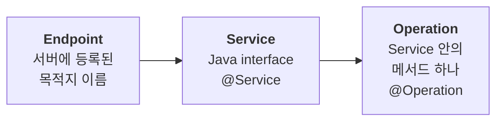

# Nexus 개요 — 서비스 간 호출의 표준 방식

[← 색인으로 돌아가기](../temporal-client-worker-flow.md)

---

Temporal의 **cross-namespace / cross-service 호출 프리미티브**. 다른 Temporal 서비스(또는 다른 cluster)의 Workflow/Activity를 **네트워크 안전하게 Workflow처럼** 호출하도록 만든 공식 추상화 — Spring MSA의 WebClient/RestClient에 가장 가까운 "서비스 간 RPC" 역할을 한다.

## 주소 체계 — 3단 식별자



Spring MSA로 치면 `Endpoint`가 "서비스 주소", `Service`가 "컨트롤러", `Operation`이 "엔드포인트" 레벨에 해당. **Endpoint 이름만 서버 설정으로 분리**해두면 호출 코드는 환경(dev/stage/prod)에 종속되지 않는다.

## 호출의 두 지점

```java
// 1) Workflow 코드 안 — 호출 시마다
SampleNexusService svc = Workflow.newNexusServiceStub(
    SampleNexusService.class,
    NexusServiceOptions.newBuilder()
        .setOperationOptions(NexusOperationOptions.newBuilder()
            .setScheduleToCloseTimeout(Duration.ofSeconds(10))
            .build())
        .build());
HelloOutput out = svc.hello(input);

// 2) Worker 등록 시 — 환경별 endpoint 주입 (운영/테스트에서 바꿔치기)
worker.registerWorkflowImplementationTypes(
    WorkflowImplementationOptions.newBuilder()
        .setNexusServiceOptions(Map.of(
            "SampleNexusService",
            NexusServiceOptions.newBuilder().setEndpoint("prod-nexus").build()))
        .build(),
    HelloCallerWorkflowImpl.class);
```

## 언제 Nexus인가 — 다른 방식과 비교

| 상황 | 추천 |
| --- | --- |
| 같은 namespace / 같은 팀의 서브 플로우 분해 | **ChildWorkflow** (같은 코드 베이스, 가벼움) |
| 같은 서비스 안에서 Activity만 다른 Worker 풀에 분산 | **Activity + TaskQueue 분리** |
| **다른 namespace / 다른 팀의 서비스를 Workflow에서 호출** | **Nexus** ← 여기 |
| 외부 애플리케이션이 Workflow를 **시작**만 하면 됨 (서비스 간 호출 아님) | `WorkflowClient.start(...)` (일반 Starter) |

## Nexus의 이점 (ChildWorkflow·일반 호출 대비)

1. **서비스 경계가 명확** — 호출 측은 provider의 코드/jar를 몰라도 됨. interface만 공유하면 끝. REST 스펙 공유와 같은 느낌.
2. **환경별 endpoint 교체가 운영 영역** — 호출 코드 수정 없이 테스트에선 `test-endpoint`, 운영에선 `prod-endpoint`로 swap (`core/.../nexus/caller/CallerWorkflowTest.java`).
3. **cross-cluster 지원** — 다른 Temporal cluster로도 호출 가능. 글로벌 서비스 메시 성격.
4. **Workflow 안에서 호출** — 재시도/타임아웃/취소 전파가 Workflow 결정성 모델 안에서 그대로 동작. Signal/Query/Update와 궁합이 좋음.

## 핵심 옵션

- **`NexusServiceOptions`** — 서비스 전체 수준 (`setEndpoint`, 공통 `setOperationOptions`, operation별 `setOperationMethodOptions`)
- **`NexusOperationOptions`** — operation 호출 수준 (`setScheduleToCloseTimeout`, `setCancellationType`)
- **`NexusOperationCancellationType`** — 4가지 (ABANDON / TRY_CANCEL / WAIT_REQUESTED / WAIT_COMPLETED). 상세는 [04 조합](04-composition.md#nexusoperationcancellationtype-심화--4가지-동작의-상세-차이) 참고.

## 깊이 파고들기

- [04 조합: §13 Nexus 섹션](04-composition.md) — 옵션 전체, Cancellation 4가지 심화, ChildWorkflow와의 상세 비교
- [00 시작하기: MSA 매핑](00-getting-started.md#1-a-msa-호출과의-매핑--spring-webclientrestclient와-비교) — Spring 호출 모델과 Temporal 호출 모델의 전반적 매핑
- 샘플: `core/src/main/java/io/temporal/samples/nexuscancellation/`, `core/src/main/java/io/temporal/samples/nexusmultipleargs/`, `core/src/main/java/io/temporal/samples/nexusmessaging/`
