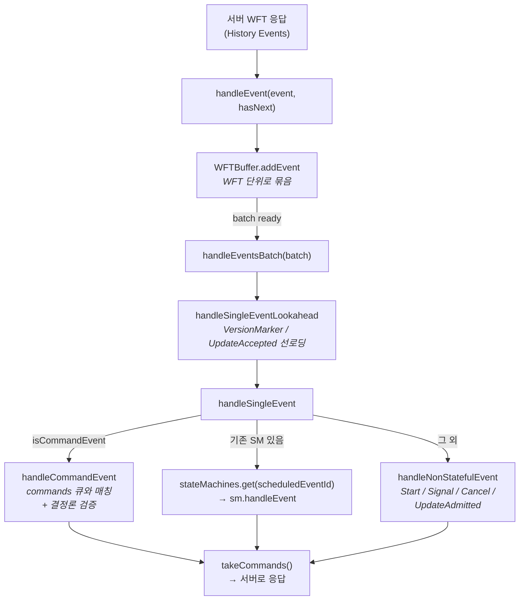
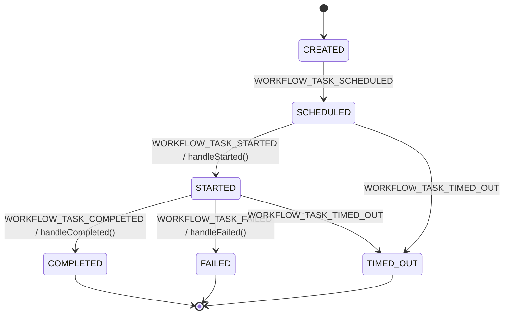
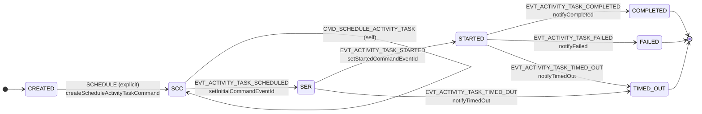
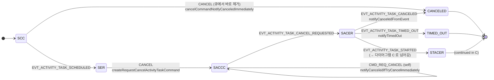
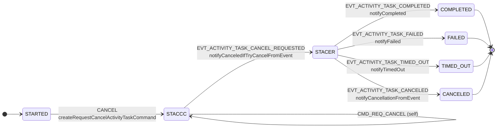
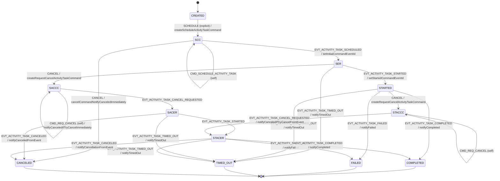
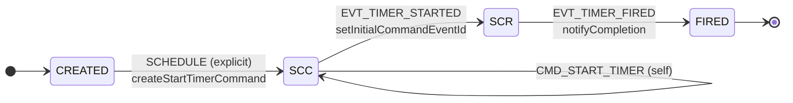
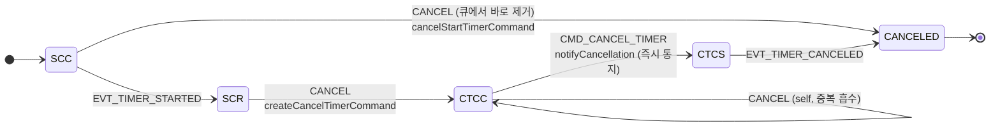
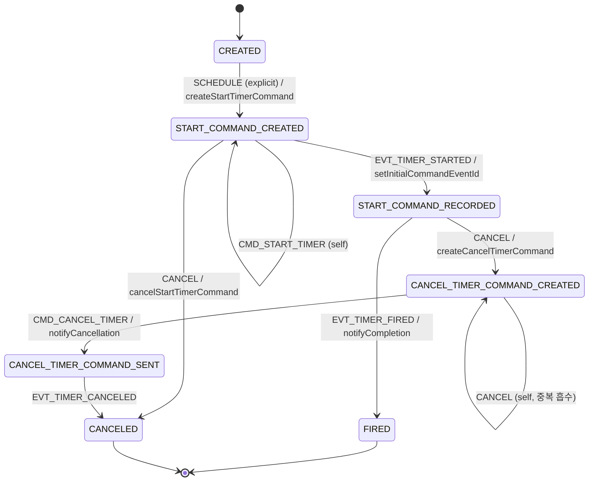

# SDK 내부 상태머신 (`WorkflowStateMachines`)

[← 색인으로 돌아가기](../temporal-client-worker-flow.md)

---

Worker가 서버에서 `WorkflowTask` 를 받으면, 그 안의 **History Event** 들을 하나씩 `io.temporal.internal.statemachines.WorkflowStateMachines` 에 밀어넣고 그 결과 **다음에 서버로 보낼 Commands** 를 뽑아낸다. replay(과거 재실행)와 live(새 실행) 모두 같은 파이프라인을 탄다.

## 전체 파이프라인



## 샘플 History 로 보는 처리 순서

`HelloActivity` 처럼 **Activity 1회 → 완료** 하는 가장 단순한 workflow의 history는 아래 형태:

```
#1  WorkflowExecutionStarted
#2  WorkflowTaskScheduled
#3  WorkflowTaskStarted
#4  WorkflowTaskCompleted
#5  ActivityTaskScheduled      (command event, activityId="greet-1")
#6  ActivityTaskStarted
#7  ActivityTaskCompleted
#8  WorkflowTaskScheduled
#9  WorkflowTaskStarted
#10 WorkflowTaskCompleted
#11 WorkflowExecutionCompleted (command event)
```

**첫 번째 WFT (`#1~#3` 수신)**:

- `#1 WorkflowExecutionStarted` → `handleNonStatefulEvent` → `callbacks.start(event)` 로 **사용자 workflow 메서드가 처음 실행**. `activity.greet(...)` 호출이 `cancellableCommands` 큐에 `ScheduleActivityTask` command 를 push, Promise `.get()` 에서 blocked.
- `#2 WorkflowTaskScheduled` → `WorkflowTaskStateMachine` 생성, `stateMachines.put(2, sm)`.
- `#3 WorkflowTaskStarted` → `stateMachines.get(2)` 로 라우팅 → `prepareCommands()` → `cancellableCommands → commands` 로 이동.
- Worker가 `takeCommands()` → `ScheduleActivityTask` 1개를 서버로 전송.

**두 번째 WFT (`#4~#9` 수신, 일부는 replay)**:

- `#5 ActivityTaskScheduled` 는 **command event** → `handleCommandEvent`:
  - `commands.peek()` 에서 이전 WFT가 보낸 `ScheduleActivityTask` command 를 꺼내 매칭.
  - `validateCommand()` 로 activityId / activityType / taskQueue 비교 — 불일치 시 **`NonDeterministicException`**.
  - 매칭된 `ActivityStateMachine` 을 `stateMachines.put(5, sm)` 로 등록.
- `#6 ActivityTaskStarted`, `#7 ActivityTaskCompleted` → 모두 `scheduledEventId=5` 로 라우팅되어 같은 SM 에 전달. `#7` 에서 `completionCallback` 으로 Promise complete.
- `#9 WorkflowTaskStarted` 처리 시 `eventLoop()` 가 돌면서 사용자 코드가 깨어나 다음 command(`CompleteWorkflowExecution`)를 발행.

## 핵심 설계 포인트

1. **WFTBuffer가 WFT 경계를 만든다** — 한 WFT 내 이벤트를 묶어 봐야 `lookahead`(VersionMarker 선로딩, UpdateAccepted 매칭)와 replay/live 전환(`lastTask` 판단)이 가능.
2. **`stateMachines` 맵의 key = "originating event id"** — Activity / Timer / ChildWorkflow 모두 `scheduledEventId` 를 key로 등록. `getInitialCommandEventId(event)` 가 매핑.
3. **결정론 검증은 `handleCommandEvent` 에서** — replay 중 "큐에서 peek한 command" ≠ "history에서 받은 command event" 면 `NonDeterministicException`. workflow 코드에서 `UUID.randomUUID()` / `System.currentTimeMillis()` 직접 호출이 금지인 이유.

---

## `WorkflowTaskStateMachine` — WFT 생애주기 관찰자

**Command를 발행하지 않는** 특수 SM. 생성자에서 `commandSink` 로 "throw" 를 넣어둬서 command 발행 시 예외. 역할은 **"WFT가 Started 됐으니 사용자 workflow 코드를 돌릴 시점"** 을 `Listener.workflowTaskStarted` 로 알리는 것 하나.



**Final states**: `COMPLETED`, `FAILED`, `TIMED_OUT`. `SCHEDULED → FAILED` 전이는 없다(Failed는 Started 이후에만 발생).

**핵심 트릭** — `handleStarted()` 끝에 아래 분기가 있다:

```java
if (currentEvent.getEventId() >= workflowTaskStartedEventId && !hasNextEvent) {
    handleCompleted();   // 상태는 STARTED에 머문 채 listener 즉시 호출
}
```

지금 처리 중인 WFT가 **history 끝(= live 영역)** 이면, `COMPLETED` 이벤트는 아직 history에 존재하지 않지만 **사용자 코드는 지금 돌아야 한다**. 그래서 상태 전이 없이 `handleCompleted()` 를 미리 호출해 `Listener.workflowTaskStarted(...)` 를 발사 → `eventLoop()` 가 돌아 사용자 workflow 코드 재개.

**리셋 지원** — `handleFailed()` 에서 `WORKFLOW_TASK_FAILED_CAUSE_RESET_WORKFLOW` 이면 `listener.updateRunId(newRunId)` 로 `currentRunId` 교체 → `randomUUID()` / `newRandom()` 결정론 시드가 새로 맞춰짐.

---

## `ActivityStateMachine` — 상태 12개의 Cancel 경합 처리

전체를 한 장에 그리면 밀도가 너무 높아 **세 축 × 세 다이어그램**으로 쪼갠다. 전체 통합본은 섹션 끝의 접힌 블록 참고.

### A. 해피 패스 — Schedule → Started → 종결

Cancel 이 전혀 끼어들지 않는 흐름. 상태는 `CREATED → SCC → SER → STARTED → COMPLETED/FAILED/TIMED_OUT` 로 선형이다.



**읽기 포인트**:

- `SCC → SCC` self transition 은 `addCommand()` 호출로 "command 를 외부 큐에 넣는 그 순간" 을 포착하는 훅. 실제 상태값은 그대로.
- `SER` 는 서버가 `ActivityTaskScheduled` 이벤트를 history 에 적어 승인한 상태. 아직 worker 가 polling 전.
- `SER → TIMED_OUT` 은 ScheduleToStart 타임아웃 (polling 되지 못하고 타임아웃), `STARTED → TIMED_OUT` 은 StartToClose/Heartbeat 타임아웃.

### B. Started 이전 Cancel — command 큐에 있을 때 vs 서버 승인된 뒤

Activity 가 `STARTED` 되기 전에 cancel 요청이 들어오는 경우. 서버 승인 여부(③축)에 따라 두 경로.



**읽기 포인트**:

- **`SCC → CANCELED` 는 서버 통신 전혀 없음**. 아직 큐에만 있던 Schedule command 를 빼면 끝. 그래서 즉시 `CanceledFailure` 통지.
- **`SER → SACCC` 는 서버 통신 필요**. 이미 `ActivityTaskScheduled` 가 history 에 적힌 상태라 `RequestCancelActivityTask` command 를 새로 발행해야 함.
- `SACER → STACER` 가로 전이 — **cancel 요청을 보냈는데 서버가 Started 를 먼저 돌려주는** 레이스. 이 경우 "Started 후 Cancel 경합" 상태(다이어그램 C)로 이어진다.
- `SACCC` self transition 의 `notifyCanceledIfTryCancelImmediately` — cancel command 발행 순간 `TRY_CANCEL` 모드면 Promise 를 즉시 complete.

### C. Started 이후 Cancel 경합 — 종결 이벤트와의 레이스

이미 Activity 가 돌고 있는데 cancel 요청이 들어오는 경우. 서버 결과(COMPLETED/FAILED/TIMED_OUT)와 cancel 확정(CANCELED)의 **네 가지 종결 이벤트가 모두 가능**한 레이스 구간.



**읽기 포인트**:

- `STACER` 에서 종결 이벤트 **4종을 모두 수용**해야 하는 이유 — Activity worker 가 cancel 신호를 받기 전에 이미 성공/실패/타임아웃으로 종료됐을 수 있다. "cancel 보냈다 ≠ cancel 로 끝난다".
- 다이어그램 B 의 `SACER → STACER` 로 들어온 경우에도 여기 로직이 그대로 적용 — Scheduled 상태에서 cancel 요청했는데 서버가 Started 를 먼저 돌려준 케이스.
- `STACCC → STACER` 전이 핸들러 `notifyCanceledIfTryCancelFromEvent` — 서버가 `CancelRequested` 를 돌려준 시점에 `TRY_CANCEL` 모드면 Promise complete.

<details>
<summary>전체 상태 다이어그램 (12 상태 통합)</summary>



</details>

**상태 약어**:

- `SCC` = `SCHEDULE_COMMAND_CREATED` (사용자가 `activity.foo()` 호출 직후, command가 아직 큐에만 있음)
- `SER` = `SCHEDULED_EVENT_RECORDED` (서버가 받아 history에 기록 완료)
- `SACCC` = `SCHEDULED_ACTIVITY_CANCEL_COMMAND_CREATED` (Started 전 Cancel 요청)
- `SACER` = `SCHEDULED_ACTIVITY_CANCEL_EVENT_RECORDED`
- `STACCC` = `STARTED_ACTIVITY_CANCEL_COMMAND_CREATED` (Started 후 Cancel 요청)
- `STACER` = `STARTED_ACTIVITY_CANCEL_EVENT_RECORDED`

**세 축의 조합이 12 상태를 만든다**:

| 축 | 값 |
| --- | --- |
| ① Activity 진행 단계 | Scheduled / Started / Done |
| ② Cancel 요청 여부 | 없음 / 요청됨 |
| ③ Command 서버 승인 | 아직 큐 안 / 서버 승인됨 |

`SCC` 와 `SER` 가 분리된 건 ③ 때문. `SCC` 상태에서 Cancel 하면 큐에서 빼면 끝(서버 통신 없음), `SER` 상태에서 Cancel 하면 `RequestCancelActivityTask` command를 **새로** 발행해야 함.

**`ActivityCancellationType` 3종이 "언제 Promise를 complete 하느냐"를 결정**:

| 모드 | 통지 시점 |
| --- | --- |
| `ABANDON` | 통지하지 않음(그대로 버림) |
| `TRY_CANCEL` | cancel command가 큐에 들어가거나 서버가 `CancelRequested` 를 돌려준 **즉시** CanceledFailure 통지 |
| `WAIT_CANCELLATION_COMPLETED` | 서버가 `ActivityTaskCanceled` 를 돌려줄 때까지 **대기** 후 통지 |

**Self-transition (`SCC → SCC`, `SACCC → SACCC`, `STACCC → STACCC`)** — StateMachine 공통 로직에서 `addCommand()` 호출 시 해당 CommandType으로 자기 자신에게 전이가 들어온다. "command를 외부 큐에 넣은 바로 그 순간"을 포착하기 위한 훅으로, 각 self transition 에 걸린 `notifyCanceledIfTryCancel*` 핸들러가 `TRY_CANCEL` 모드의 즉시 통지를 담당한다.

**`WorkflowStateMachines` 와의 연결 지점**:

| 시점 | WorkflowStateMachines 동작 | ActivityStateMachine |
| --- | --- | --- |
| 사용자 코드 `activity.foo()` | `scheduleActivityTask()` → `newInstance()` → `SCHEDULE` explicit 투입 | `CREATED → SCC` |
| `takeCommands()` | SCC 의 Schedule command 반출 | `SCC → SCC` (self) |
| history: `ActivityTaskScheduled` | `handleCommandEvent` → 매칭 → `stateMachines.put(eventId, sm)` | `SCC → SER` |
| history: `ActivityTaskStarted` | `stateMachines.get(scheduledEventId)` → `sm.handleEvent` | `SER → STARTED` |
| history: `ActivityTaskCompleted` | 동일 라우팅. SM 이 final → `stateMachines.remove()` | `STARTED → COMPLETED*` |

---

## `TimerStateMachine` — 가장 단순한 비동기 primitive

`Workflow.sleep(…)` / `Workflow.newTimer(…)` 가 사용하는 SM. ActivityStateMachine 대비 상태가 **7개로 거의 반**인데, 두 가지 이유다:

1. **"Started" 단계가 없다** — 서버가 timer를 혼자 돌리므로 `TimerStarted → TimerFired` 두 이벤트만 존재. Activity의 `Scheduled → Started → Completed` 3단계 중 중간이 통째로 생략.
2. **Cancellation mode 개념이 없다** — `ActivityCancellationType` 같은 분기가 없고 **항상 즉시 통지**. "서버가 cancel 을 확정했는지" 대기할 이유가 없음(timer는 side effect 가 없으니까).

상태 수가 7개로 작긴 하지만 **해피 패스 + Cancel 두 경로** 로 쪼개면 "왜 cancel 경로가 두 개인가" 가 더 명확히 보인다. 전체 통합본은 섹션 끝의 접힌 블록 참고.

약어: `SCC` = `START_COMMAND_CREATED`, `SCR` = `START_COMMAND_RECORDED`, `CTCC` = `CANCEL_TIMER_COMMAND_CREATED`, `CTCS` = `CANCEL_TIMER_COMMAND_SENT`.

### A. 해피 패스 — Start → Fire

Cancel 이 없는 흐름. 4개 상태를 직선으로 지난다.



**읽기 포인트**:

- Activity 와 달리 **중간 `STARTED` 상태가 없다** — 서버가 timer 를 혼자 돌리기 때문. history 에도 `TimerStarted → TimerFired` 두 이벤트뿐.
- `SCC → SCC` self transition 은 Activity 와 같은 패턴 — `addCommand()` 호출로 command 를 외부 큐에 넣는 순간을 포착.
- `SCR → FIRED` 가 서버가 타이머를 발화시킨 시점. 이때 `notifyCompletion` 이 Promise 를 complete.

### B. Cancel 두 경로 — 서버 통신 전 vs 서버 통신 후

`scope.cancel()` 이 들어왔을 때, timer 가 "아직 서버로 안 나갔는지 / 이미 서버가 돌리는 중인지" 로 두 경로가 갈린다.



**읽기 포인트**:

- **`SCC → CANCELED` (왼쪽 분기)** — StartTimer command 가 아직 큐에만 있던 상태. 큐에서 빼면 끝, 서버 통신 전혀 없음.
- **`SCR → CTCC → CTCS → CANCELED` (오른쪽 분기)** — 이미 `TimerStarted` 가 history 에 있는 상태. `CancelTimer` command 를 새로 발행해야 함.
- **중요: `CTCC → CTCS` 로 넘어가는 순간(= cancel command 를 외부 큐에 내보내는 순간) 이미 `notifyCancellation()` 이 호출**. ActivityStateMachine 과 달리 timer 는 **서버 확정(`TimerCanceled` 이벤트)을 기다리지 않는다** — timer 는 side effect 가 없기 때문에 "cancel 했으니 fire 안 할 거다" 를 서버 확정 없이도 보장 가능.
- `CTCC → CTCC` self transition — `scope.cancel()` 이 중복 호출돼도 안전하게 흡수.

<details>
<summary>전체 상태 다이어그램 (7 상태 통합)</summary>



</details>

**Final states**: `FIRED`, `CANCELED`.

**`notifyCancellation()` 의 트릭** — 다이어그램 B 에서 "서버 확정을 기다리지 않고 즉시 통지" 가 어떻게 가능한지의 구현. 실제 서버 이벤트가 아니라 **in-memory 로 가짜 `HistoryEvent`를 조립**해서 콜백에 넘긴다:

```java
private void notifyCancellation() {
  completionCallback.apply(
      HistoryEvent.newBuilder()
          .setEventType(EventType.EVENT_TYPE_TIMER_CANCELED)
          .setTimerCanceledEventAttributes(
              TimerCanceledEventAttributes.newBuilder()
                  .setIdentity("workflow")
                  .setTimerId(startAttributes.getTimerId()))
          .build());
}
```

호출 측(상위 Workflow 런타임) 입장에서는 "서버가 보낸 CANCELED 이벤트"와 "SDK가 조립한 가짜 CANCELED 이벤트"를 **같은 코드 경로**로 처리할 수 있다. 두 경로 모두 Promise 를 `CanceledFailure` 로 fail 시킴.

**ActivityStateMachine 과의 비교**:

| 축 | ActivityStateMachine | TimerStateMachine |
| --- | --- | --- |
| 상태 수 | 12 | 7 |
| "Started" 중간 단계 | 있음 (SER → STARTED) | 없음 (서버가 혼자 처리) |
| Cancel mode 분기 | 3종 (ABANDON / TRY_CANCEL / WAIT_COMPLETED) | 없음 (항상 즉시 통지) |
| Started 후 Cancel 경합 | STACER 가 4개 종결 이벤트 수용 | `CTCS → CANCELED` 단방향 |
| 완료 통지 콜백 | `(Optional<Payloads>, FailureResult)` | `(HistoryEvent)` — 가짜 이벤트도 OK |
