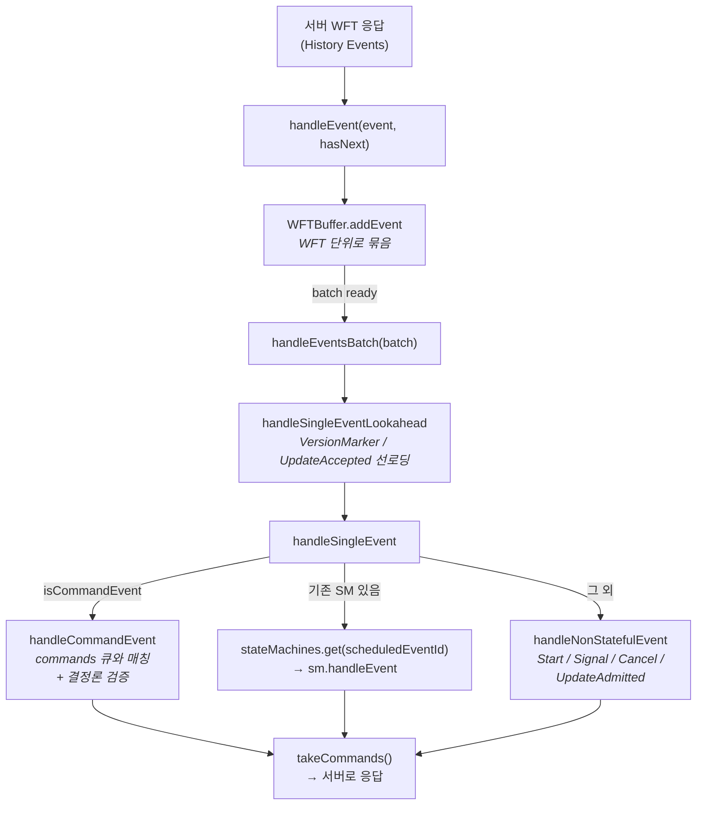
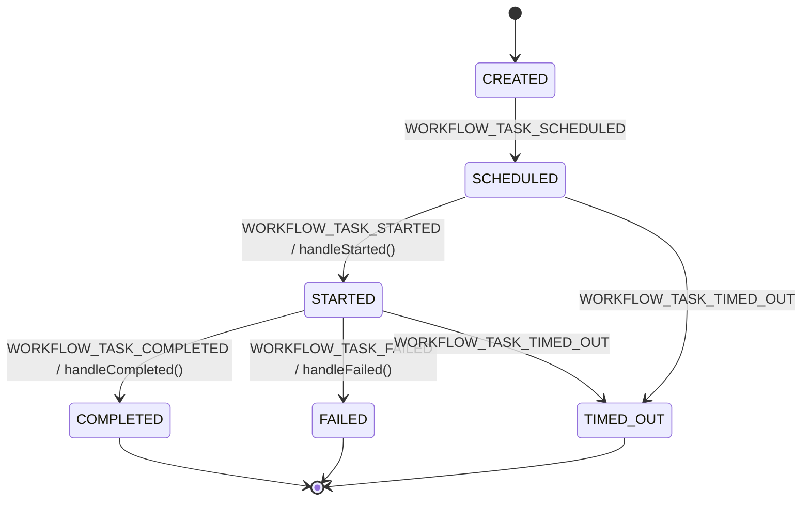
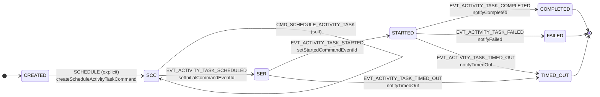
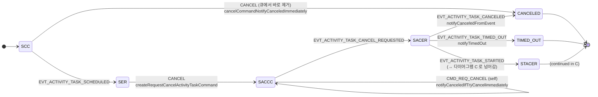
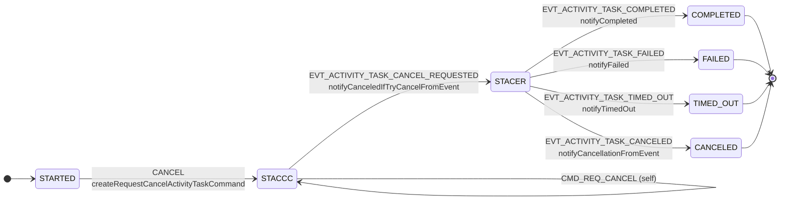
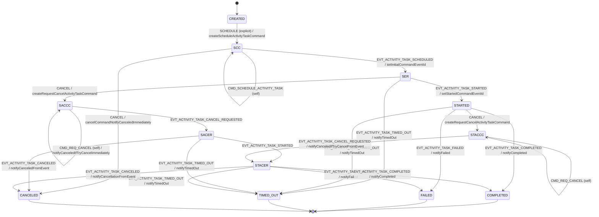
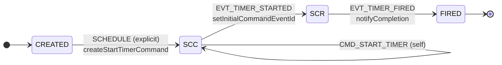
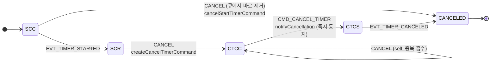
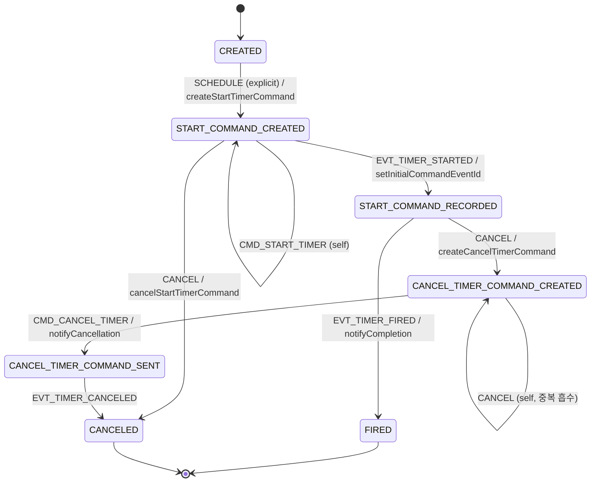

# SDK 내부 상태머신 (`WorkflowStateMachines`)

[← 색인으로 돌아가기](../temporal-client-worker-flow.md)

---

Worker가 서버에서 `WorkflowTask` 를 받으면, 그 안의 **History Event** 들을 하나씩 `io.temporal.internal.statemachines.WorkflowStateMachines` 에 밀어넣고 그 결과 **다음에 서버로 보낼 Commands** 를 뽑아낸다. replay(과거 재실행)와 live(새 실행) 모두 같은 파이프라인을 탄다.

## 전체 파이프라인



## 세 개의 내부 큐 — `cancellableCommands` / `commands` / `messageOutbox`

`WorkflowStateMachines` 가 외부 반출(=서버 전송) 하기 전까지 **메모리에 쌓는 세 개의 큐**가 있다. 샘플 추적 테이블의 "큐 상태" 컬럼이 가리키는 바로 그 큐들.

```java
// io.temporal.internal.statemachines.WorkflowStateMachines
private final Queue<CancellableCommand> cancellableCommands = new ArrayDeque<>();
private final Queue<CancellableCommand> commands             = new ArrayDeque<>();
private final Queue<Message>            messageOutbox        = new ArrayDeque<>();
```

### 역할

| 큐 | 담기는 것 | 특징 |
| --- | --- | --- |
| **`cancellableCommands`** | WFT 처리 **중에** 사용자 코드가 유발한 command (`ScheduleActivityTask`, `StartTimer`, `StartChildWorkflowExecution`, `CompleteWorkflowExecution` …) | **아직 서버로 안 나감** — 같은 WFT 안에서 `scope.cancel()` 등으로 **큐에서 바로 제거/취소 가능**. 이름의 `Cancellable`이 그 뜻. |
| **`commands`** | `prepareCommands()` 호출 시점에 `cancellableCommands` 에서 **순서 그대로 이동**해 온, 전송 확정분 | `takeCommands()` 가 `drainTo` 로 꺼내 `RespondWorkflowTaskCompleted` 로 서버에 반출. **순서 고정 — 중간 삽입·삭제 금지**(결정론 보존) |
| **`messageOutbox`** | Update 프로토콜 메시지 (`Accepted` / `Completed` / `Rejected`) | command 가 아니라 **별개 축의 프로토콜 메시지**. 같은 WFT 응답 안에서 `commands` 와 **분리된 필드**로 함께 전송 |

### 전이 다이어그램

```mermaid
flowchart LR
    code["사용자 Workflow 코드<br/>activities.foo() / Workflow.newTimer() /<br/>Workflow.newChildWorkflowStub()..."] -->|SCHEDULE 트리거| cc["<b>cancellableCommands</b><br/>(WFT 처리 중 누적)"]
    cc -->|scope.cancel() / timer.cancel()<br/>같은 WFT 안이면 큐에서 제거| gone["🗑️ (서버로 안 나감)"]
    cc -->|prepareCommands()<br/>WFT 종료 직전| cmds["<b>commands</b><br/>(전송 확정, 순서 고정)"]
    upd["Update 핸들러 흐름<br/>Accepted / Completed / Rejected"] --> mo["<b>messageOutbox</b><br/>(프로토콜 메시지)"]
    cmds -->|takeCommands()<br/>drainTo| rpc["RespondWorkflowTaskCompleted<br/>commands 필드"]
    mo -->|drainTo| rpc2["RespondWorkflowTaskCompleted<br/>messages 필드"]
```

### 예제 데이터 — 한 WFT 안에서의 큐 변화

주문 워크플로가 (1) 타이머를 띄우고 (2) 액티비티를 띄운 뒤 (3) 중간에 타이머를 cancel 하고 (4) 같은 WFT 에서 Update Accepted 를 발행하는 경우:

```
[WFT 시작]
cancellableCommands = []
commands            = []
messageOutbox       = []

[① Workflow.newTimer(Duration.ofSeconds(10))]
cancellableCommands = [StartTimer{timerId=t1, 10s}]

[② activities.charge(orderId)]
cancellableCommands = [StartTimer{t1}, ScheduleActivityTask{a1, "charge"}]

[③ timer.cancel()  — 아직 같은 WFT 안, 서버 미전송이라 그냥 큐에서 제거]
cancellableCommands = [ScheduleActivityTask{a1, "charge"}]

[④ Update "setStatus" Accepted — 프로토콜 메시지]
messageOutbox       = [Message{id=upd-7/accept, body=Accepted{}}]

[WFT 종료 — prepareCommands()]
cancellableCommands = []
commands            = [ScheduleActivityTask{a1, "charge"}]
messageOutbox       = [Message{id=upd-7/accept, body=Accepted{}}]

[takeCommands() + takeMessages() → RespondWorkflowTaskCompleted]
서버로 commands + messages 함께 전송
```

### 왜 세 개로 나눠놨나

- **`cancellableCommands` 분리** — Temporal 워크플로에서 "command 발행 → 같은 WFT 안에서 취소"가 자주 생긴다(타이머·액티비티 취소, Saga 보상 분기 등). 서버에 보내기 전까지는 메모리에서 **자유롭게 지울 수 있어야** 하니 별도 큐.
- **`commands` 분리** — 반출 확정 후에는 **순서·내용 변경 금지**(결정론). `prepareCommands()` 가 "스냅샷을 뜬 그 순간" 이후로는 손대지 않도록 다른 큐로 격리.
- **`messageOutbox` 분리** — Update 프로토콜 메시지(`Accepted/Completed/Rejected`)는 **command 가 아니라** 다른 축의 메시지. 서버 응답 `RespondWorkflowTaskCompleted` 에도 `commands`·`messages` 필드가 분리돼 있어, SDK 쪽도 **원본 그대로 분리** 유지.

### 샘플 추적 테이블의 "큐 상태" 컬럼이 가리키는 것

바로 아래 `HelloActivity` 추적 테이블의 "큐 상태" 컬럼은 이 세 큐 중 **대부분 `cancellableCommands`** 를 가리킨다. ⑥의 `prepareCommands()` 호출 시점에만 `cancellableCommands → commands` 전이가 일어나고, ⑦에서 `commands` 가 drain 되며 모두 비워진다.

---

## 샘플 1 — `HelloActivity` 전체 추적

리포의 [`HelloActivity.java`](../../core/src/main/java/io/temporal/samples/hello/HelloActivity.java) 를 끝까지 따라가 본다. **Activity 1회 → 완료** 하는 가장 단순한 workflow 라 전체 파이프라인이 다 보인다.

### 사용자 코드

```java
public static class GreetingWorkflowImpl implements GreetingWorkflow {
  private final GreetingActivities activities =
      Workflow.newActivityStub(
          GreetingActivities.class,
          ActivityOptions.newBuilder().setStartToCloseTimeout(Duration.ofSeconds(2)).build());

  @Override
  public String getGreeting(String name) {
    return activities.composeGreeting("Hello", name);   // ★ 이 한 줄이 모든 걸 트리거
  }
}
```

### 서버 history 가 쌓이는 모양

```
#1  WorkflowExecutionStarted
#2  WorkflowTaskScheduled
#3  WorkflowTaskStarted
#4  WorkflowTaskCompleted
#5  ActivityTaskScheduled      (command event, activityId="greet-1")
#6  ActivityTaskStarted
#7  ActivityTaskCompleted
#8  WorkflowTaskScheduled
#9  WorkflowTaskStarted
#10 WorkflowTaskCompleted
#11 WorkflowExecutionCompleted (command event)
```

이 history 는 **두 번의 WFT** 로 나뉘어 worker 에 전달된다. WFT1 은 `#1~#3`, WFT2 는 `#4~#9` (`#10~#11` 은 WFT2 처리 결과로 서버에 저장되는 미래 이벤트).

### WFT1 — 사용자 코드가 처음 실행되는 순간

| 순서 | 사용자 코드 / SDK 내부 동작 | State machine 변화 | 큐 상태 |
| --- | --- | --- | --- |
| ① history `#1` 수신 | `handleNonStatefulEvent(WorkflowExecutionStarted)` → `callbacks.start(event)` → **`getGreeting("World")` 메서드 호출** | — | `cancellableCommands`: `[]` |
| ② 사용자 코드 `activities.composeGreeting(...)` | `scheduleActivityTask()` → `ActivityStateMachine.newInstance()` → `SCHEDULE` 투입 | `CREATED → SCC` | `cancellableCommands`: `[ScheduleActivityTask(greet-1)]` |
| ③ Promise `.get()` 에서 block | workflow thread 양보 | — | — |
| ④ history `#2` 수신 | `WorkflowTaskStateMachine` 신규 생성, `stateMachines.put(2, sm)` | WFT SM: `CREATED → SCHEDULED` | — |
| ⑤ history `#3` 수신 (= WFT 끝) | `stateMachines.get(2)` 라우팅 → `handleStarted()` | WFT SM: `SCHEDULED → STARTED` → (lookahead `handleCompleted()`) | — |
| ⑥ `prepareCommands()` 호출 | 큐에 쌓인 command 를 외부 반출용 큐로 이동 | `SCC → SCC` (self, `addCommand()` 훅) | `cancellableCommands → commands`: `[ScheduleActivityTask]` |
| ⑦ worker `takeCommands()` | 서버로 응답 전송 | — | 비워짐 |

**핵심**: 사용자가 `activities.composeGreeting(...)` 을 호출한 그 순간엔 서버 통신이 전혀 없다. command 는 workflow 메모리의 `cancellableCommands` 큐에만 있고, WFT 가 끝날 때 batch 로 서버에 보내진다.

### WFT2 — Activity 완료 후, workflow 완결까지

history `#4~#9` 가 한 batch 로 들어온다. `#4~#5` 는 WFT1 결과가 서버에 기록된 "자기 자신의 과거" (replay 영역), `#6~#9` 가 신규 이벤트.

| 순서 | 수신 event | WorkflowStateMachines 동작 | ActivityStateMachine 상태 |
| --- | --- | --- | --- |
| ① `#4 WorkflowTaskCompleted` | WFT SM(id=2) 종결, `stateMachines.remove(2)` | — |
| ② `#5 ActivityTaskScheduled` ★ command event | `handleCommandEvent` → `commands.peek()` 로 WFT1 의 `ScheduleActivityTask` 꺼내 매칭 → `validateCommand()` (activityId / type / taskQueue 비교) → `ActivityStateMachine` 을 `stateMachines.put(5, sm)` | `SCC → SER` |
| ③ `#6 ActivityTaskStarted` | `stateMachines.get(5).handleEvent(...)` | `SER → STARTED` |
| ④ `#7 ActivityTaskCompleted` | 동일 라우팅. `completionCallback` 으로 Promise complete → **blocked 되어 있던 workflow thread 재개 준비** | `STARTED → COMPLETED` (final → `stateMachines.remove(5)`) |
| ⑤ `#8 WorkflowTaskScheduled` | 새 WFT SM(id=8) 생성 | — |
| ⑥ `#9 WorkflowTaskStarted` (= WFT 끝) | WFT SM(id=8) → `handleStarted()` 안에서 `eventLoop()` 실행 → workflow thread 가 깨어나 `activities.composeGreeting` 리턴값을 받고 **메서드 종료** → `completeWorkflowExecution()` command push | 해당 SM 은 이미 remove 됨 |
| ⑦ `takeCommands()` | 서버로 `CompleteWorkflowExecution` command 전송 | — |

**핵심**: `#5` 처리 시점의 "큐에서 peek 한 command" vs "history 에서 들어온 command event" 매칭이 **결정론 검증의 모든 것**. 사용자 코드가 매번 다른 activityId 를 생성하면 ② 에서 `validateCommand()` 가 깨지고 `NonDeterministicException` 이 터진다.

## 핵심 설계 포인트

1. **WFTBuffer가 WFT 경계를 만든다** — 한 WFT 내 이벤트를 묶어 봐야 `lookahead`(VersionMarker 선로딩, UpdateAccepted 매칭)와 replay/live 전환(`lastTask` 판단)이 가능.
2. **`stateMachines` 맵의 key = "originating event id"** — Activity / Timer / ChildWorkflow 모두 `scheduledEventId` 를 key로 등록. `getInitialCommandEventId(event)` 가 매핑.
3. **결정론 검증은 `handleCommandEvent` 에서** — replay 중 "큐에서 peek한 command" ≠ "history에서 받은 command event" 면 `NonDeterministicException`. workflow 코드에서 `UUID.randomUUID()` / `System.currentTimeMillis()` 직접 호출이 금지인 이유.

---

## `WorkflowTaskStateMachine` — WFT 생애주기 관찰자

**Command를 발행하지 않는** 특수 SM. 생성자에서 `commandSink` 로 "throw" 를 넣어둬서 command 발행 시 예외. 역할은 **"WFT가 Started 됐으니 사용자 workflow 코드를 돌릴 시점"** 을 `Listener.workflowTaskStarted` 로 알리는 것 하나.



**Final states**: `COMPLETED`, `FAILED`, `TIMED_OUT`. `SCHEDULED → FAILED` 전이는 없다(Failed는 Started 이후에만 발생).

**핵심 트릭** — `handleStarted()` 끝에 아래 분기가 있다:

```java
if (currentEvent.getEventId() >= workflowTaskStartedEventId && !hasNextEvent) {
    handleCompleted();   // 상태는 STARTED에 머문 채 listener 즉시 호출
}
```

지금 처리 중인 WFT가 **history 끝(= live 영역)** 이면, `COMPLETED` 이벤트는 아직 history에 존재하지 않지만 **사용자 코드는 지금 돌아야 한다**. 그래서 상태 전이 없이 `handleCompleted()` 를 미리 호출해 `Listener.workflowTaskStarted(...)` 를 발사 → `eventLoop()` 가 돌아 사용자 workflow 코드 재개.

**리셋 지원** — `handleFailed()` 에서 `WORKFLOW_TASK_FAILED_CAUSE_RESET_WORKFLOW` 이면 `listener.updateRunId(newRunId)` 로 `currentRunId` 교체 → `randomUUID()` / `newRandom()` 결정론 시드가 새로 맞춰짐.

---

## `ActivityStateMachine` — 상태 12개의 Cancel 경합 처리

전체를 한 장에 그리면 밀도가 너무 높아 **세 축 × 세 다이어그램**으로 쪼갠다. 전체 통합본은 섹션 끝의 접힌 블록 참고.

### A. 해피 패스 — Schedule → Started → 종결

**예시 상황**: `HelloActivity` 처럼 `activities.composeGreeting(...)` 한 번 호출하고 결과를 그냥 받는 코드. Cancel 이 전혀 끼어들지 않는다.

```java
// HelloActivity.java
public String getGreeting(String name) {
  return activities.composeGreeting("Hello", name);  // 호출 → block → 결과 리턴
}
```

상태는 `CREATED → SCC → SER → STARTED → COMPLETED/FAILED/TIMED_OUT` 로 선형이다.



**읽기 포인트**:

- `SCC → SCC` self transition 은 `addCommand()` 호출로 "command 를 외부 큐에 넣는 그 순간" 을 포착하는 훅. 실제 상태값은 그대로.
- `SER` 는 서버가 `ActivityTaskScheduled` 이벤트를 history 에 적어 승인한 상태. 아직 worker 가 polling 전.
- `SER → TIMED_OUT` 은 ScheduleToStart 타임아웃 (polling 되지 못하고 타임아웃), `STARTED → TIMED_OUT` 은 StartToClose/Heartbeat 타임아웃.

**HelloActivity 로 보는 전이 시점**:

| 사용자 코드 / history event | 상태 전이 |
| --- | --- |
| `activities.composeGreeting(...)` 호출 (WFT1) | `CREATED → SCC` |
| WFT1 끝에서 `prepareCommands()` → 서버로 반출 | `SCC → SCC` (self) |
| `#5 ActivityTaskScheduled` 수신 (WFT2) | `SCC → SER` |
| `#6 ActivityTaskStarted` 수신 | `SER → STARTED` |
| `#7 ActivityTaskCompleted` 수신 | `STARTED → COMPLETED` → `stateMachines.remove(5)` |

### B. Started 이전 Cancel — command 큐에 있을 때 vs 서버 승인된 뒤

**예시 상황**: Activity 를 schedule 해 두고 **아직 결과가 돌아오기 전에** scope 가 cancel 되는 경우. 두 가지 하위 상황이 있다:

- **왼쪽 경로 (SCC → CANCELED)** — scope 안에서 async 로 activity 를 띄우고 **같은 WFT 안에서** 바로 cancel. 서버에 아직 아무것도 안 나감.
  ```java
  // 같은 workflow 안에서 조건 충족 시 activity 를 띄우지 말고 바로 접음
  CancellationScope scope = Workflow.newCancellationScope(() -> {
      Async.function(activities::expensive);  // ← SCC 로 들어감
  });
  scope.run();                                 // non-blocking
  if (alreadyHaveCachedResult()) scope.cancel(); // ← 같은 WFT 안에서 cancel
  ```
- **오른쪽 경로 (SER → SACCC → SACER → CANCELED)** — 이전 WFT 가 끝나서 서버가 이미 `ActivityTaskScheduled` 를 history 에 적었지만 **worker 가 아직 polling 전**. 이 사이에 다음 WFT 에서 signal/timer 등이 scope cancel 을 트리거.



**읽기 포인트**:

- **`SCC → CANCELED` 는 서버 통신 전혀 없음**. 아직 큐에만 있던 Schedule command 를 빼면 끝. 그래서 즉시 `CanceledFailure` 통지.
- **`SER → SACCC` 는 서버 통신 필요**. 이미 `ActivityTaskScheduled` 가 history 에 적힌 상태라 `RequestCancelActivityTask` command 를 새로 발행해야 함.
- `SACER → STACER` 가로 전이 — **cancel 요청을 보냈는데 서버가 Started 를 먼저 돌려주는** 레이스. 이 경우 "Started 후 Cancel 경합" 상태(다이어그램 C)로 이어진다.
- `SACCC` self transition 의 `notifyCanceledIfTryCancelImmediately` — cancel command 발행 순간 `TRY_CANCEL` 모드면 Promise 를 즉시 complete.

### C. Started 이후 Cancel 경합 — 종결 이벤트와의 레이스

**예시 상황**: 리포의 [`HelloCancellationScope`](../../core/src/main/java/io/temporal/samples/hello/HelloCancellationScope.java) — 같은 인사말을 여러 언어로 **병렬 호출**해서 **가장 먼저 끝난 하나만** 쓰고 나머지는 cancel 하는 패턴.

```java
// HelloCancellationScope.java
CancellationScope scope =
    Workflow.newCancellationScope(() -> {
      for (String greeting : greetings) {                        // 6개 언어 병렬 호출
        results.add(Async.function(activities::composeGreeting, greeting, name));
      }
    });
scope.run();
String result = Promise.anyOf(results).get();   // ★ 하나 끝나면 나머지는 아직 STARTED
scope.cancel();                                  // ★ 나머지 5개 → STARTED → STACCC
```

하나가 먼저 completed 되는 순간, **나머지 5개는 이미 `STARTED` 상태로 돌고 있다**. `scope.cancel()` 이 호출되면 각자 `STARTED → STACCC` 로 넘어가고, 이후 서버 결과(COMPLETED/FAILED/TIMED_OUT)와 cancel 확정(CANCELED)의 **네 가지 종결 이벤트가 모두 가능**한 레이스 구간이 된다.



**읽기 포인트**:

- `STACER` 에서 종결 이벤트 **4종을 모두 수용**해야 하는 이유 — Activity worker 가 cancel 신호를 받기 전에 이미 성공/실패/타임아웃으로 종료됐을 수 있다. "cancel 보냈다 ≠ cancel 로 끝난다".
- 다이어그램 B 의 `SACER → STACER` 로 들어온 경우에도 여기 로직이 그대로 적용 — Scheduled 상태에서 cancel 요청했는데 서버가 Started 를 먼저 돌려준 케이스.
- `STACCC → STACER` 전이 핸들러 `notifyCanceledIfTryCancelFromEvent` — 서버가 `CancelRequested` 를 돌려준 시점에 `TRY_CANCEL` 모드면 Promise complete.

**HelloCancellationScope 의 cancel 모드**: 예시 코드는 `ActivityCancellationType.WAIT_CANCELLATION_COMPLETED` 로 설정돼 있어서, cancel 신호를 보내도 **서버가 `ActivityTaskCanceled` 를 돌려줄 때까지** 각 Promise 가 `.get()` 에서 계속 blocked. activity 쪽에서 heartbeat 중 `ActivityCompletionException` 을 catch 해 cleanup → 재throw 하면 그제서야 `STACER → CANCELED` 전이가 일어나고 Promise 가 `CanceledFailure` 로 완결된다.

| cancel 모드 | 다이어그램 C 에서 Promise 가 complete 되는 시점 |
| --- | --- |
| `ABANDON` | 아예 complete 안 됨. activity 는 계속 돌지만 workflow 는 신경 안 씀 |
| `TRY_CANCEL` | `STARTED → STACCC` 전이의 self-transition 에서 즉시 통지 (서버 응답 안 기다림) |
| `WAIT_CANCELLATION_COMPLETED` ← 샘플 | `STACER → CANCELED` 가 일어날 때 통지 (서버 확정 대기) |

<details>
<summary>전체 상태 다이어그램 (12 상태 통합)</summary>



</details>

**상태 약어**:

- `SCC` = `SCHEDULE_COMMAND_CREATED` (사용자가 `activity.foo()` 호출 직후, command가 아직 큐에만 있음)
- `SER` = `SCHEDULED_EVENT_RECORDED` (서버가 받아 history에 기록 완료)
- `SACCC` = `SCHEDULED_ACTIVITY_CANCEL_COMMAND_CREATED` (Started 전 Cancel 요청)
- `SACER` = `SCHEDULED_ACTIVITY_CANCEL_EVENT_RECORDED`
- `STACCC` = `STARTED_ACTIVITY_CANCEL_COMMAND_CREATED` (Started 후 Cancel 요청)
- `STACER` = `STARTED_ACTIVITY_CANCEL_EVENT_RECORDED`

**세 축의 조합이 12 상태를 만든다**:

| 축 | 값 |
| --- | --- |
| ① Activity 진행 단계 | Scheduled / Started / Done |
| ② Cancel 요청 여부 | 없음 / 요청됨 |
| ③ Command 서버 승인 | 아직 큐 안 / 서버 승인됨 |

`SCC` 와 `SER` 가 분리된 건 ③ 때문. `SCC` 상태에서 Cancel 하면 큐에서 빼면 끝(서버 통신 없음), `SER` 상태에서 Cancel 하면 `RequestCancelActivityTask` command를 **새로** 발행해야 함.

**`ActivityCancellationType` 3종이 "언제 Promise를 complete 하느냐"를 결정**:

| 모드 | 통지 시점 |
| --- | --- |
| `ABANDON` | 통지하지 않음(그대로 버림) |
| `TRY_CANCEL` | cancel command가 큐에 들어가거나 서버가 `CancelRequested` 를 돌려준 **즉시** CanceledFailure 통지 |
| `WAIT_CANCELLATION_COMPLETED` | 서버가 `ActivityTaskCanceled` 를 돌려줄 때까지 **대기** 후 통지 |

**Self-transition (`SCC → SCC`, `SACCC → SACCC`, `STACCC → STACCC`)** — StateMachine 공통 로직에서 `addCommand()` 호출 시 해당 CommandType으로 자기 자신에게 전이가 들어온다. "command를 외부 큐에 넣은 바로 그 순간"을 포착하기 위한 훅으로, 각 self transition 에 걸린 `notifyCanceledIfTryCancel*` 핸들러가 `TRY_CANCEL` 모드의 즉시 통지를 담당한다.

**`WorkflowStateMachines` 와의 연결 지점**:

| 시점 | WorkflowStateMachines 동작 | ActivityStateMachine |
| --- | --- | --- |
| 사용자 코드 `activity.foo()` | `scheduleActivityTask()` → `newInstance()` → `SCHEDULE` explicit 투입 | `CREATED → SCC` |
| `takeCommands()` | SCC 의 Schedule command 반출 | `SCC → SCC` (self) |
| history: `ActivityTaskScheduled` | `handleCommandEvent` → 매칭 → `stateMachines.put(eventId, sm)` | `SCC → SER` |
| history: `ActivityTaskStarted` | `stateMachines.get(scheduledEventId)` → `sm.handleEvent` | `SER → STARTED` |
| history: `ActivityTaskCompleted` | 동일 라우팅. SM 이 final → `stateMachines.remove()` | `STARTED → COMPLETED*` |

---

## `TimerStateMachine` — 가장 단순한 비동기 primitive

`Workflow.sleep(…)` / `Workflow.newTimer(…)` 가 사용하는 SM. ActivityStateMachine 대비 상태가 **7개로 거의 반**인데, 두 가지 이유다:

1. **"Started" 단계가 없다** — 서버가 timer를 혼자 돌리므로 `TimerStarted → TimerFired` 두 이벤트만 존재. Activity의 `Scheduled → Started → Completed` 3단계 중 중간이 통째로 생략.
2. **Cancellation mode 개념이 없다** — `ActivityCancellationType` 같은 분기가 없고 **항상 즉시 통지**. "서버가 cancel 을 확정했는지" 대기할 이유가 없음(timer는 side effect 가 없으니까).

상태 수가 7개로 작긴 하지만 **해피 패스 + Cancel 두 경로** 로 쪼개면 "왜 cancel 경로가 두 개인가" 가 더 명확히 보인다. 전체 통합본은 섹션 끝의 접힌 블록 참고.

약어: `SCC` = `START_COMMAND_CREATED`, `SCR` = `START_COMMAND_RECORDED`, `CTCC` = `CANCEL_TIMER_COMMAND_CREATED`, `CTCS` = `CANCEL_TIMER_COMMAND_SENT`.

### A. 해피 패스 — Start → Fire

**예시 상황**: `Workflow.sleep(Duration.ofSeconds(10))` 처럼 timer 를 그냥 끝까지 기다리는 경우. Cancel 이 없는 흐름이라 4개 상태를 직선으로 지난다.

```java
// 가장 흔한 사용: 재시도 사이의 대기, 폴링 간격, SLA 타이머 등
Workflow.sleep(Duration.ofSeconds(10));   // ← 내부적으로 TimerStateMachine 하나 생성
```



**읽기 포인트**:

- Activity 와 달리 **중간 `STARTED` 상태가 없다** — 서버가 timer 를 혼자 돌리기 때문. history 에도 `TimerStarted → TimerFired` 두 이벤트뿐.
- `SCC → SCC` self transition 은 Activity 와 같은 패턴 — `addCommand()` 호출로 command 를 외부 큐에 넣는 순간을 포착.
- `SCR → FIRED` 가 서버가 타이머를 발화시킨 시점. 이때 `notifyCompletion` 이 Promise 를 complete.

### B. Cancel 두 경로 — 서버 통신 전 vs 서버 통신 후

**예시 상황**: 리포의 [`HelloCancellationScopeWithTimer`](../../core/src/main/java/io/temporal/samples/hello/HelloCancellationScopeWithTimer.java) 와는 **반대 방향** — 저 샘플은 "timer 가 fire 되면 activity scope 를 cancel" 하는 패턴이고, 여기서는 "activity 가 먼저 끝나면 **timer 쪽을** cancel" 하는 패턴을 보자.

```java
// 예: activity 가 30초 안에 끝나면 60초 fallback timer 는 접는다
Promise<String> activityResult = Async.function(activities::doWork);
Promise<Void>  fallbackTimer  = Workflow.newTimer(Duration.ofSeconds(60));

Promise.anyOf(activityResult, fallbackTimer).get();
if (activityResult.isCompleted()) {
    fallbackTimer.cancel();   // ★ 이 호출이 아래 두 경로 중 하나로 분기
}
```

`fallbackTimer.cancel()` 이 호출될 때, timer 가 "아직 서버로 안 나갔는지 / 이미 서버가 돌리는 중인지" 에 따라 두 경로가 갈린다.



**읽기 포인트**:

- **`SCC → CANCELED` (왼쪽 분기)** — StartTimer command 가 아직 큐에만 있던 상태. 큐에서 빼면 끝, 서버 통신 전혀 없음.
- **`SCR → CTCC → CTCS → CANCELED` (오른쪽 분기)** — 이미 `TimerStarted` 가 history 에 있는 상태. `CancelTimer` command 를 새로 발행해야 함.
- **중요: `CTCC → CTCS` 로 넘어가는 순간(= cancel command 를 외부 큐에 내보내는 순간) 이미 `notifyCancellation()` 이 호출**. ActivityStateMachine 과 달리 timer 는 **서버 확정(`TimerCanceled` 이벤트)을 기다리지 않는다** — timer 는 side effect 가 없기 때문에 "cancel 했으니 fire 안 할 거다" 를 서버 확정 없이도 보장 가능.
- `CTCC → CTCC` self transition — `scope.cancel()` 이 중복 호출돼도 안전하게 흡수.

<details>
<summary>전체 상태 다이어그램 (7 상태 통합)</summary>



</details>

**Final states**: `FIRED`, `CANCELED`.

**`notifyCancellation()` 의 트릭** — 다이어그램 B 에서 "서버 확정을 기다리지 않고 즉시 통지" 가 어떻게 가능한지의 구현. 실제 서버 이벤트가 아니라 **in-memory 로 가짜 `HistoryEvent`를 조립**해서 콜백에 넘긴다:

```java
private void notifyCancellation() {
  completionCallback.apply(
      HistoryEvent.newBuilder()
          .setEventType(EventType.EVENT_TYPE_TIMER_CANCELED)
          .setTimerCanceledEventAttributes(
              TimerCanceledEventAttributes.newBuilder()
                  .setIdentity("workflow")
                  .setTimerId(startAttributes.getTimerId()))
          .build());
}
```

호출 측(상위 Workflow 런타임) 입장에서는 "서버가 보낸 CANCELED 이벤트"와 "SDK가 조립한 가짜 CANCELED 이벤트"를 **같은 코드 경로**로 처리할 수 있다. 두 경로 모두 Promise 를 `CanceledFailure` 로 fail 시킴.

### 샘플 2 — `HelloCancellationScopeWithTimer`: Timer fire 가 Activity cancel 을 트리거

리포의 [`HelloCancellationScopeWithTimer`](../../core/src/main/java/io/temporal/samples/hello/HelloCancellationScopeWithTimer.java) 는 **두 state machine 이 서로 영향을 주는** 전형적인 패턴이다. "activity 가 3초 안에 안 끝나면 접고 기본값 리턴".

```java
// HelloCancellationScopeWithTimer.java
CancellationScope cancellationScope =
    Workflow.newCancellationScope(() -> {
      result = activities.updateInfo(input);               // Activity SM 생성
    });

Workflow.newTimer(Duration.ofSeconds(3))                   // Timer SM 생성
    .thenApply(r -> { cancellationScope.cancel(); return null; });  // ★ fire 시 scope cancel

cancellationScope.run();                                    // Activity 블록 대기
```

**두 state machine 의 동시 진행**:

| 시점 | Activity SM | Timer SM | 비고 |
| --- | --- | --- | --- |
| WFT1: 사용자 코드 실행 | `CREATED → SCC` | `CREATED → SCC` | 두 command 가 큐에 push |
| WFT1 끝: `takeCommands()` | `SCC → SCC` (self) | `SCC → SCC` (self) | `ScheduleActivityTask` + `StartTimer` 둘 다 서버로 |
| WFT2: `ActivityTaskScheduled` | `SCC → SER` | — | — |
| WFT2: `TimerStarted` | — | `SCC → SCR` | — |
| WFT2: `ActivityTaskStarted` | `SER → STARTED` | — | activity worker 가 heartbeat 시작 |
| WFT3 (3초 뒤): `TimerFired` | — | `SCR → FIRED` → `notifyCompletion` | timer promise 깨어남 → `thenApply` 람다 실행 → `scope.cancel()` 호출 |
| 같은 WFT 내: `scope.cancel()` 효과 | `STARTED → STACCC` | — | `RequestCancelActivityTask` command push |
| WFT3 끝: `takeCommands()` | `STACCC → STACCC` (self) | — | 서버로 cancel 요청 전송 |
| WFT4: `ActivityTaskCancelRequested` | `STACCC → STACER` | — | — |
| WFT4+: 서버 결과 | `STACER → CANCELED` (또는 COMPLETED — 레이스) | — | activity 가 heartbeat 로 cancel 받고 cleanup 후 throw → CANCELED |

**읽기 포인트**:

- Timer SM 과 Activity SM 은 **독립적으로** 자기 history event 를 처리한다 — 서로 참조하지 않음. 둘을 연결하는 건 **사용자 코드 (`thenApply` 람다)** 뿐.
- `TimerFired` 가 들어오는 WFT 안에서 `scope.cancel()` 이 호출되면, 그 즉시 Activity SM 에 `CANCEL` explicit 전이가 투입된다. 즉 **같은 WFT 안에서 두 SM 이 연쇄 전이**.
- 샘플이 `WAIT_CANCELLATION_COMPLETED` 모드라서 activity 쪽 Promise 는 `STACER → CANCELED` 가 일어나야 fail. 그 전까지 `cancellationScope.run()` 이 return 안 함.

**ActivityStateMachine 과의 비교**:

| 축 | ActivityStateMachine | TimerStateMachine |
| --- | --- | --- |
| 상태 수 | 12 | 7 |
| "Started" 중간 단계 | 있음 (SER → STARTED) | 없음 (서버가 혼자 처리) |
| Cancel mode 분기 | 3종 (ABANDON / TRY_CANCEL / WAIT_COMPLETED) | 없음 (항상 즉시 통지) |
| Started 후 Cancel 경합 | STACER 가 4개 종결 이벤트 수용 | `CTCS → CANCELED` 단방향 |
| 완료 통지 콜백 | `(Optional<Payloads>, FailureResult)` | `(HistoryEvent)` — 가짜 이벤트도 OK |
